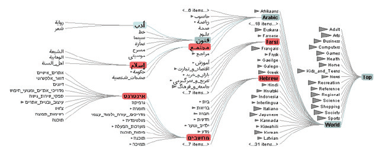

# 14.3 Elide

## Elision

<!-- verbatim p.349 -->
> One design choice for embedding is elision: some items are omitted from the view completely, in a form of dynamic filtering. Other items are summarized using dynamic aggregation for context, and only the focus items are shown in detail.
<!-- /verbatim -->

## Degree-of-interest functions

A general framework for reasoning about these three sets of items is a degree of interest (DOI) function [p.349]:

<!-- verbatim p.349 -->
> DOI = I(x) −D(x, y). In this equation, I is an interest function; D is the distance, either semantic or spatial; x is the location of an item; y is the current focus point [Furnas 86].
<!-- /verbatim -->

There may be one focus point or multiple independent foci [p.349]. The DOI function is continuous and does not itself separate focus items to show in detail, context items to aggregate and items to elide; algorithms using the function make those interpretations, often with threshold values [pp.349-350].

Interest functions typically exploit knowledge of dataset structure, especially hierarchical relationships: if a few subsections of a document were selected as foci, their enclosing sections would make good context [p.350].

## Example: DOITrees Revisited

The DOITrees Revisited system uses multiple foci to show an elided version of a 600,000-node tree, with shaded triangles as an aggregate representation of the size of elided subtrees [p.350]. Context is computed by tree traversal from the focus nodes up towards their common ancestors and the root, so distance is topological (hops through the tree) rather than Euclidean [p.350]. Focus nodes are chosen explicitly by clicking or indirectly by searching [p.350]. The card holds its System box [p.350].

## Figures

-  **Figure 14.2** [p.350]. DOITrees Revisited uses elision to show multiple focus nodes within context in a 600,000 node tree. From [Heer and Card 04, Figure 1].

## Related

- [DOITrees Revisited](../idioms/doitrees-revisited.md): the worked example's card, with its System box [p.350]
- [13.3.1 Item Filtering](../ch13-reduce-items-attributes/s13-03-filter/s13-03-01-item-filtering.md): filtering, which elision applies dynamically to omit items [p.349]
- [13.4.1 Item Aggregation](../ch13-reduce-items-attributes/s13-04-aggregate/s13-04-01-item-aggregation.md): aggregation, which elision applies dynamically to summarise context [p.349]
- [14.6 Costs and Benefits: Distortion](s14-06-costs-benefits-distortion.md): Furnas's later view that what is shown by selective filtering matters more than how it is distorted [p.360]
