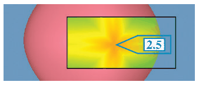

# 14.4 Superimpose

## Local superimposed layers

<!-- verbatim p.351 -->
> Another choice for integrating focus and context is the use of superimposed layers. In this case, the focus layer is limited to a local region, rather than being a global layer that stretches across the entire view to cover everything.
<!-- /verbatim -->

## Example: Toolglass and Magic Lenses

The Toolglass and Magic Lenses system uses a see-through lens to show colour-coded Gaussian curvature in a foreground layer over a background layer holding the rest of the 3D scene [p.351]. Details appear inside the lens and the unchanged remainder of the view gives context; the lens layer occludes the region beneath it [p.351]. The system handled many kinds of data and encodings; this example shows 3D spatial data [p.351]. The curvature lens reveals that an object rendered as a perfect sphere is in fact faceted, made from multiple patches [p.351]. The card holds its System box [p.351].

## Figures

-  **Figure 14.3** [p.351]. The Toolglass and Magic Lenses idiom provides focus and context through a superimposed local layer: the see-through lens color codes the patch-work sphere with Gaussian curvature information and provides a numeric value for the point at the center. From [Bier et al. 93, Figure 12].

## Related

- [Toolglass and Magic Lenses](../idioms/toolglass-and-magic-lenses.md): the example's card, with its System box [p.351]
- [12.5 Superimpose Layers](../ch12-facet-into-multiple-views/s12-05-superimpose-layers/node.md): superimposing layers globally, which the book contrasts with this local layer [p.351]
