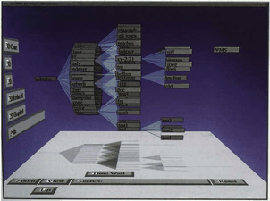
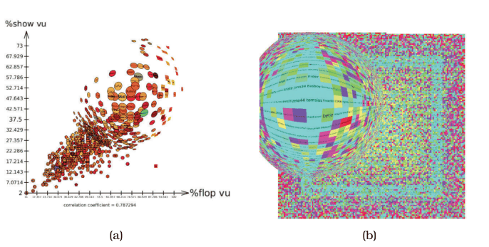
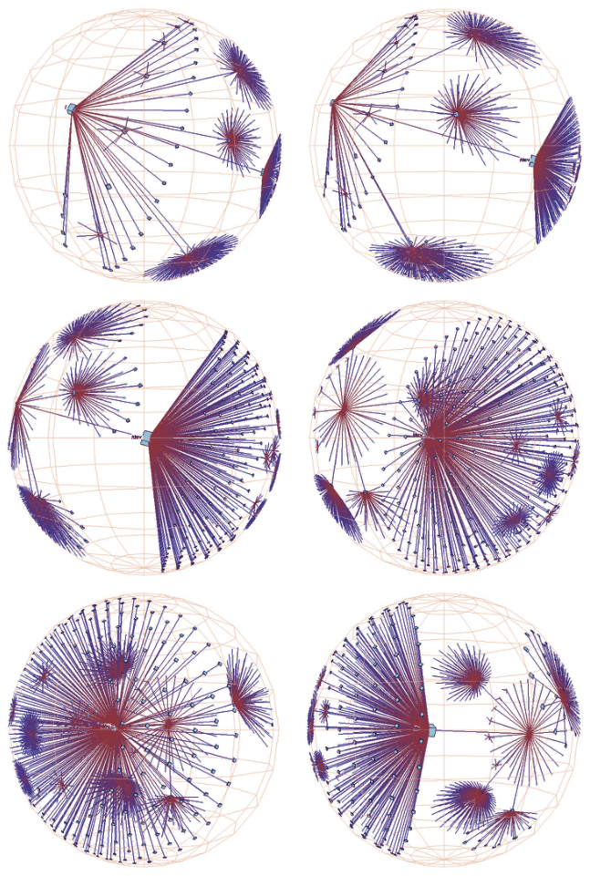
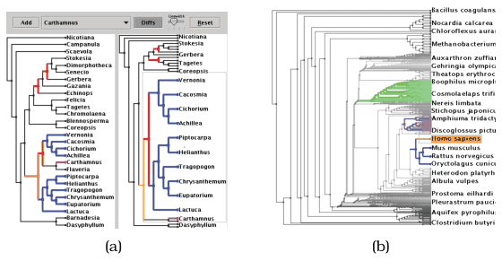
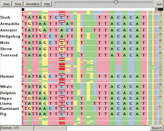
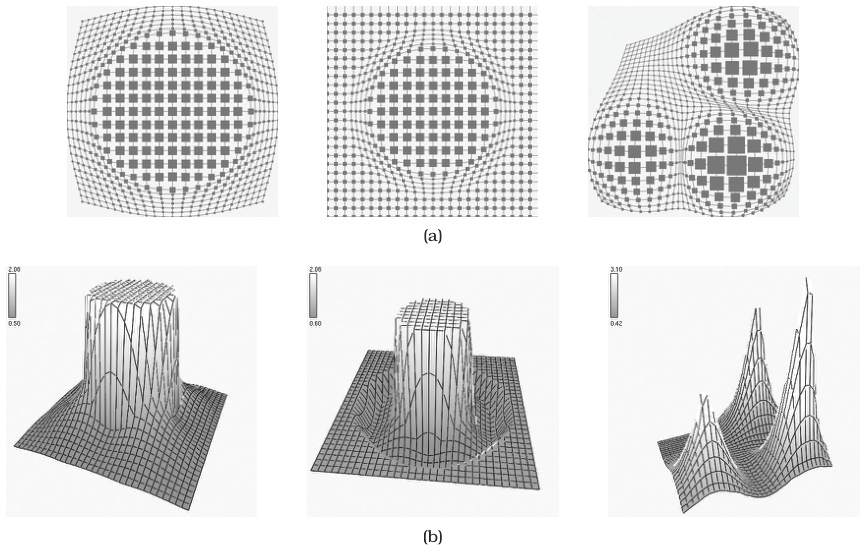

# 14.5 Distort

## Geometric distortion

Unlike elision or layers, many focus+context idioms integrate focus and context in a single view by geometrically distorting the context regions to make room for detail in the focus regions [p.352].

## The four design choices

<!-- verbatim p.352 -->
> As with the other two choices, there is the choice of the number of focus regions: is there only a single region of focus, or does the idiom allow multiple foci? Another choice is the shape of the focus: is it a radial, rectangular, or a completely arbitrary shape? A third choice is the extent of the focus: is it global across the entire image, or constrained to just a local region? A fourth choice is the interaction metaphor.
<!-- /verbatim -->

The interaction metaphors are constrained geometric navigation, moveable lenses (evoking a real magnifying glass), stretching and squishing a rubber sheet, and working with vector fields [p.352]. The book illustrates the choices with five idioms [p.352]:

| Idiom | Foci | Shape | Extent | Interaction metaphor |
| --- | --- | --- | --- | --- |
| 3D perspective | single | not stated | global | constrained geometric navigation [pp.352-353] |
| Fisheye lens | single | radial | local | moveable (draggable) lens [pp.353-354] |
| Hyperbolic geometry | single | radial | global | hyperbolic translation [pp.354-356] |
| Stretch and squish navigation | multiple | rectangular | global | stretch and squish [pp.356-358] |
| Nonlinear magnification fields | multiple | arbitrary | local | lens, stretch or data-driven [pp.358-359] |

## Example: 3D Perspective

Several early idioms used 3D perspective as a global distortion region with a single focus point, navigated by constrained geometric navigation [p.352]. The distortion from standard 3D graphics transformations is intuitive and familiar, and was used deliberately for distortion-based focus+context in early systems such as Cone Trees [pp.352-353]. Many people found it compelling at first, but it lost popularity as the costs and benefits of 3D layout for abstract information became better understood [p.353].

## Example: Fisheye Lens

The fisheye lens has a single focus of local extent and radial shape, with a draggable lens on top of the main view, giving the same radial distortion as physical camera lenses and door peepholes [p.353]. Its foreground layer completely replaces what is beneath it, like the magic lens, rather than superimposing extra information [p.353]. The lens moves by standard 2D translation, and graphics hardware supports high-performance fisheye lenses with vertex shaders [p.353]. In Figure 14.5, a fisheye lens over a poker-player scatterplot and a dense matrix view makes labels large enough to read while the focus stays embedded in the global pattern [pp.353-354].

## Example: Hyperbolic Geometry

Hyperbolic geometry uses a single radial global focus with hyperbolic translation as its interaction metaphor [p.354]. It exploits non-Euclidean geometry to accommodate structures such as trees that grow exponentially, where Euclidean geometry offers only polynomial space; an infinite non-Euclidean plane or volume maps to a finite Euclidean circle or sphere [p.354]. Hyperbolic translation changes the focus point of the projection, changing which items are magnified at the centre and minimised at the periphery, with a global effect similar to a fisheye lens across the whole scene [pp.354-356]. Figure 14.6 shows a 3D H3 file-system tree: three frames of hyperbolic translation, then three of ordinary rotation; 3D was chosen for greater information density at the cost of partial occlusion in any one frame [p.356].

## Example: Stretch and Squish Navigation

Stretch and squish navigation uses multiple rectangular foci of global extent: the scene is drawn on a rubber sheet where stretching one region squishes the rest [p.356]. TreeJuxtaposer uses it to compare two small trees with linked highlighting and navigation, and to stretch many regions within one large tree [p.356]. The sheet's borders stay fixed so all items remain in the viewport, though possibly very small, and focal regions can be stretched separately horizontally and vertically [p.356].

These figures also show **guaranteed visibility**, an encoding idiom that keeps important objects visible however small, by aggregating at the subpixel level while taking each item's importance attribute into account [p.356]. Realistic graphics skip distant objects, but in abstract scenes camera distance is a poor stand-in for importance, so an original or derived attribute is used instead of, or with, geometric distance [pp.356-357]. In Figure 14.8, gene sequences over 16,000 nucleotides wide fit a frame under 700 pixels wide, and red difference marks stay visible even where hundreds or thousands of items share a pixel [p.357]. Figure 11.7 shows the same: red alert boxes are always visible because colour also encodes importance [pp.357-358].

## Example: Nonlinear Magnification Fields

Nonlinear magnification fields are a general computational framework with multiple foci of arbitrary magnification level and shape, whose scope can be limited to local regions [p.358]. It computes the implicit magnification field needed for a desired transformation, supports metaphors including lenses and stretchable surfaces, and can expose the fields directly, for example for data-driven magnification trails of moving objects [pp.358-359].

## Figures

-  **Figure 14.4** [p.352]. The Cone Tree system used 3D perspective for focus+context, providing a global distortion region with a single focus point, and using standard geometric navigation for interaction. From [Card and Mackinlay 99, Figure 10].
-  **Figure 14.5** [p.354]. Focus+context with interactive fisheye lens, with poker player dataset. (a) Scatterplot showing correlation between two strategies. (b) Dense matrix view showing correlation between a specific complex strategy and the player’s winning rate, encoded by color.
-  **Figure 14.6** [p.355]. Animated transition showing navigation through 3D hyperbolic geometry for a file system tree laid out with the H3 idiom, where the first three frames show hyperbolic translation changing the focus point and the last three show standard 3D rotation spinning the structure around. From [Munzner 98, Figure 3].
-  **Figure 14.7** [p.357]. TreeJuxtaposer uses stretch and squish navigation with multiple rectangular foci for exploring phylogenetic trees. (a) Stretching a single region when comparing two small trees. (b) Stretching multiple regions within a large tree. From [Munzner et al. 03, Figures 5 and 1].
-  **Figure 14.8** [p.357]. PRISequenceJuxtaposer supports comparing gene sequences using the stretch and squish navigation idiom with the guaranteed visibility of marks representing items with a high importance value, via a rendering algorithm with custom subpixel aggregation. From [Slack et al. 06, Figure 3].
-  **Figure 14.9** [p.358]. General frameworks calculate the magnification and minimization fields needed to achieve desired transformations in the image. (a) Desired transformations. (b) Calculated magnification fields. From [Keahey 98, Figure 3].

## Related

- [3D Perspective](../idioms/3d-perspective.md): card for the Cone Trees example and its System box [p.352]
- [Fisheye Lens](../idioms/fisheye-lens.md): idiom box and use conditions [p.354]
- [Hyperbolic Geometry](../idioms/hyperbolic-geometry.md): idiom box and use conditions [p.356]
- [Stretch and Squish Navigation](../idioms/stretch-and-squish-navigation.md): idiom box and guaranteed visibility [p.358]
- [Nonlinear Magnification Fields](../idioms/nonlinear-magnification-fields.md): idiom box for multiple local arbitrary foci [p.359]
- [6.3 No Unjustified 3D](../ch06-rules-thumb/s06-03-no-unjustified-3d/node.md): the costs and benefits of 3D for abstract data, cited for 3D perspective and H3 [pp.353-356]
- [11.5 Navigate: Changing Viewpoint](../ch11-manipulate-view/s11-05-navigate-changing-viewpoint.md): home of Figure 11.7, the LiveRAC stretch-and-squish example with guaranteed visibility [p.356]
- [Toolglass and Magic Lenses](../idioms/toolglass-and-magic-lenses.md): the magic lens whose replacing layer the fisheye lens shares [p.353]
- [14.6 Costs and Benefits: Distortion](s14-06-costs-benefits-distortion.md): when these distortions help or hurt [p.352]
