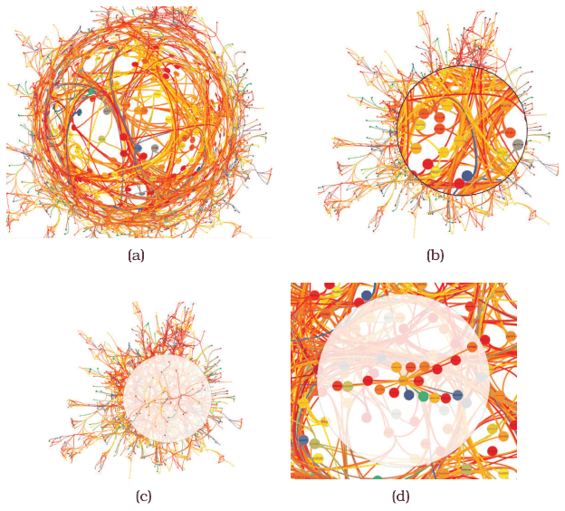

# 14.6 Costs and Benefits: Distortion

## Embedding among the alternatives

Embedding focus within context in a single view is one of five major alternatives for showing complex information; the others are deriving new data, manipulating a single changing view, faceting into multiple views and reducing the data shown [p.359]. The book says the trade-offs among these five are still not fully understood [p.359].

## Costs of distortion

<!-- verbatim p.359 -->
> What has gradually become clear is that distortion-based focus+context in particular has measurable costs, in addition to whatever benefits it may provide. One cost is the problem that distance or length judgements are severely impaired, so distortion is a poor match with any tasks that require such comparisons.
<!-- /verbatim -->

- **Topology tasks suit it.** One of the most successful uses is exploring node–link layouts of networks and trees: understanding topology shown by connecting lines, or by containment for nested parent–child relationships, is likely robust to distortion because precise angle and length judgements are not needed [p.359].
- **Unnoticed distortion.** Users may not realise the view is distorted and misunderstand the structure; the risk is highest for unfamiliar or sparse structures [p.359]. Many idioms show distortion explicitly: hyperbolic views typically show the enclosing circle or sphere, and magnification fields often show a superimposed grid or shading implying the stretched surface's height [pp.359-360].
- **Object constancy.** Even when users understand the distortion, they bear the internal overhead of recognising an item in two frames as the same object, which may require mentally subtracting the transformation [p.360]. This is almost effortless for standard 3D perspective, but the cost of tracking general distortions rises with the amount of distortion [p.360]. Some empirical evidence shows constrained and predictable distortion is better tolerated than drastic distortion [p.360].

## What versus how

The originator of generalised fisheye views has expressed surprise at the enthusiasm for distortion, suggesting that what is shown through selective filtering is more central than how any distortion idiom shows it [p.360]. The fisheye metaphor can also apply directly to structured data, such as a hierarchical document with some sections collapsed and others expanded [p.360].

## Four approaches on one graph

Figure 14.10 applies four approaches to the same node–link graph to show the costs and benefits of distortion versus occlusion versus other interaction [p.360]:

- **Fisheye lens.** A small circle of very high magnification is surrounded by a larger region varying continuously from medium magnification to very high compression, returning to low compression at the periphery [p.360]. Though designed to reduce disorientation, fisheye lenses can be quite disorienting: the continuous change adds cognitive load to untangle shape from distortion [p.360]. Distortion is less problematic with familiar shapes such as maps of known places, since people read it as a change to a known baseline; with unfamiliar structures the shape is hard to reconstruct [pp.360-361]. Interactive use, moving the lens and comparing states, still leaves some cognitive load [p.361].
- **Magnifying lens.** A superimposed local lens with two discrete levels, a highly magnified circle and a low-compression periphery, with a discontinuous jump where the lens occludes the surrounding region [p.361]. In this example the fisheye may be harder to use; the book says it is not clear that avoiding occlusion is worth the cost of interpreting continuous magnification [p.361].
- **Neighbourhood highlighting with layering.** It does not distort position; it reduces the opacity of items outside the one- or two-hop neighbourhood of a target node and sizes the lens to fit that neighbourhood [p.362]. It would not help where magnification is critical, such as reading labels, but supports path tracing well [p.362].
- **Layering plus Bring and Go.** Bring and Go temporarily moves only the one-hop neighbours close to the target node, preserving direction and relative distance to minimise disorientation [p.362]. Exploiting topology this way reduces the cost of tracking moving objects, since only those neighbours move during animated transitions, whereas a fisheye lens moves every item in its span [p.362].

## Figures

-  **Figure 14.10** [p.361]. Four approaches to graph exploration. (a) Fisheye lens. (b) Magnifying lens. (c) Neighborhood highlighting with layering. (d) Neighborhood highlighting with both layering and Bring and Go interaction. From [Lambert et al. 10, Figures 2a, 2b, 3b, and 4b].

## Related

- [Fisheye Lens](../idioms/fisheye-lens.md): the distortion idiom weighed here against the magnifying lens [p.360]
- [Hyperbolic Geometry](../idioms/hyperbolic-geometry.md): shows its enclosing circle or sphere to signal distortion [p.359]
- [Nonlinear Magnification Fields](../idioms/nonlinear-magnification-fields.md): shows a grid or shading to signal distortion [p.360]
- [9 Arrange Networks and Trees](../ch09-arrange-networks-trees/node.md): the node–link and containment layouts where distortion works best [p.359]
- [12 Facet into Multiple Views](../ch12-facet-into-multiple-views/node.md): faceting, one of the four alternatives to embedding [p.359]
- [11 Manipulate View](../ch11-manipulate-view/node.md): a single changing view, another alternative [p.359]
- [13 Reduce Items and Attributes](../ch13-reduce-items-attributes/node.md): reducing the data shown, another alternative [p.359]
- [12.5.3 Dynamic Layers](../ch12-facet-into-multiple-views/s12-05-superimpose-layers/s12-05-03-dynamic-layers.md): interactive layering of the kind neighbourhood highlighting uses [p.362]
