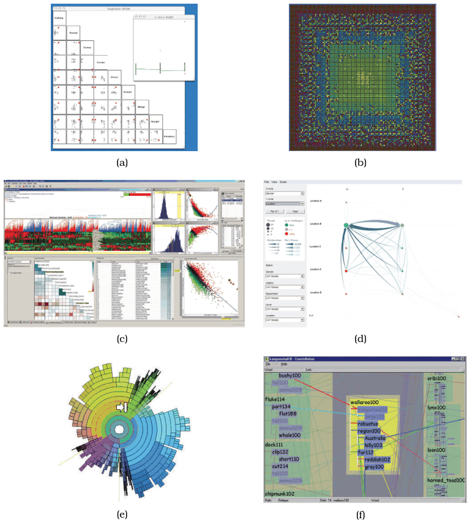

# 15.1 The Big Picture

Figure 15.1 shows the six vis systems the chapter analyses as full case studies [p.366]:

- **Scagnostics** gives a scalable summary of large scatterplot matrices through a derived SPLOM, built by classifying the geometric shapes formed by the point distributions in the original scatterplots [p.366].
- **VisDB** treats an entire database as a very large table and encodes it with dense, space-filling layouts whose items are coloured by their relevance to a specific query [p.366].
- **Hierarchical Clustering Explorer (HCE)** supports systematic exploration of multidimensional tables, such as microarray measurements of gene expression, with an associated hierarchical clustering [p.366].
- **PivotGraph** summarises networks with the succinct data abstraction of a derived network, created by rolling groups of nodes and links up into aggregate nodes based on two categorical attributes [p.366].
- **InterRing** explores trees with a space-filling radial layout and interaction built around multifocus focus+context distortion [p.366].
- **Constellation** supports browsing a complex multilevel linguistic network, with a layout that encodes query relevance with spatial position and dynamic layering to avoid the perceptual impact of edge crossings [p.366].

## Figures

-  **Figure 15.1** [p.365]. Six case studies of full vis systems. (a) Scagnostics, from [Wilkinson et al. 05, Figure 5]. (b) VisDB, from [Keim and Kriegel 94, Figure 6]. (c) Hierarchical Clustering Explorer, from [Seo and Shneiderman 05, Figure 1]. (d) PivotGraph, from [Wattenberg 06, Figure 5]. (e) InterRing, from [Yang et al. 02, Figure 4]. (f) Constellation, from [Munzner 00, Figure 5.5].

## Related

- [15.3 Graph-Theoretic Scagnostics](s15-03-graph-theoretic-scagnostics.md): the full analysis of Scagnostics [p.366]
- [15.4 VisDB](s15-04-visdb.md): the full analysis of VisDB [p.366]
- [15.5 Hierarchical Clustering Explorer](s15-05-hierarchical-clustering-explorer.md): the full analysis of HCE [p.366]
- [15.6 PivotGraph](s15-06-pivotgraph.md): the full analysis of PivotGraph [p.366]
- [15.7 InterRing](s15-07-interring.md): the full analysis of InterRing [p.366]
- [15.8 Constellation](s15-08-constellation.md): the full analysis of Constellation [p.366]
