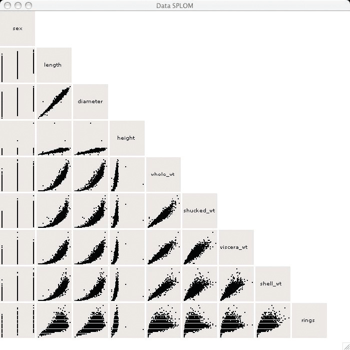
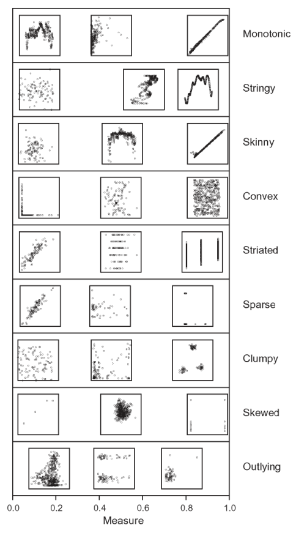
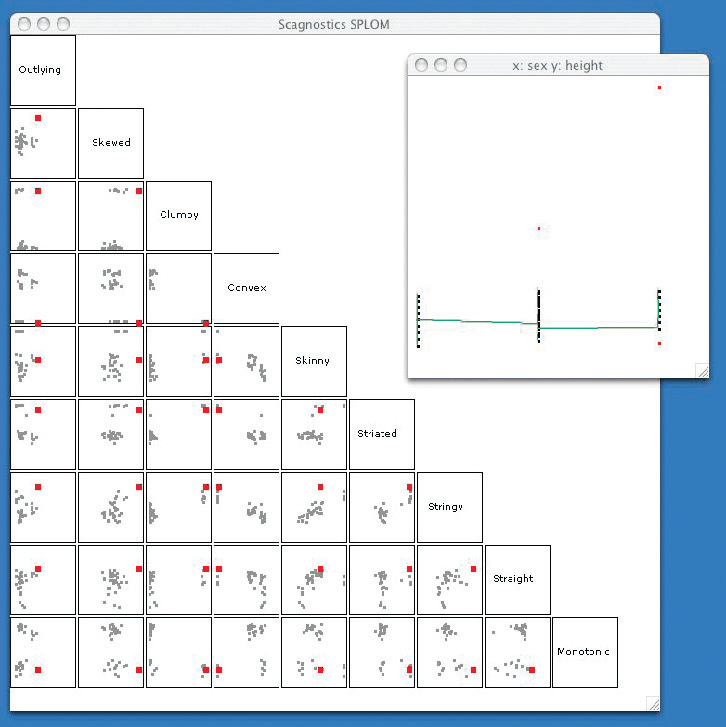

# 15.3 Graph-Theoretic Scagnostics

## From scatterplot to SPLOM to scagnostics SPLOM

Graph-theoretic scagnostics is a scalable idiom for exploring scatterplot matrices (SPLOMs). A scagnostics SPLOM is a next step beyond a standard SPLOM, just as a SPLOM is a step beyond a single scatterplot [p.367]. A single scatterplot supports direct comparison between two attributes by plotting their values along two spatial axes; a SPLOM is the systematic way to compare all possible pairs of attributes, with the attributes ordered along both rows and columns and one scatterplot in each cell. Figure 15.2 shows a SPLOM of an abalone dataset with nine attributes [p.367].

SPLOMs are an example of both matrix alignment and small multiples [p.367].

## The scalability problem

The SPLOM matrix grows quadratically. Each individual plot needs enough screen space to distinguish the points within it, so the idiom does not scale well past a few dozen attributes [p.369].

## Derived data: nine shape measures

<!-- verbatim p.369 -->
> The idea of scagnostics, short for scatterplot computer-guided diagnostics, is to identify a small number of measurements that nicely categorize the shape of the point distributions within each scatterplot.
<!-- /verbatim -->

The nine measures, grouped by what they describe [p.369]:

- **Outlier detection:** outlying [p.369].
- **Point distribution and density:** skewed, clumpy, sparse and striated [p.369].
- **Shape:** convex, skinny and stringy [p.369].
- **Association:** monotonic [p.369].

Figure 15.3 shows real-world datasets rated low, medium and high on each measure [p.369].

## The scagnostics SPLOM: a scatterplot of scatterplots

The measurements are shown in a new scagnostics SPLOM in which each point represents an entire scatterplot of the original SPLOM; that scatterplot is shown when the point is selected. Figure 15.4 shows the scagnostics matrix for the abalone dataset [p.369]. As with standard SPLOMs, views have linked highlighting, and selecting a point also triggers a popup detail view of the full scatterplot [p.369].

The rationale: because the measures were chosen carefully to reflect scatterplot shape, the distribution of points in the scagnostics SPLOM should give a fast overview of the most important characteristics of the original SPLOM. Its outliers guide the user to the unusually shaped, and so potentially interesting, scatterplots in the original [p.369].

## System box

<!-- verbatim p.369 -->
> What: Data Table.
<!-- /verbatim -->

<!-- verbatim p.369 -->
> What: Derived Nine quantitative attributes per scatterplot (pairwise combination of original attributes).
<!-- /verbatim -->

<!-- verbatim p.369 -->
> Why: Tasks Identify, compare, and summarize; distributions and correlation.
<!-- /verbatim -->

<!-- verbatim p.369 -->
> How: Encode Scatterplot, scatterplot matrix.
<!-- /verbatim -->

<!-- verbatim p.369 -->
> How: Manipulate Select.
<!-- /verbatim -->

<!-- verbatim p.369 -->
> How: Facet Juxtaposed small-multiple views coordinated with linked highlighting, popup detail view.
<!-- /verbatim -->

<!-- verbatim p.369 -->
> Scale Original attributes: dozens.
<!-- /verbatim -->

The box gives no How: Reduce field [p.369].

## Figures

-  **Figure 15.2** [p.368]. Scatterplot matrices (SPLOM) showing abalone data. From [Wilkinson et al. 05, Figure 1].
-  **Figure 15.3** [p.370]. The nine scagnostics measures that describe scatterplot shape, with examples of real-world datasets rated low, medium, and high for each of the nine measures. From [Wilkinson and Wills 08, Figure 6].
-  **Figure 15.4** [p.371]. Scagnostics SPLOM for the abalone dataset, where each point represents an entire scatterplot in the original matrix. The selected point is highlighed in red in each view, and the scatterplot corresponding to it is shown in a popup detail view. From [Wilkinson et al. 05, Figure 5].

## Related

- [7.4 Express: Quantitative Values](../ch07-arrange-tables/s07-04-express-quantitative-values.md): scatterplots, the building block [p.367]
- [7.5.2 Matrix Alignment: Two Keys](../ch07-arrange-tables/s07-05-separate-order-align-categorical/s07-05-02-matrix-alignment-two-keys.md): SPLOMs as a matrix alignment [p.367]
- [12.3.2 Share Data: All, Subset, None](../ch12-facet-into-multiple-views/s12-03-juxtapose-coordinate-views/s12-03-02-share-data-all-subset.md): SPLOMs as small multiples [p.367]
- [Scatterplots](../idioms/scatterplots.md): the idiom each scagnostics point summarises [p.367]
- [Scatterplot Matrix (SPLOM)](../idioms/scatterplot-matrix-splom.md): the idiom whose quadratic growth scagnostics addresses [p.369]
- [11.4.2 Highlighting](../ch11-manipulate-view/s11-04-select-elements/s11-04-02-highlighting.md): the linked highlighting between views [p.369]
