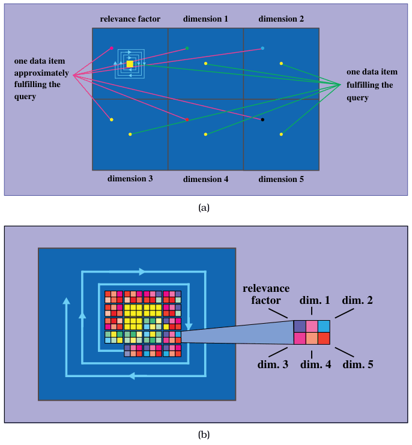
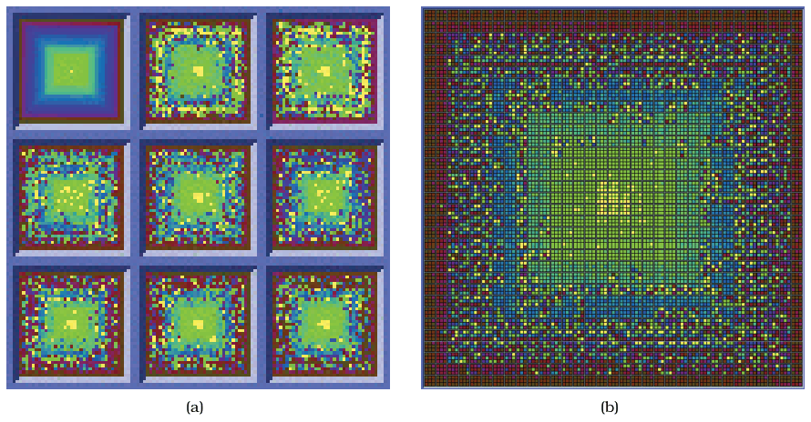
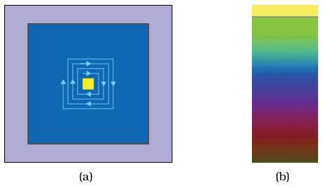

# 15.4 VisDB

## Data abstraction: a database as a table, seen through a query

VisDB treats an entire database as a very large table and shows it with respect to a specific query that matches some subset of its items [p.372]. It computes derived attributes measuring the relevance of the query to the original attributes and items: each item gets a relevance score for each original attribute, and an overall relevance score combining them adds one more derived column to the table (Figure 15.5a) [p.372].

## Encoding: dense, space-filling, spiral, colour-coded

Both of VisDB's layout idioms are dense and space-filling and use square colour-coded area marks; Figure 15.5 shows them schematically and Figure 15.6 as screenshots [p.372].

- **Spatial order.** Regions are not in a standard aligned rectilinear or radial layout; they follow a spiral emanating from the centre (Figure 15.7a) [p.372].
- **Colormap.** A sequential colormap uses multiple hues ordered with monotonically increasing luminance, to support both categorical and ordered perception of the data: dark red at the bottom, purple and blue in the mid-range, then cyan, brighter green, and a very bright yellow at the high end to emphasise the top of the range (Figure 15.7b) [p.372].

## Two ways to partition space, for two kinds of task

**Layout 1: partition by attribute.** The dataset is split into small-multiple views side by side, one per attribute (Figures 15.5a and 15.6a, the latter with 1000 items) [p.372]. Items sit in the same order in every view, ordered by the derived overall relevance, but each view colours them by relevance for its own attribute. In the upper-left view the colouring attribute is overall relevance too, so position and colour are redundant there; the other views show different colour patterns [p.372].

- Inspecting patterns within one view serves characterising distributions, finding groups of similar values within an attribute, and per-attribute outlier detection [p.372].
- Comparing patterns between views serves looking for correlations between attributes [p.372].

**Layout 2: partition by item.** A single view is partitioned into one region per item, each holding a glyph that shows all the item's attributes (Figures 15.5b and 15.6b) [p.373]. This supports comparison across items and finding groups of similar items, rather than comparison across attributes [p.373].

## Reduction and scale

Both layouts reduce by filtering: when there are more items than room in the view, items are filtered by relevance. The system can therefore handle tables of up to several million items, though only one million can be shown at once on a screen of one million pixels [p.374].

- The small-multiples layout is effective for up to 10–12 attributes, with around 100,000 items per view and one million across all views [p.374].
- The glyph layout handles only up to around 100,000 visible items, an order of magnitude fewer; the elements within a glyph must be boxes larger than a single pixel to be salient and glyphs need borders to be distinguished from their neighbours [p.374].

## What the case illustrates

VisDB is an early example of a very information-dense design that tests the upper limits of useful information density, and a very clear example of how different strategies for partitioning space can support different tasks [p.374].

## System box

<!-- verbatim p.375 -->
> What: Data Table (database) with k attributes; query returning table subset (database query).
<!-- /verbatim -->

<!-- verbatim p.375 -->
> What: Derived k + 1 quantitative attributes per original item: query relevance for the k original attributes plus overall relevance.
<!-- /verbatim -->

<!-- verbatim p.375 -->
> Why: Tasks Characterize distribution within attribute, find groups of similar values within attribute, find outliers within attribute, find correlation between attributes, find similar items.
<!-- /verbatim -->

<!-- verbatim p.375 -->
> How: Encode Dense, space-filling; area marks in spiral layout; colormap: categorical hues and ordered luminance.
<!-- /verbatim -->

<!-- verbatim p.375 -->
> How: Facet Layout 1: partition by attribute into per-attribute views, small multiples. Layout 2: partition by items into per-item glyphs.
<!-- /verbatim -->

<!-- verbatim p.375 -->
> How: Reduce Filtering
<!-- /verbatim -->

<!-- verbatim p.375 -->
> Scale Attributes: one dozen. Total items: several million. Visible items (using multiple views, in total): one million. Visible items (using glyphs): 100,000
<!-- /verbatim -->

## Figures

-  **Figure 15.5** [p.373]. VisDB layouts schematically, for a dataset with five attributes. (a) Each attribute is shown in a separate small-multiple view. (b) In an alternate VisDB layout, each item is shown with a glyph with per-attribute sections in a single combined view. From [Keim and Kriegel 94, Figures 2 and 4].
-  **Figure 15.6** [p.374]. VisDB screenshots with a dataset of eight attributes and 1000 items. (a) Attribute-based grouping with one small-multiple view for each attribute. (b) Item-based grouping has a single combined view with multiattribute glyph. From [Keim and Kriegel 94, Figure 6].
-  **Figure 15.7** [p.375]. VisDB layout orientation and colors. (a) Layouts are are ordered internally in a spiral emanating from the center. (b) The VisDB sequential colormap uses multiple hues with monotonically increasing luminance. From [Keim and Kriegel 94, Figures 2 and 3].

## Related

- [12.4.1 Regions, Glyphs, and Views](../ch12-facet-into-multiple-views/s12-04-partition-into-views/s12-04-01-regions-glyphs-views.md): partitioning into per-attribute views versus per-item glyphs [p.373]
- [7.7 Spatial Layout Density](../ch07-arrange-tables/s07-07-spatial-layout-density.md): dense and space-filling layouts [p.372]
- [10.3.2 Ordered Colormaps](../ch10-map-color-other-channels/s10-03-colormaps/s10-03-02-ordered-colormaps.md): the multi-hue sequential colormap with increasing luminance [p.372]
- [13.3.1 Item Filtering](../ch13-reduce-items-attributes/s13-03-filter/s13-03-01-item-filtering.md): filtering by relevance when items exceed the room available [p.374]
- [3.5 Targets](../ch03-why-task-abstraction/s03-05-targets.md): distributions, outliers and correlation, the targets the two layouts serve differently [p.372]
