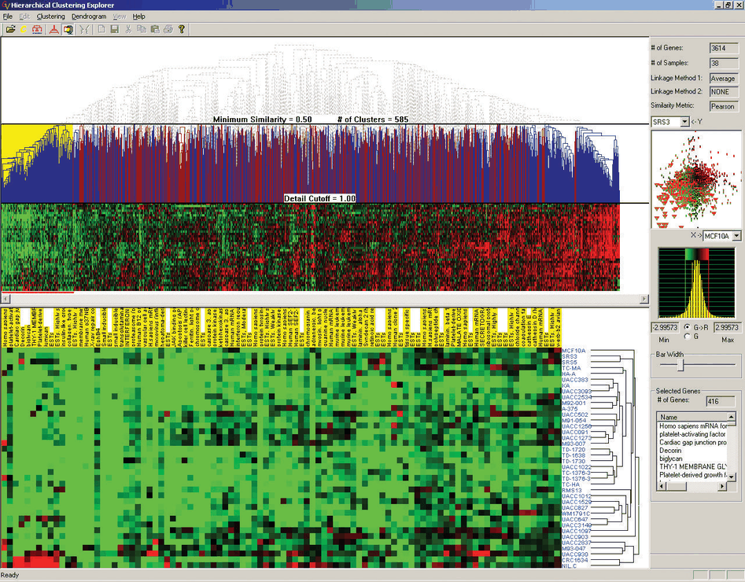
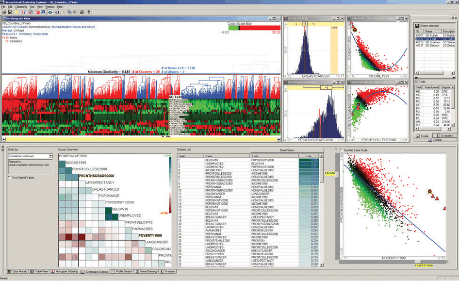
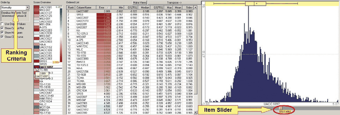

# 15.5 Hierarchical Clustering Explorer

## Data abstraction

The Hierarchical Clustering Explorer (HCE) supports systematic exploration of a multidimensional table with an associated hierarchical clustering. It was originally designed for genomics, where the table holds microarray measurements of gene expression [p.376]. The original data is a multidimensional table with two key attributes, genes and experimental conditions, and one quantitative value attribute, the activity of each gene under each condition. The derived data is a cluster hierarchy of the items based on a similarity measure between items [p.376].

The clustering is computed outside the tool and expected as input; the book treats it as derived rather than original data for the purposes of the analysis [p.376].

## Scalability through combined idioms

<!-- verbatim p.376 -->
> HCE is a good example of achieving scalability through carefully designed combination of visual encoding and interaction idioms in order to support datasets much larger than could be handled by a single static view.
<!-- /verbatim -->

The target is 100 to 20,000 gene attributes and 2 to 80 experimental condition attributes [p.376]. It is reached with the reduction choices of interactively controlled aggregation, filtering and navigation, and the view coordination choices of overview–detail, small multiple, and multiform side-by-side views with linked highlighting [p.376].

## Cluster heatmap views: overview and detail

Figure 15.8 shows HCE on a genomics dataset: two cluster heatmap views coordinated as overview–detail, plus scatterplot and histogram views that give different encodings [p.376].

- **Aggregated overview.** The top cluster heatmap shows an entire dataset of 3614 genes in fewer than 1500 pixels by replacing individual leaves with the average values of adjacent leaves [p.376].
- **Adjustable density.** The user can change the overview's density, trading an aggregate view that loses some detail but shows the whole display at once against a zoomed-in view that shows only some columns and needs horizontal panning to see the rest [p.376].
- **Dynamic filtering by dendrogram cut.** The horizontal Minimum Similarity line through the dendrogram is an interactive filtering control. Dragging it down filters out the heatmap columns for the parts of the dendrogram above the bar and partitions the heatmap into pieces matching the number of clusters just below it [pp.376-377].
- **Detail view.** The bottom view shows a heatmap of the cluster selected in the overview, and adds a second dendrogram for the row clustering at the side; that dendrogram is left out of the overview to maximise the number of columns that fit [p.377].
- **Linked highlighting.** The selected cluster's background is yellow in the overview, and the detail view's column labels are coloured yellow too to emphasise the correspondence [pp.377-378].

## Rank-by-feature

HCE has also been used in other domains, such as census demographics (Figure 15.9) [p.378]. The rank-by-feature idiom combines the design choice of changing the order with the reduction choice of aggregation, to guide exploration and achieve scalability [p.378]. The data abstraction gains many derived attributes: orderings of each original attribute and each pairwise combination of attributes, computed for several ordering criteria, from which the user selects [p.378]. In the book's vocabulary, rank means order and feature means either an attribute or an attribute pair [p.378].

The results appear in three views (Figures 15.9 and 15.10) [p.379]:

- **Compact aggregate overviews.** A matrix with the same alignment as a SPLOM, where each cell is a single area mark coloured by the chosen criterion with a diverging blue–white–brown colormap; and, for individual attributes, a list alignment that matches the cluster heatmap's ordering, with the same colouring [p.379].
- **Intermediate list.** All attributes in a list alignment both ordered and coloured by the criterion; it is less compact, shows a middle level of detail per attribute and so is navigated by scrolling [p.379].
- **Detail view.** Full detail for the selected attribute as a histogram, or for the selected attribute pair as a scatterplot [p.379].

The user selects by clicking a cell in the list or matrix views, or flips quickly through alternatives with single or double sliders in the detail views [p.379]. The slider in Figure 15.10 is labelled Item Slider, but in the book's vocabulary it chooses which attribute the detail view shows [p.379].

## System box

<!-- verbatim p.379 -->
> What: Data Multidimensional table: two categorical key attributes (genes, conditions); one quantitative value attribute (gene activity level in condition).
<!-- /verbatim -->

<!-- verbatim p.380 -->
> What: Derived Hierarchical clustering of table rows and columns (for cluster heatmap); quantitative derived attributes for each attribute and pairwise attribute combination; quantitative derived attribute for each ranking criterion and original attribute combination.
<!-- /verbatim -->

<!-- verbatim p.380 -->
> Why: Tasks Find correlation between attributes; find clusters, gaps, outliers, trends within items.
<!-- /verbatim -->

<!-- verbatim p.380 -->
> How: Encode Cluster heatmap, scatterplots, histograms, boxplots. Rank-by-feature overviews: continuous diverging colormaps on area marks in reorderable 2D matrix or 1D list alignment.
<!-- /verbatim -->

<!-- verbatim p.380 -->
> How: Reduce Dynamic filtering; dynamic aggregation.
<!-- /verbatim -->

<!-- verbatim p.380 -->
> How: Manipulate Navigate with pan/scroll.
<!-- /verbatim -->

<!-- verbatim p.380 -->
> How: Facet Multiform with linked highlighting and shared spatial position; overview–detail with selection in overview populating detail view.
<!-- /verbatim -->

<!-- verbatim p.380 -->
> Scale Genes (key attribute): 20,000. Conditions (key attribute): 80. Gene activity in condition (quantitative value attribute): 20,000 × 80 = 1,600,000.
<!-- /verbatim -->

## Figures

-  **Figure 15.8** [p.377]. Hierachical Clustering Explorer uses interactive aggregation and filtering for the scalable display of a multidimensional table showing gene activity in different conditions using multiple overview+detail cluster heatmap views. From [Seo and Shneiderman 02, Figure 2].
-  **Figure 15.9** [p.378]. HCE on a demographics dataset showing the rank-by-feature idiom for systematic exploration of pairwise combinations of attributes using a matrix overview and scatterplot. From [Seo and Shneiderman 05, Figure 1].
-  **Figure 15.10** [p.379]. Detail of HCE rank-by-feature views for ranking individual attributes using a list overview and histogram/boxplot. From [Seo and Shneiderman 05, Figure 2].

## Related

- [7.5.2 Matrix Alignment: Two Keys](../ch07-arrange-tables/s07-05-separate-order-align-categorical/s07-05-02-matrix-alignment-two-keys.md): cluster heatmaps and SPLOM-style matrix alignment [p.376]
- [Cluster Heatmaps](../idioms/cluster-heatmaps.md): the idiom used in both the overview and the detail view [p.376]
- [12.3.2 Share Data: All, Subset, None](../ch12-facet-into-multiple-views/s12-03-juxtapose-coordinate-views/s12-03-02-share-data-all-subset.md): overview–detail and small-multiple coordination [p.376]
- [13.4.1 Item Aggregation](../ch13-reduce-items-attributes/s13-04-aggregate/s13-04-01-item-aggregation.md): averaging adjacent leaves into an aggregated overview [p.376]
- [13.3.1 Item Filtering](../ch13-reduce-items-attributes/s13-03-filter/s13-03-01-item-filtering.md): dynamic filtering with the similarity bar [p.376]
- [11.5 Navigate: Changing Viewpoint](../ch11-manipulate-view/s11-05-navigate-changing-viewpoint.md): panning and scrolling through zoomed-in and list views [p.376]
- [7.5 Separate, Order, and Align: Categorical Regions](../ch07-arrange-tables/s07-05-separate-order-align-categorical/node.md): ordering, which rank-by-feature derives per criterion [p.378]
- [10.3.2 Ordered Colormaps](../ch10-map-color-other-channels/s10-03-colormaps/s10-03-02-ordered-colormaps.md): the diverging colormap on the rank-by-feature overviews [p.379]
- [Histograms](../idioms/histograms.md): the detail view for a single attribute [p.379]
- [Scatterplots](../idioms/scatterplots.md): the detail view for an attribute pair [p.379]
- [Boxplot Charts](../idioms/boxplot-charts.md): part of the encode choices in the system box [p.380]
