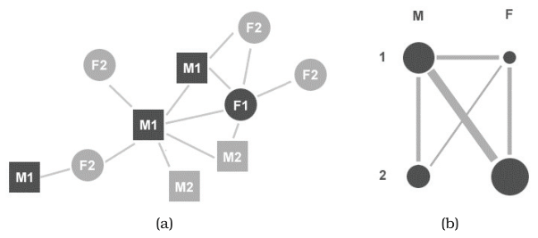
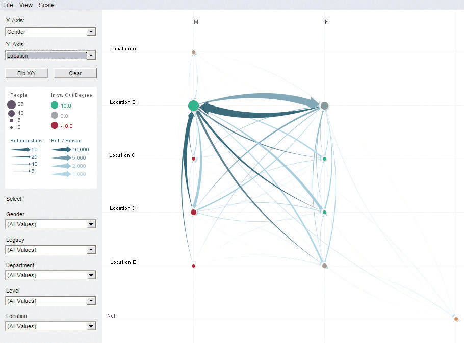

# 15.6 PivotGraph

## A different data abstraction

Connection, containment and matrix views of networks are different visual encodings of the same data abstraction: they all depict the network's link structure [p.380]. PivotGraph instead encodes a different data abstraction, a new network derived from the original by aggregating groups of nodes and links into a roll-up according to categorical attribute values on the nodes [p.380].

## How it works

- **Roll-up.** Roll-ups can use up to two attributes at once. With two, nodes are laid out on a grid; with one, on a line [p.380].
- **Layout.** Node positions in the grid are computed to minimise link-crossing clutter, and links are drawn as curves [p.380].
- **Filtering.** The user can select attributes of interest that filter the derived network [p.380].
- **Interaction.** The user explores through roll-up and selection, seeing encodings that directly summarise high-level relationships between attribute-based groups, and can drill down for more detail on any node or link on demand [p.380].
- **Animated transitions.** Choosing a different roll-up smoothly interpolates between the two layouts [p.380].

## Worked example: gender and division

Figure 15.11 sets a node–link drawing of a small network beside its PivotGraph roll-up. Nodes carry two categorical attributes, gender (M or F) and company division (1 or 2) [p.381]. The node–link view shows the full network and emphasises its topology, with gender as node shape (squares for M, circles for F) and division as greyscale value (black for 1, grey for 2) [p.381].

The PivotGraph view has four derived nodes, one for each gender and division combination, placed in a grid: males in division 1 upper left, females in division 1 upper right, males in division 2 lower left, females in division 2 lower right [p.381]. Node size encodes each group's size. A single derived link stands for the whole group of original edges between two groups, with that group's size encoded as line width. Here every gender and division pair is connected except men and women in division 2 [p.381].

## Worked example: a corporate social network

Figure 15.12 rolls up an anonymised real corporate social network by gender and office location. Most cross-gender communication occurs in location B, and there are no women at location A [p.381]. A diverging red–green colormap encodes an extra quantitative attribute: the number of inward versus outward links at each node [pp.381-382].

## Scale

PivotGraph is highly scalable: it summarises an arbitrarily large number of original nodes and links, easily handling thousands to millions. The derived layout's visual complexity depends only on the number of levels of the two attributes chosen for roll-up [p.382].

## Strengths, weaknesses and role in a multi-view system

- PivotGraph complements the standard node–link and matrix layouts, so it could serve as one of several linked multiform views as well as on its own as a single view [pp.382-383].
- It is very well suited to comparisons across attributes at the aggregate level, a task that is difficult with previous approaches [p.383].
- It is poorly suited to understanding topological features of networks, which is easy with node–link views when the network is not too large [p.383].

The idiom box is on the [PivotGraph card](../idioms/pivotgraph.md) [p.383].

## Figures

-  **Figure 15.11** [p.381]. The PivotGraph idiom. (a) Node–link view of small network with two attributes on nodes: gender (M/F) is encoded by node shape, and company division (1/2) is encoded by grayscale value. (b) The schematic PivotGraph roll-up of the same simple network where size of nodes and links of the derived graph shows the number of items in these aggregated groups. From [Wattenberg 06, Figure 4].
-  **Figure 15.12** [p.382]. PivotGraph on graph rolled up by gender and location, showing most cross-gender communication occurs in location B. From [Wattenberg 06, Figure 5].

## Related

- [PivotGraph](../idioms/pivotgraph.md): the idiom box, use and avoid conditions, and code [p.383]
- [9.4 Costs and Benefits: Connection versus Matrix](../ch09-arrange-networks-trees/s09-04-costs-benefits-connection-matrix.md): the standard network layouts PivotGraph complements [p.383]
- [13.4.1 Item Aggregation](../ch13-reduce-items-attributes/s13-04-aggregate/s13-04-01-item-aggregation.md): the aggregation behind the roll-up [p.380]
- [11.3 Change View over Time](../ch11-manipulate-view/s11-03-change-view-over-time.md): animated transitions between roll-ups [p.380]
- [12.3.1 Share Encoding: Same/Different](../ch12-facet-into-multiple-views/s12-03-juxtapose-coordinate-views/s12-03-01-share-encoding-same-different.md): multiform views, the role PivotGraph could play beside node–link and matrix views [p.383]
- [10.3.2 Ordered Colormaps](../ch10-map-color-other-channels/s10-03-colormaps/s10-03-02-ordered-colormaps.md): the diverging colormap for inward versus outward links [p.382]
