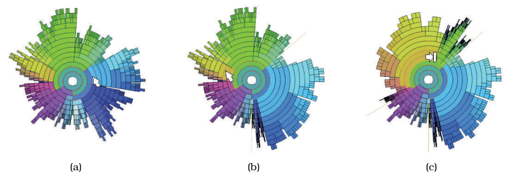

# 15.7 InterRing

## Encoding and interaction

InterRing explores trees with a space-filling, radial layout that encodes the hierarchy visually [p.383]. Interaction is built around a multifocus focus+context distortion approach that changes the room allocated to different parts of the hierarchy [p.383]. Figure 15.13(a) shows the undistorted base layout; (b) shows that enlarging the blue subtree shrinks the room given to its siblings; (c) shows a further distortion that also enlarges the tan region for emphasis [p.383].

## Structure-based colouring

The proposed structure-based colouring redundantly emphasises the hierarchical information already encoded spatially [p.383]. It could be dropped when InterRing is the only view, freeing colour to show a different attribute [p.383]. It is particularly useful when shared colour coding coordinates multiple views, so that items in other linked views with different spatial layouts are coloured by the tree hierarchy [p.383].

## Scalability

- **Nodes.** Moderate: hundreds of nodes easily, with leaf labels large enough to read. The space-filling configuration yields about three times as many legible labels as a classical node–link layout with labels of the same size [pp.383-384].
- **Extreme case.** With each leaf a single pixel and the whole screen in use, it could scale to several thousand nodes [p.384].
- **Edges.** A tree has as many edges as nodes, so edges need no separate analysis [p.384].
- **Depth.** Maximum tree depth, the number of levels from root to the farthest leaves, is another useful factor for trees. InterRing handles up to several dozen levels; hundreds would be overwhelming [p.384].

## Role in a multi-view system

InterRing is a viable single view when tree exploration is the only task, and is designed to work with other views where a hierarchy view should support selection, navigation and roll-up/drill-down [p.384]. It also supports directly editing the hierarchy, which many tree browsing systems do not [p.384].

## System box

<!-- verbatim p.384 -->
> What: Data Tree.
<!-- /verbatim -->

<!-- verbatim p.384 -->
> Why: Tasks Selection, rollup/drilldown, hierarchy editing.
<!-- /verbatim -->

<!-- verbatim p.384 -->
> How: Encode Radial, space-filling layout. Color by tree structure.
<!-- /verbatim -->

<!-- verbatim p.384 -->
> How: Facet Linked coloring and highlighting.
<!-- /verbatim -->

<!-- verbatim p.384 -->
> How: Reduce Embed: distort; multiple foci.
<!-- /verbatim -->

<!-- verbatim p.384 -->
> Scale Nodes: hundreds if labeled, thousands if dense. Levels in tree: dozens.
<!-- /verbatim -->

## Figures

-  **Figure 15.13** [p.384]. The InterRing hierarchy vis idiom uses a space-filling radial visual encoding and distortion-based focus+context interaction. (a) The hierarchy before distortion. (b) The blue selected subtree is enlarged. (c) A second tan region is enlarged. From [Yang et al. 02, Figure 4].

## Related

- [14.5 Distort](../ch14-embed-focus-context/s14-05-distort.md): the multifocus distortion InterRing's interaction is built on [p.383]
- [14.6 Costs and Benefits: Distortion](../ch14-embed-focus-context/s14-06-costs-benefits-distortion.md): the trade-offs of distortion-based focus+context [p.383]
- [9.5 Containment: Hierarchy Marks](../ch09-arrange-networks-trees/s09-05-containment-hierarchy-marks.md): other space-filling tree encodings [p.383]
- [7.6.3 Radial Layouts](../ch07-arrange-tables/s07-06-spatial-axis-orientation/s07-06-03-radial-layouts.md): radial spatial layouts [p.383]
- [12.3.1 Share Encoding: Same/Different](../ch12-facet-into-multiple-views/s12-03-juxtapose-coordinate-views/s12-03-01-share-encoding-same-different.md): shared colour coding to coordinate views [p.383]
- [9.2 Connection: Link Marks](../ch09-arrange-networks-trees/s09-02-connection-link-marks.md): the classical node–link tree layout InterRing's label capacity is compared with [p.384]
