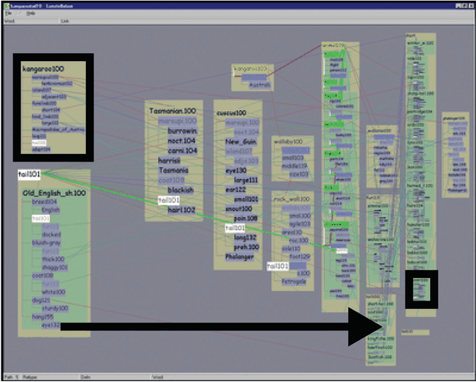
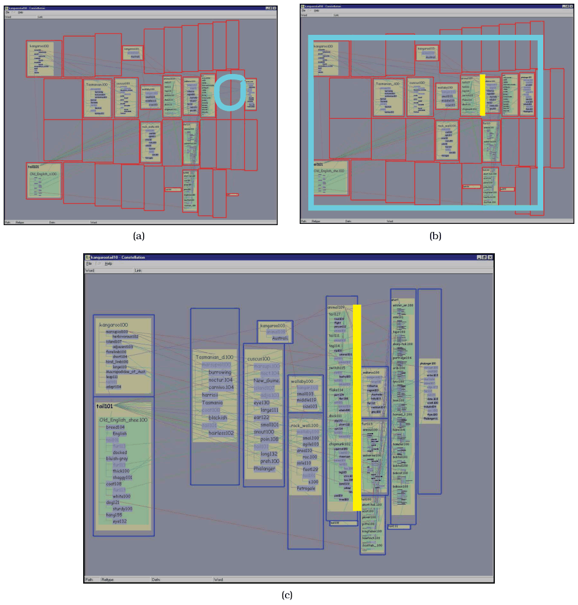
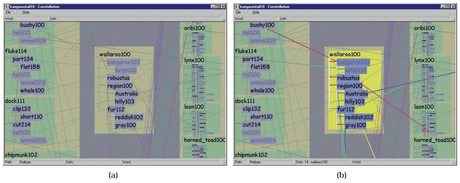
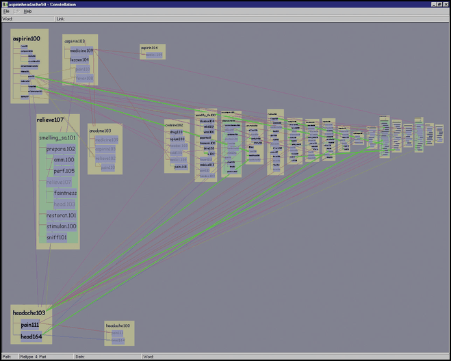
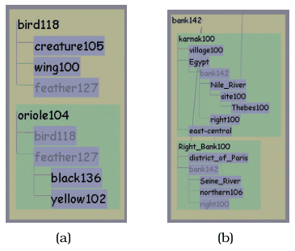
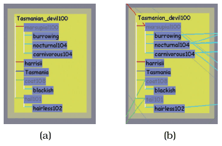
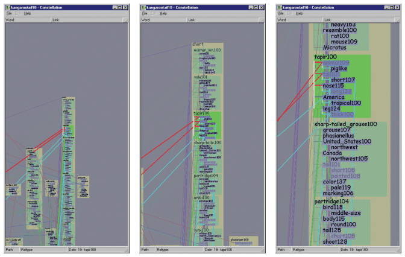

# 15.8 Constellation

## Overview

Constellation supports browsing a complex multilevel linguistic network, and several of its encoding decisions diverge from traditional node–link layout [p.385]. It minimises the perceptual impact of edge crossings with dynamic highlighting of a foreground layer rather than a crossing-minimisation algorithm, which frees spatial position to encode two ordered attributes [p.385]. Nodes linked to several subgraphs are duplicated within each to maximise readability at the subgraph level; drawing each node once would raise the cognitive load of understanding subgraph structure through too much tracing back and forth along links. Hovering signals the duplication with dynamic highlighting [p.385].

## Domain situation

Constellation is a highly specialised tool designed for a very small audience over a limited period: computational linguistics researchers developing algorithms to traverse a very large network built from an online dictionary [p.385]. It was meant to "work itself out of a job" and be abandoned once their algorithms were tuned [p.385].

## Data abstraction

- **Low level.** A node is a word sense, the narrow meaning of a word used in a particular way; most words have several, as bank means both a financial institution and the side of a river [p.385].
- **Middle level.** Metanodes each hold a subgraph of around 10–12 nodes representing one dictionary definition, linking the headword being defined to all the leafwords in the defining sentence [p.385].
- **Large scale.** Subgraphs combine because the same word appears in many definitions, as a headword in one and as a leafword in several others [p.385].
- **Link type.** A categorical attribute gives each link's relationship, such as is-a or part-of. Of a few dozen values most are rare, so the attribute was binned into eight: the seven most frequent types plus an eighth "other" category [p.385].
- **Query results.** The researchers did not need the full network. They wanted their query algorithms' results: the top 10 or 50 paths between a source and a sink word, ranked by the quantitative attribute plausibility. Each path is an ordered list of words, each carrying the set of definitions used to place it in the path [pp.385-386].

## Task abstraction

The primary task was to hand-check whether computed plausibility matched human intuition: were all high-ranking paths believable, and were all believable paths highly ranked? The secondary task was checking data quality, that very common stop words had been excluded [p.386]. This is the consume-discover case: search covers both browsing high-ranking paths and locating low-believability paths, and query covers both identification and comparison. Every task requires extensive reading of node labels [p.386].

## High-level layout: plausibility on a curvilinear grid

Each path flows down a vertical column of a curvilinear grid, from the source word at the top to the sink at the bottom, and paths are ordered horizontally by plausibility, most plausible on the left [p.387]. Definitions on the plausible left get more room than those on the implausible right (Figure 15.14); less plausible paths tend to be longer, with more definitions per word, and paths on the implausible right get less horizontal space [p.387]. This variability leaves many empty cells in the base grid, so full cells are expanded horizontally and vertically to fill the space and reach high information density (Figure 15.15) [p.387].

## Dynamic layers instead of crossing minimisation

Using spatial position to encode information precludes algorithmic crossing minimisation, so Constellation uses superimposed dynamic layers to minimise the perceptual impact of crossings (Figure 15.16 shows the background and foreground versions of a definition graph) [p.387]. Four kinds of structure can be highlighted to create different constellations, which gives the system its name: paths, definition graphs, all direct connections to one word, and all links of one type [p.387]. Figure 15.17 highlights all links of type Part, and shows the "sideways T" layout typical of a query whose source and sink are closely related, so all high-ranking paths are very short (aspirin and headache) [p.387].

## Mid-level and low-level layouts

- **Path segment (mid level).** One path word with all its definitions, using containment marks for the hierarchy: the segment's box is tan. A path word with its own definition has that definition drawn in the tan section (Figure 15.18a); the other definitions assigned to the word are each enclosed in a green box nested within the tan segment, as in Figure 15.18(b), where the path word itself is not defined [p.387].
- **Definition (low level).** A ladder-like rectilinear structure encodes with spatial position and line marks; each leafword has its own blue label box, white vertical lines show the definition's hierarchical microstructure, and horizontal edges are colour coded by link type (Figure 15.19a) [p.387].
- **Duplicated words.** Every definition is drawn with all its words in order for readability, so words in several definitions are duplicated. The master copy, on the most plausible path, is black; later instances are grey proxies joined to the master by a long slanted line mark (Figure 15.19b) [p.390].

## Semantic zooming across three viewing levels

Constellation is optimised for a global view of interpath relationships, a local view for reading individual definitions, and an intermediate view for associations within path segments [p.390]. A subtle form of semantic zooming achieves this: the space devoted to different classes of words changes dynamically with zoom level. In Figure 15.20's animated transition, the first frame gives the top words much more space than the rest, and the last allocates space nearly equally [p.390].

## System box

<!-- verbatim p.391 -->
> What: Data Three-level network of paths, subgraphs (definitions), and nodes (word senses).
<!-- /verbatim -->

<!-- verbatim p.391 -->
> Why: Tasks Discover/verify: browse and locate types of paths, identify and compare.
<!-- /verbatim -->

<!-- verbatim p.391 -->
> How: Encode Containment and connection link marks, horizontal spatial position for plausibility attribute, vertical spatial position for order within path, color links by type.
<!-- /verbatim -->

<!-- verbatim p.391 -->
> How: Manipulate Navigate: semantic zooming. Change: Animated transitions.
<!-- /verbatim -->

<!-- verbatim p.391 -->
> How: Reduce Superimpose dynamic layers.
<!-- /verbatim -->

<!-- verbatim p.391 -->
> Scale Paths: 10–50. Subgraphs: 1–30 per path. Nodes: several thousand.
<!-- /verbatim -->

## Figures

-  **Figure 15.14** [p.386]. The Constellation high-level layout bases horizontal spatial position on the plausibility attribute, where more room is allocated to definitions on highly plausible and usually short paths on the left, and less room to those on less plausible and typically longer paths on the right. From [Munzner 00, Figure 5.4].
-  **Figure 15.15** [p.388]. Resizing grid cells to increase information density. (a) Base curvilinear grid. (b) After eliminating the empty columns. (c) After eliminating empty cell rows in each column. From [Munzner 00, Figure 5.13].
-  **Figure 15.16** [p.389]. Constellation uses the design choice of dynamic superimposed layers. (a) Edges in the background layer are not obtrusive. (b) The newly selected foreground layer is distinguished from the background with changes of the size, luminance, and saturation channels. From [Munzner 00, Figure 5.5].
-  **Figure 15.17** [p.389]. The constellation showing all relations of type Part is highlighted. From [Munzner 00, Figure 5.16a].
-  **Figure 15.18** [p.390]. Mid-level Constellation path segment layout, using containment to show hierarchical relationship between path word in tan and its associated definitions in green. (a) One of the definitions is for the path word itself. (b) Path word that is not itself defined, but only appears within other definitions. From [Munzner 00, Figure 5.9].
-  **Figure 15.19** [p.390]. Low-level Constellation definition layout, using rectilinear links and spatial position. (a) The base layout, with horizontal lines color-coded for link type. (b) Long-distance links are drawn between the master version of the word and all of its duplicated proxies. From [Munzner 00, Figure 5.10].
-  **Figure 15.20** [p.391]. Constellation uses a subtle version of the semantic zooming design choice, where the space allocated for the first word versus the rest of the definition changes according to the zoom level. From [Munzner 00, Figure 5.19].

## Related

- [12.5.3 Dynamic Layers](../ch12-facet-into-multiple-views/s12-05-superimpose-layers/s12-05-03-dynamic-layers.md): the superimposed dynamic layers that replace crossing minimisation [p.387]
- [Semantic Zooming](../idioms/semantic-zooming.md): the zooming idiom behind the three viewing levels [p.390]
- [Animated Transitions](../idioms/animated-transitions.md): the zoom transition sequence [p.390]
- [9.5 Containment: Hierarchy Marks](../ch09-arrange-networks-trees/s09-05-containment-hierarchy-marks.md): containment marks in the path segment layout [p.387]
- [9.2 Connection: Link Marks](../ch09-arrange-networks-trees/s09-02-connection-link-marks.md): the traditional node–link layout Constellation diverges from [p.385]
- [3.4.3 Search](../ch03-why-task-abstraction/s03-04-actions/s03-04-03-search.md): browse and locate, the search tasks the linguists needed [p.386]
- [3.4.4 Query](../ch03-why-task-abstraction/s03-04-actions/s03-04-04-query.md): identify and compare, the query tasks [p.386]
- [4.3.1 Domain Situation](../ch04-analysis-four-levels-validation/s04-03-four-levels-design/s04-03-01-domain-situation.md): a tool built for a very small, specific target audience [p.385]
