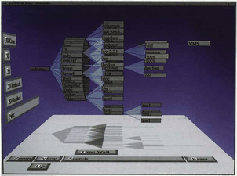

# 3D Perspective

## Idiom box

No idiom box in the book.

The book describes this example through Cone Trees in a System box rather than an Idiom box; its fields are quoted here [p.353].

<!-- verbatim p.353 -->
> System Cone Trees
<!-- /verbatim -->

<!-- verbatim p.353 -->
> What: Data Tree.
<!-- /verbatim -->

<!-- verbatim p.353 -->
> How: Encode 3D node–link layout.
<!-- /verbatim -->

<!-- verbatim p.353 -->
> How: Reduce Embed: distort with 3D perspective; single global focus region.
<!-- /verbatim -->

<!-- verbatim p.353 -->
> Scale Nodes: thousands.
<!-- /verbatim -->

## What it is

Several early idioms used 3D perspective to provide a global distortion region with a single focus point, with constrained geometric navigation as the interaction metaphor [p.352]. The distortion arising from standard 3D computer graphics transformations is a very intuitive and familiar effect, and many early systems used it deliberately for a distortion-based focus+context experience, such as the influential Cone Tree system [pp.352-353]. Figure 14.4 shows Cone Trees using standard geometric navigation [p.352].

## Use when / avoid when

- **History, not a recommendation.** Many people found it compelling and strongly preferred it on first encounter, but it lost popularity as the trade-offs of 3D spatial layout for abstract information became better understood [p.353].
- **Mental tracking is cheap.** In most cases people mentally subtract standard 3D perspective distortion almost effortlessly, whereas the cost of tracking general distortions rises with the amount of distortion [p.360].
- **Avoid** for tasks needing distance or length comparisons, which distortion severely impairs [p.359].
- The book gives no positive use condition for this idiom beyond its early history; it defers to the costs and benefits of 3D in Section 6.3 [p.353].

## Figures

-  **Figure 14.4** [p.352]. The Cone Tree system used 3D perspective for focus+context, providing a global distortion region with a single focus point, and using standard geometric navigation for interaction. From [Card and Mackinlay 99, Figure 10].

## Alternatives and disambiguation

- **Hyperbolic Geometry.** Also a global single radial focus for trees, but from projecting non-Euclidean space and moved by hyperbolic translation [pp.354-356].
- **Fisheye Lens.** A single focus of local rather than global extent, over any layout [p.353].

## Related

- [6.3 No Unjustified 3D](../ch06-rules-thumb/s06-03-no-unjustified-3d/node.md): the costs and benefits of 3D the book cites for this idiom [p.353]
- [6.3.4 Perspective Distortion Dangers](../ch06-rules-thumb/s06-03-no-unjustified-3d/s06-03-04-perspective-distortion-dangers.md): why perspective distortion hurts abstract-data comparison [p.353]
- [14.5 Distort](../ch14-embed-focus-context/s14-05-distort.md): the distortion design choices and the example [p.352]
- [9.2 Connection: Link Marks](../ch09-arrange-networks-trees/s09-02-connection-link-marks.md): 2D node–link tree layouts [p.353]
- [14.7 Further Reading](../ch14-embed-focus-context/s14-07-further-reading.md): Perspective Wall and Cone Trees sources [p.363]

## Implementation hints [NOT FROM BOOK]

### matplotlib

```python
import numpy as np, matplotlib.pyplot as plt
fig = plt.figure()
ax = fig.add_subplot(projection="3d")
def cone(p, depth, r):
    if depth == 0:
        return
    for k in range(4):
        a = 2 * np.pi * k / 4 + depth
        c = (p[0] + r * np.cos(a), p[1] + r * np.sin(a), p[2] - 1)
        ax.plot(*zip(p, c), c="k", lw=0.7)
        cone(c, depth - 1, r * 0.4)
cone((0, 0, 0), 3, 2.0)
ax.view_init(elev=20, azim=30)  # rotate the camera to change the focus
```

### D3

D3 is 2D. Project a 3D layout yourself with `d3.geoOrthographic` style rotation maths, or hand the layout to a WebGL library such as three.js; animate camera rotation with `d3.timer`.
