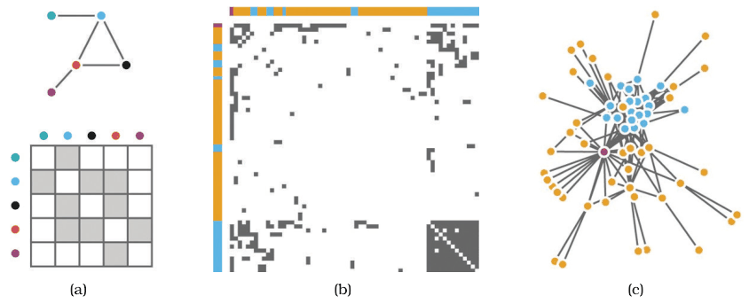
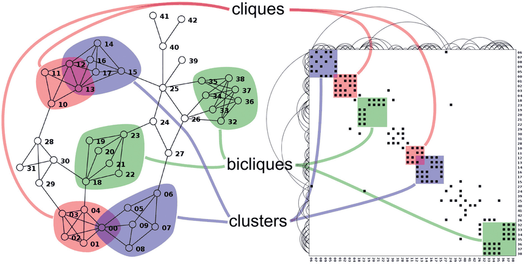

# Adjacency Matrix View

## Idiom box

<!-- verbatim p.234 -->
> What: Data Network.
<!-- /verbatim -->

<!-- verbatim p.234 -->
> What: Derived Table: network nodes as keys, link status between two nodes as values.
<!-- /verbatim -->

<!-- verbatim p.234 -->
> How: Encode Area marks in 2D matrix alignment.
<!-- /verbatim -->

<!-- verbatim p.234 -->
> Scale Nodes: 1000. Links: one milllion.
<!-- /verbatim -->

The box has no Why: Tasks field, and "milllion" is the book's spelling [p.234].

## What it is

Every node is laid out along both the vertical and horizontal edges of a square region, and a link between two nodes is shown by colouring the area mark in the cell where their row and column intersect [p.233]. The network becomes a derived table with two keys, each a full list of nodes, and one value per cell recording whether a link exists [p.233]. It uses 2D alignment, like the tabular matrix views of Section 7.5.2 [p.233].

Cell colour can encode another attribute; size coding is limited by pixels per cell to a few distinguishable levels; weighted networks can use an ordered channel such as luminance or size [p.233]. Undirected networks need only the half above or below the diagonal; directed networks need the full square [p.233].

## Use when / avoid when

- **Use** for large and dense networks: no occlusion, so it stays effective up to one thousand nodes and one million edges, and handles density up to the node count squared [pp.234-236].
- **Use** when screen space must be predictable, or the layout must stay stable as items are added; stability lets multilevel matrix views support geometric or semantic zooming [p.236].
- **Use** with reordering of the axes on demand [p.236].
- **Use** for estimating node and edge counts, finding the most connected node, finding a node by label, finding a direct link and finding a common neighbour; an empirical study found these did not get harder with size, unlike in node–link views [pp.236-238].
- **Use** for spotting cliques (a filled block on the diagonal), clusters, bicliques and node degree (filled cells in a row or column), once users are trained [pp.236-237].
- **Avoid** for topological tasks: its most crucial weakness is poor support for investigating topological structure, and finding a multiple-link path was always harder than in node–link views [pp.237-238].
- **Weakness: unfamiliarity.** Most users read small node–link views without training but typically need training to interpret matrix views [p.236].

## Figures

-  **Figure 9.6** [p.234]. Comparing node–link matrix and matrix views of a network. (a) Node–link and matrix views of small network. (b) Matrix view of larger network. (c) Node–link view of larger network. From [Gehlenborg and Wong 12, Figures 1 and 2].
-  **Figure 9.7** [p.237]. Characteristic patterns in matrix views and node–link views: both can show cliques and clusters clearly. From [McGuffin 12, Figure 6].

## Alternatives and disambiguation

- **Force-directed placement and other node–link layouts** show links directly and suit topology tasks and small networks, but clutter past a link density of about three or four; matrices trade topology support for avoiding that clutter [pp.235-237].
- **Hybrid systems** such as MatrixExplorer use both node–link and matrix views to combine their strengths [p.237].
- **Cluster heatmaps** share the matrix views' density limit of small area marks, but encode a table rather than a network [p.234].

## Related

- [9.3 Matrix Views](../ch09-arrange-networks-trees/s09-03-matrix-views.md): the idiom's full description [p.233]
- [9.4 Costs and Benefits: Connection versus Matrix](../ch09-arrange-networks-trees/s09-04-costs-benefits-connection-matrix.md): strengths, weaknesses and the empirical comparison [p.235]
- [Force-Directed Placement](force-directed-placement.md): the main node–link alternative [p.236]
- [Cluster Heatmaps](cluster-heatmaps.md): a tabular matrix view with the same scale [p.234]
- [7.5.2 Matrix Alignment: Two Keys](../ch07-arrange-tables/s07-05-separate-order-align-categorical/s07-05-02-matrix-alignment-two-keys.md): the 2D alignment and scalability analysis it shares [p.233]

## Implementation hints [NOT FROM BOOK]

### matplotlib

```python
import networkx as nx, matplotlib.pyplot as plt
G = nx.karate_club_graph()
order = list(nx.utils.reverse_cuthill_mckee_ordering(G))  # a reordering
A = nx.to_numpy_array(G, nodelist=order, weight="weight")
plt.imshow(A, cmap="Greys", interpolation="nearest")
plt.xticks(range(len(order)), order, rotation=90, fontsize=6)
plt.yticks(range(len(order)), order, fontsize=6)
```

### D3

Use one `d3.scaleBand().domain(order).range([0, size])` for both axes and draw a `rect` per link at `(x(source), x(target))`, filled through `d3.scaleSequential(d3.interpolateBlues)` for weights. Reorder by changing the band domain and transitioning `x`/`y` (Bostock's "Les Misérables co-occurrence" pattern).
