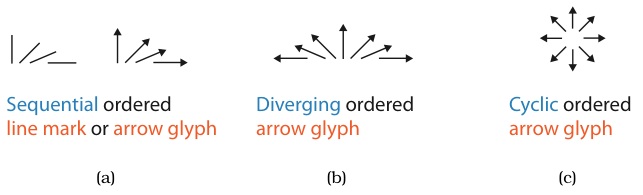

# Angle Channel

## Idiom box

No idiom box in the book.

- **What: Data.** Ordered attributes: sequential, diverging or cyclic (Figure 10.14) [p.262].
- **Why: Tasks.** Judging magnitude from the direction a mark points [p.262].
- **How: Encode.** Orientation of line marks or arrow glyphs, as tiltmaps over one, two or four quadrants [p.262].

## What it is

<!-- verbatim p.262 -->
> The angle channel encodes magnitude information based on the orientation of a mark: the direction that it points.
<!-- /verbatim -->

Angle (orientation judged against another line) and tilt (judged against the display's global frame) are essentially the same channel; angle, tilt and orientation are often synonyms [p.262].

## Use when / avoid when

- **Use** for a sequential attribute within one 90° quadrant, with line marks or arrow glyphs (Figure 10.14a) [p.262].
- **Use** an arrow tilted through 180° for a diverging attribute, with vertical as the neutral zero point, like a diverging colormap's neutral midpoint (Figure 10.14b) [p.262].
- **Use** arrow glyphs over all four quadrants for a cyclic attribute (Figure 10.14c). A plain line cycles four times per 360° turn; an arrow, whose top differs from its bottom, cycles once [p.262].
- **Note** its accuracy: angle is somewhat less accurate than length and position, but more accurate than area, the next channel down [p.262].
- **Avoid** relying on fine distinctions away from horizontal, vertical and diagonal: 89° versus 90°, 44° versus 45° and 1° versus 0° are visible, 37° versus 38° is not [p.262].

## Figures

-  **Figure 10.14** [p.262]. Tiltmaps using the angle channel to show three different types of ordered data. (a) A sequential attribute can be shown with either a line mark or an arrow glyph in one quadrant. (b) A diverging attribute can be shown with two quadrants and an arrow glyph. (c) A cyclic attribute can be shown with all four quadrants and arrow glyphs.

## Alternatives and disambiguation

- **Size Channels**: length is more accurate than angle, area less [pp.261-262].
- **Ordered Colormaps**: the diverging colormap's neutral midpoint plays the role of the diverging tiltmap's vertical [p.262].
- **Curvature Channel**: another magnitude channel for line marks, but at the bottom of the ranking with two or three bins [p.263].

## Related

- [10.4 Other Channels](../ch10-map-color-other-channels/s10-04-other-channels.md#s10.04.02): the full subsection [p.262]
- [Ordered Colormaps](ordered-colormaps.md): the sequential and diverging colour equivalents [p.262]
- [Size Channels](size-channels.md): the neighbouring channels in the accuracy ranking [p.262]

## Implementation hints [NOT FROM BOOK]

### matplotlib

```python
import matplotlib.pyplot as plt
import numpy as np
x, y = np.meshgrid(np.arange(6), np.arange(4))
diverging = np.linspace(-1, 1, x.size).reshape(x.shape)  # -1..1 -> -90..90 deg from vertical
theta = np.pi / 2 - diverging * np.pi / 2
plt.quiver(x, y, np.cos(theta), np.sin(theta), pivot="middle")
plt.gca().set_aspect("equal")
```

### D3

```js
import * as d3 from "d3";
const tilt = d3.scaleLinear([-1, 0, 1], [-90, 0, 90]); // diverging tiltmap, 0 = vertical
const transform = (d) => `translate(${d.x},${d.y}) rotate(${tilt(d.v)})`;
console.log(transform({ x: 10, y: 10, v: 0.5 }));
```
