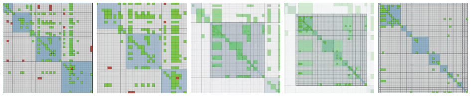

# Animated Transitions

## Idiom box

<!-- verbatim p.274 -->
> What: Data Compound network.
<!-- /verbatim -->

<!-- verbatim p.274 -->
> How: Manipulate Change with animated transition. Navigate between aggregation levels.
<!-- /verbatim -->

The box describes the Figure 11.5 example; it gives no Why: Tasks or Scale field [p.274].

## What it is

<!-- verbatim p.273 -->
> One of the best-justified uses of animation is the idiom of animated transition, where a series of frames is generated to smoothly transition from one state to another.
<!-- /verbatim -->

It is the alternative to a jump cut, where the display changes abruptly from one state to the next [p.273]. It is often used for navigation between two camera viewpoints, and can bridge any change: reordering items, filtering by adding or removing items, changing the visual encoding, or updating values as they change over time [p.273]. In Figure 11.5, five frames of an adjacency matrix of a compound network zoom one level down its cluster hierarchy: the middle block stretches to fill the space as structure appears inside it, and the other blocks squish to nothing, growing more aggregated as their space shrinks [p.274].

## Use when / avoid when

- **Use** when users must keep a sense of context between two states: the transition shows how each item moves, instead of forcing users to track items with internal cognitive and memory resources [p.273].
- **Use** when the amount of change is limited: few objects change while the rest stay the same, or groups of objects move together in similar ways [pp.273-274].
- **Stages.** Transitions can also be broken down into a small number of stages [p.274].
- **Avoid** when many items change in different ways all over the frame, because people cannot track everything [pp.273-274].
- Animation has intuitive appeal to beginning designers, but its cognitive load and other trade-offs need careful thought [p.273].
- An empirical study showed that carefully designed animated transitions support better graphical perception of change [Heer and Robertson 07] [p.274].

## Figures

-  **Figure 11.5** [p.274]. Frames from an animated transition showing zoom between levels in a compound network arranged as an adjacency matrix. From [van Ham 03, Figure 4].

## Alternatives and disambiguation

- **Jump cut**: the abrupt change animated transitions replace [p.273].
- **Constrained navigation** uses an animated transition along a computed camera trajectory to a selected item; the transition is the means, the constraint is the navigation choice [p.282].
- **LineUp** uses an animated transition whenever its bar alignment changes [pp.272-273].

## Related

- [11.3 Change View over Time](../ch11-manipulate-view/s11-03-change-view-over-time.md): the idiom in context [p.273]
- [6.5 Eyes Beat Memory](../ch06-rules-thumb/s06-05-eyes-beat-memory.md): strengths and weaknesses of animation [p.273]
- [Constrained Navigation](constrained-navigation.md): animated camera trajectories to a selected item [p.282]
- [9.3 Matrix Views](../ch09-arrange-networks-trees/s09-03-matrix-views.md): the adjacency matrix encoding in Figure 11.5 [p.274]
- [13.4.1 Item Aggregation](../ch13-reduce-items-attributes/s13-04-aggregate/s13-04-01-item-aggregation.md): the hierarchical aggregation the example navigates [p.274]
- [11.7 Further Reading](../ch11-manipulate-view/s11-07-further-reading.md): the taxonomy and guidelines for transitions [p.287]

## Implementation hints [NOT FROM BOOK]

### matplotlib

Interpolate positions between two states with `FuncAnimation`; save with `anim.save("t.gif")` or show interactively.

```python
import numpy as np, matplotlib.pyplot as plt
from matplotlib.animation import FuncAnimation
vals = np.array([5, 2, 8, 3, 6]); names = list("ABCDE")
start = np.arange(5); end = np.argsort(np.argsort(-vals))  # rank after sorting
fig, ax = plt.subplots()
bars = ax.barh(start, vals, tick_label=names)
ax.invert_yaxis()

def frame(t):
    t = 0.5 - 0.5 * np.cos(np.pi * t)  # ease in-out
    for b, y0, y1 in zip(bars, start, end):
        b.set_y((1 - t) * y0 + t * y1 - 0.4)
    ax.set_yticks((1 - t) * start + t * end, names)
    return bars

anim = FuncAnimation(fig, frame, frames=np.linspace(0, 1, 30), interval=30)
```

### D3

```js
// key the join so each item keeps its mark, then transition attributes
const y = d3.scaleBand().domain(data.toSorted((a, b) => b.v - a.v).map(d => d.id)).range([0, h]);
svg.selectAll("rect").data(data, d => d.id)
  .transition().duration(750).ease(d3.easeCubicInOut)
  .delay((d, i) => i * 20)  // stage the change
  .attr("y", d => y(d.id));
```
