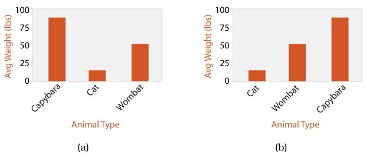
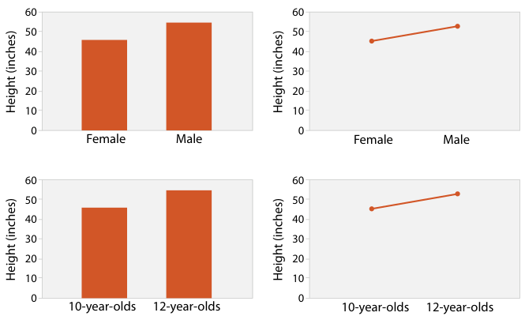
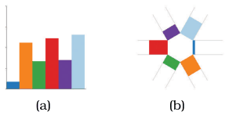
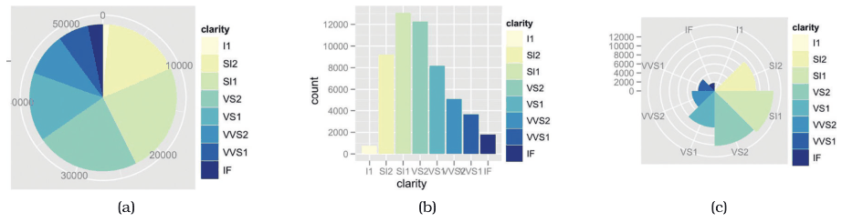

# Bar Charts

## Idiom box

<!-- verbatim p.176 -->
> What: Data Table: one quantitative value attribute, one categorical key attribute.
<!-- /verbatim -->

<!-- verbatim p.176 -->
> How: Encode Line marks, express value attribute with aligned vertical position, separate key attribute with horizontal position.
<!-- /verbatim -->

<!-- verbatim p.176 -->
> Why: Task Lookup and compare values.
<!-- /verbatim -->

<!-- verbatim p.176 -->
> Scale Key attribute: dozens to hundreds of levels.
<!-- /verbatim -->

## What it is

The best-known idiom showing one key and one value attribute [p.171]. A bar chart uses a line mark and encodes a quantitative value attribute with one spatial position channel; the categorical key attribute puts each line mark in a separate region of space, one per level [p.175]. The marks are aligned within a common frame, so the highest-accuracy aligned position channel is used rather than the lower-accuracy unaligned channel [p.175].

Ordering the regions alphabetically (formally a derived attribute) makes lookup by name easy but often hides meaningful patterns; ordering by the value attribute that sets the bar heights makes dataset trends easier to see [p.175]. Bar charts are often augmented with a second categorical attribute shown with colour or shape [p.181].

## Use when / avoid when

- **Use** to look up individual values [p.175].
- **Use** for discrete comparisons: in Zacks and Tversky's study, bar charts elicited discrete-comparison answers such as "Twelve year olds are taller than ten year olds" [p.181].
- **Compared with a pie chart** of the same data, a bar chart needs only high-accuracy position along a common scale, where a pie needs less accurate angle and area judgements [p.193].
- **Scale**: several to dozens of bars is common; a full-screen chart of 1000 pixels can handle up to hundreds of bars, but not thousands, because white space must separate the bars [p.175].

## Figures

-  **Figure 7.4** [p.175]. Bar chart. The key attribute, species, separates the marks along the horizontal spatial axis. The value attribute, weight, expresses the value with aligned vertical spatial position and line marks. (a) Marks ordered alphabetically according to species name. (b) Marks ordered by the weight attribute used for bar heights.
-  **Figure 7.9** [p.182]. Bar charts and line charts both encode a single attribute. Bar charts encourage discrete comparisons, while line graphs encourage trend assessments. Line charts should not be used for categorical data, as in the upper right, because their implications are misleading. After [Zacks and Tversky 99, Figure 2].
-  **Figure 7.16** [p.192]. Radial versus rectilinear layouts. (a) Rectilinear bar chart. (b) Radial bar chart. After [Booshehrian et al. 11, Figure 4].
-  **Figure 7.17** [p.193]. Pie chart versus bar chart accuracy. (a) Pie charts require angle and area judgements. (b) Bar charts require only high-accuracy length judgements for individual items. (c) Polar area charts are a more direct equivalent of bar charts, where the length of each wedge varies like the length of each bar. From [Wickham 10, Figures 15 and 16].

## Alternatives and disambiguation

- **Dot charts** encode the same value with point marks rather than line marks [p.180].
- **Line charts** add connection marks that imply a trend; the book says they should be used for ordered keys but not categorical ones [p.181].
- **Stacked bar charts** replace each bar with a glyph of stacked sub-bars to show a second categorical key [p.176].
- **Radial bar charts** use the same line marks and length channel; only the orientation of the axes differs [p.192].
- **Pie charts and polar area charts** show one quantitative and one categorical attribute radially, with less accurate channels [p.193].

## Related

- [7.5.1 List Alignment: One Key](../ch07-arrange-tables/s07-05-separate-order-align-categorical/s07-05-01-list-alignment-one-key.md): the section that presents this idiom and compares it with dot and line charts [p.175]
- [5.5 Channel Effectiveness](../ch05-marks-channels/s05-05-channel-effectiveness/node.md): why aligned position and length beat angle and area [p.193]
- [7.6.3 Radial Layouts](../ch07-arrange-tables/s07-06-spatial-axis-orientation/s07-06-03-radial-layouts.md): the radial bar, pie and polar area comparisons [p.192]
- [Line Charts](line-charts.md): the trend-implying sibling for ordered keys [p.181]
- [Stacked Bar Charts](stacked-bar-charts.md): bar charts with two keys [p.176]

## Implementation hints [NOT FROM BOOK]

### matplotlib

Sort by value for data-driven ordering; keep the default alphabetical order only when lookup by name matters.

```python
import matplotlib.pyplot as plt

weights = {"cat": 5, "dog": 30, "goat": 60, "pig": 90, "sheep": 70}
species, kg = zip(*sorted(weights.items(), key=lambda kv: kv[1], reverse=True))

fig, ax = plt.subplots()
ax.bar(species, kg, color="C0")
ax.set(xlabel="species", ylabel="weight (kg)")
ax.spines[["top", "right"]].set_visible(False)
```

Use `ax.barh` with long category names, and `ax.bar_label` to print values.

### D3

```js
const sorted = d3.sort(data, d => -d.value);
const x = d3.scaleBand().domain(sorted.map(d => d.key)).range([0, width]).padding(0.2);
const y = d3.scaleLinear().domain([0, d3.max(data, d => d.value)]).nice().range([height, 0]);
svg.selectAll("rect").data(sorted).join("rect")
  .attr("x", d => x(d.key)).attr("width", x.bandwidth())
  .attr("y", d => y(d.value)).attr("height", d => y(0) - y(d.value));
svg.append("g").attr("transform", `translate(0,${height})`).call(d3.axisBottom(x));
svg.append("g").call(d3.axisLeft(y));
```
