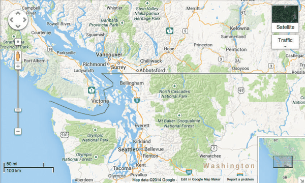

# Bird’s-Eye Maps

## Idiom box

<!-- verbatim p.296 -->
> What: Data Geographic.
<!-- /verbatim -->

<!-- verbatim p.296 -->
> How: Encode Use given.
<!-- /verbatim -->

<!-- verbatim p.296 -->
> How: Facet Partition into two views with same encoding, overview–detail.
<!-- /verbatim -->

<!-- verbatim p.296 -->
> (How: Reduce) Navigate.
<!-- /verbatim -->

The box gives no Why: Tasks or Scale field [p.296].

## What it is

Interactive online geographic maps combine the shared encoding and overview–detail choices: a large map exploration view is augmented by a small "bird's-eye" view that gives an orienting overview (Figure 12.3) [p.295]. The two views share encoding and dataset and differ in viewpoint and size [p.295]. A small rectangle in the overview shows the region visible in the detail view [pp.295-296].

The minimum navigational linkage is unidirectional: the rectangle's position and size in the overview update as the user pans and zooms the large detail view. With bidirectionally linked views, the user can also move the rectangle in the small view to update the region the large one shows [p.296]. Interaction in the small window changing the viewpoint in the large one is the book's example of linked navigation [p.301].

## Use when / avoid when

- **Use** when the user explores details in a large view and needs a zoomed-out overview to stay oriented; for other tasks the book suggests the reverse, a large overview with a small detail window [pp.294-295].
- **Use** juxtaposed overview and detail views rather than a single changing view when users must keep track of where they are: with the change choice users are more likely to lose track of their location, having no scaffolding to augment internal memory [p.295].
- **Avoid** two views that show identical information: with both data and encoding shared the views are redundant, one of two combinations that are not useful [p.301]. Both views could in theory be set to the same zoom level, but normally one shows only a subset of the other, and even at the same zoom, different rotation or translation can show different subsets [pp.294-295].

## Figures

-  **Figure 12.3** [p.295]. Overview–detail example with geographic maps, where the views have the same encoding and dataset; they differ in viewpoint and size. Made with Google Maps, <http://maps.google.com>.

## Alternatives and disambiguation

- **Multiform Overview–Detail Microarrays** also pairs an overview with a detail view, but the detail view uses a different encoding (multiform), whereas bird's-eye maps share one encoding [p.296].
- **Multiple detail views** suit datasets with multilevel structure at discrete scales, one view per level, acting as a visual history of the user's selections; bird's-eye maps use the common choice of exactly two views [p.295].
- **Changing a single view** with navigation is the alternative to a second view; with it users are more likely to lose track of their location [p.295].

## Related

- [12.3.2 Share Data: All, Subset, None](../ch12-facet-into-multiple-views/s12-03-juxtapose-coordinate-views/s12-03-02-share-data-all-subset.md): overview–detail in full [p.294]
- [12.3.3 Share Navigation: Synchronize](../ch12-facet-into-multiple-views/s12-03-juxtapose-coordinate-views/s12-03-03-share-navigation-synchronize.md): linked navigation between the overview and detail [p.301]
- [11.5 Navigate: Changing Viewpoint](../ch11-manipulate-view/s11-05-navigate-changing-viewpoint.md): the navigation the box lists under How: Reduce [p.294]
- [Multiform Overview–Detail Microarrays](multiform-overview-detail-microarrays.md): the multiform variant of overview–detail [p.296]
- [Improvise](improvise.md): uses a bird's-eye map overview with linked navigation inside a larger system [p.303]

## Implementation hints [NOT FROM BOOK]

### matplotlib

```python
import numpy as np, matplotlib.pyplot as plt
from matplotlib.patches import Rectangle
x, y = np.meshgrid(np.linspace(0, 10, 400), np.linspace(0, 10, 400))
z = np.sin(x) * np.cos(y) + 0.1 * x
fig, ax = plt.subplots(figsize=(6, 5))
ax.imshow(z, extent=[0, 10, 0, 10], origin="lower", cmap="terrain")
ax.set_xlim(3, 5); ax.set_ylim(4, 6)                    # detail view
ov = ax.inset_axes([0.68, 0.68, 0.3, 0.3])              # bird's-eye overview
ov.imshow(z, extent=[0, 10, 0, 10], origin="lower", cmap="terrain")
ov.add_patch(Rectangle((3, 4), 2, 2, fill=False, ec="red", lw=1.5))
ov.set_xticks([]); ov.set_yticks([])
```

### D3

```js
import * as d3 from "d3";
const width = 600, height = 400, k = 0.2;               // overview scale
const zoom = d3.zoom().scaleExtent([1, 16]).on("zoom", ({ transform: t }) => {
  d3.select("#detail g").attr("transform", t);
  d3.select("#viewport")                                // rectangle in the overview
    .attr("x", -t.x / t.k * k).attr("y", -t.y / t.k * k)
    .attr("width", width / t.k * k).attr("height", height / t.k * k);
});
d3.select("#detail").call(zoom);
// Bidirectional: d3.drag() on #viewport calls zoom.translateTo on #detail.
```
