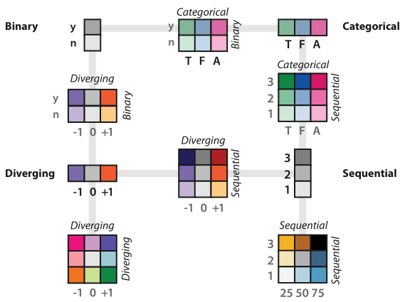

# Bivariate Colormaps

## Idiom box

No idiom box in the book.

- **What: Data.** Two attributes at once: categorical, binary, sequential or diverging; or one categorical attribute with hierarchical structure [pp.259-260].
- **Why: Tasks.** Showing two attributes simultaneously in the colour channel [p.244].
- **How: Encode.** Carefully designed combinations of luminance, hue and saturation; with a binary attribute, a fixed base set of hues whose saturation varies [pp.244-260].

## What it is

<!-- verbatim p.259 -->
> The safest use of the color channel is to visually encode a single attribute; these colormaps are known as univariate.
<!-- /verbatim -->

Colormaps that encode two separate attributes are bivariate. Figure 10.6 shows categorical–binary, diverging–binary, sequential–sequential, diverging–diverging, diverging–sequential and categorical–sequential examples [pp.259-260].

## Use when / avoid when

- **Use** when one attribute is binary: two families of colours, made by fixing base hues and varying saturation, are straightforward to read [pp.259-260].
- **Use** the same scheme for a single categorical attribute with hierarchical structure [p.260].
- **Use with caution** for two sequential or diverging attributes with multiple levels (Figure 10.6 uses three levels each): common in vis systems, but some people have difficulty interpreting them [p.260].
- **Avoid** two categorical attributes with multiple levels: results will be poor [Wainer and Francolini 80], so Figure 10.6 has no categorical–categorical map [p.260].

## Figures

-  **Figure 10.6** [p.251]. The colormap categorization partially mirrors the data types: categorical versus ordered, and sequential and diverging within ordered. Bivariate encodings of two separate attributes at once is safe if one has only two levels, but they can be difficult to interpret when both attributes have multiple levels. After [Brewer 99].

## Alternatives and disambiguation

- **Ordered Colormaps** and **Categorical Colormaps** are univariate, the safest use of colour [p.259].
- **Categorical Colormaps** with hierarchical structure can borrow the bivariate fixed-hue, varied-saturation scheme while still encoding one attribute [p.260].

## Related

- [10.3.3 Bivariate Colormaps](../ch10-map-color-other-channels/s10-03-colormaps/s10-03-03-bivariate-colormaps.md): the full section [p.259]
- [10.3.1 Categorical Colormaps](../ch10-map-color-other-channels/s10-03-colormaps/s10-03-01-categorical-colormaps.md): Figure 10.6 and the colormap taxonomy [p.251]
- [Ordered Colormaps](ordered-colormaps.md): the sequential and diverging ramps being combined [p.260]

## Implementation hints [NOT FROM BOOK]

### matplotlib

```python
import matplotlib.pyplot as plt
import numpy as np
from matplotlib.colors import to_rgb
rng = np.random.default_rng(1)
cat = rng.integers(0, 3, 60)
flag = rng.integers(0, 2, 60)  # the binary attribute
base = [to_rgb(c) for c in ("#d62728", "#1f77b4", "#2ca02c")]
def desaturate(rgb, k=0.35):
    return tuple(1 - k * (1 - v) for v in rgb)
colors = [base[c] if f else desaturate(base[c]) for c, f in zip(cat, flag)]
plt.scatter(rng.random(60), rng.random(60), c=colors, s=60, edgecolor="k", linewidth=0.3)
```

### D3

```js
import * as d3 from "d3";
const hue = d3.scaleOrdinal(["a", "b", "c"], d3.schemeSet1);
const fill = (cat, flag) => {
  const c = d3.hsl(hue(cat));
  if (!flag) c.s *= 0.35;
  return c.formatHex();
};
console.log(fill("a", true), fill("a", false));
```
