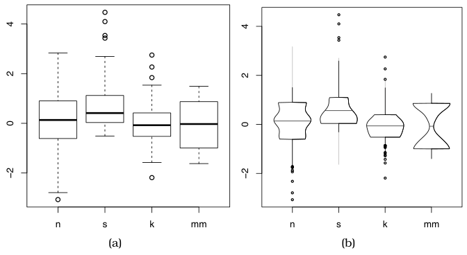

# Boxplot Charts

## Idiom box

<!-- verbatim p.335 -->
> What: Data Table: many quantitative value attributes.
<!-- /verbatim -->

<!-- verbatim p.335 -->
> What: Derived Five quantitative attributes for each original attribute, representing its distribution.
<!-- /verbatim -->

<!-- verbatim p.335 -->
> Why: Tasks Characterize distribution; find outliers, extremes, averages; identify skew.
<!-- /verbatim -->

<!-- verbatim p.335 -->
> How: Encode One glyph per original attribute expressing derived attribute values using vertical spatial position, with 1D list alignment of glyphs into separated with horizontal spatial position.
<!-- /verbatim -->

<!-- verbatim p.335 -->
> How: Reduce Item aggregation.
<!-- /verbatim -->

<!-- verbatim p.335 -->
> Scale Items: unlimited. Attributes: dozens.
<!-- /verbatim -->

"glyphs into separated with" is the book's wording [p.335].

## What it is

A visually concise idiom showing an aggregate statistical summary of all the values in the distribution of a single quantitative attribute, through five derived variables: the median (50% point), the lower and upper quartiles (25% and 75% points), and the upper and lower fences, chosen values near the extremes beyond which points count as outliers [p.333]. The box stretches between the quartiles with a horizontal line at the median; whiskers are vertical lines from the box to the fences, which are marked with horizontal lines; outliers beyond the fences are drawn as discrete dots [p.333]. Boxplots are also known as box-and-whisker diagrams [p.333].

A boxplot chart places multiple boxplots in one shared frame to contrast attribute distributions; in Figure 13.7 the quantitative value attribute is on the vertical axis and the categorical key attribute on the horizontal [p.333].

## Use when / avoid when

- **Use** to see spread (degree of dispersion), from the extent of the box, and skew relative to a normal distribution, from the asymmetry between the top and bottom of the box [p.334].
- **Use** for very many values: it aggregates an arbitrarily large set, from thousands to millions, down to five numbers [p.334].
- **Use** to compare many categories: each boxplot needs very little space on the secondary axis, so a chart can hold roughly hundreds of categorical values [p.334]. The box itself gives the attribute scale as dozens [p.335].
- **Multimodal data.** Standard boxplots are designed to handle unimodal data; a variable-width variant such as the vase plot shows density so multimodality can be checked, at the cost of more space along the secondary axis [p.334].

The text's "roughly hundreds" of categorical values and the box's "Attributes: dozens" are both the book's figures; it does not reconcile them [pp.334-335].

## Figures

-  **Figure 13.7** [p.334]. The boxplot is an idiom presenting summary statistics for the distribution of a quantitative attribute, using five derived values. These plots illustrate four kinds of distributions: normal (n), skewed (s), peaked (k), and multimodal (mm). (a) Standard box plots. (b) Vase plots, which use horizontal spatial position to show density directly. From [Wickham and Stryjewski 12, Figure 5].

## Alternatives and disambiguation

- **Bar charts** use one spatial axis per item like a boxplot, but a bar's line mark encodes a single number where a boxplot's glyph encodes five [p.333].
- **Vase plots** are a variable-width boxplot variant that shows density directly, allowing a visual check for multimodal distributions [p.334].
- **Histograms** also show a distribution, as counts per bin rather than five summary numbers [p.331] [p.333].
- **Geographically weighted boxplots** superimpose a local, spatially weighted boxplot on the global one for geographic data, and the book points back to Section 13.4.1 for boxplots [p.340].

## Related

- [13.4.1 Item Aggregation](../ch13-reduce-items-attributes/s13-04-aggregate/s13-04-01-item-aggregation.md): the section that presents the idiom [p.333]
- [Histograms](histograms.md): the bin-and-count summary of a distribution [p.333]
- [Bar Charts](bar-charts.md): the single-number analogue sharing a single spatial axis [p.333]
- [Geographically Weighted Boxplots](geographically-weighted-boxplots.md): the spatial-aggregation extension [p.340]
- [Dot Charts](dot-charts.md): outliers are drawn as dots, just as in dot charts [p.333]

## Implementation hints [NOT FROM BOOK]

### matplotlib

```python
import numpy as np, matplotlib.pyplot as plt
rng = np.random.default_rng(0)
data = [rng.normal(0, 1, 500), rng.gamma(2, 1, 500) - 2,
        rng.laplace(0, 0.5, 500), np.r_[rng.normal(-1.5, .5, 250), rng.normal(1.5, .5, 250)]]
fig, (a, b) = plt.subplots(1, 2, sharey=True)
a.boxplot(data, tick_labels=["n", "s", "k", "mm"], whis=1.5)
b.violinplot(data, showmedians=True)
b.set_xticks([1, 2, 3, 4], ["n", "s", "k", "mm"])
```

`violinplot` is the closest built-in to the vase plot's variable width.

### D3

Per category compute `d3.quantile(sorted, 0.25)`, `d3.median`, `d3.quantile(sorted, 0.75)` and fences at `q1 - 1.5 * iqr`, `q3 + 1.5 * iqr`; place categories with `d3.scaleBand()`, draw a `rect` from `y(q3)` to `y(q1)`, a median `line`, whisker `line`s, and `circle`s for values outside the fences.
