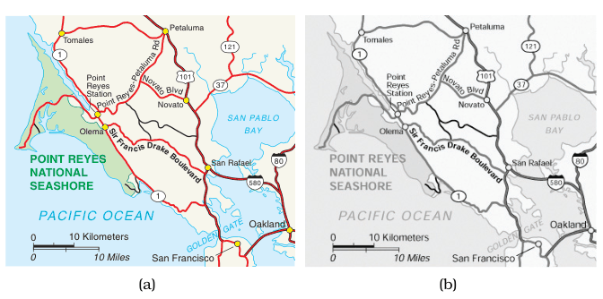

# Cartographic Layering

## Idiom box

<!-- verbatim p.315 -->
> What: Data Geographic
<!-- /verbatim -->

<!-- verbatim p.315 -->
> How: Encode Area marks for regions (water, parks, other land), line marks for roads, categorical colormap.
<!-- /verbatim -->

<!-- verbatim p.315 -->
> How: Facet Superimpose: static layers distinguished with color saturation, color luminance, and size channels.
<!-- /verbatim -->

The box gives no Why: Tasks or Scale field [p.315].

## What it is

A static layering idiom that lets the viewer easily shift attention between layers; mapmakers usually design maps this way, with all layers displayed at once and the user choosing which to focus on by directing visual attention [p.314]. In Figure 12.13(a), area marks form a background layer, with three unsaturated colours for water, parks and other land; line marks form a foreground road layer, main roads as wide fully saturated red lines and small roads as thinner black lines [p.314]. The figure caption says the layers differ in hue, saturation, luminance and size on both area and line marks [p.315].

## Use when / avoid when

- **Use** when each layer can take a different, nonoverlapping range of the active visual channels, which is one good way to make layers distinguishable [p.314].
- **Use** two layers, foreground and background, as the common choice: when layers hold many area marks, two is definitely achievable and three is possible with careful design [p.314].
- **Check** the layers in grayscale: the map works because of luminance contrast between layers (Figure 12.13(b)), an example of the slogan Get It Right in Black and White [p.314].

## Figures

-  **Figure 12.13** [p.315]. Static visual layering in maps. (a) The map layers are created by differences in the hue, saturation, luminance, and size channels on both area and line marks. (b) The grayscale view shows that each layer uses a different range in the luminance channel, providing luminance contrast. From [Stone 10].

## Alternatives and disambiguation

- **Superimposed Line Charts** is static layering of many thin lines distinguished by colour, not area and line layers separated by luminance [p.315].
- **Hierarchical Edge Bundles** layers a gray hierarchy under a red–green network, for compound graphs rather than geographic data [pp.317-318].
- **Juxtaposed views** need more display area but accommodate many more views than the two or three layers that can be superimposed [pp.291-292].

## Related

- [12.5.2 Static Layers](../ch12-facet-into-multiple-views/s12-05-superimpose-layers/s12-05-02-static-layers.md): where this example is presented [p.314]
- [12.5.1 Visually Distinguishable Layers](../ch12-facet-into-multiple-views/s12-05-superimpose-layers/s12-05-01-visually-distinguishable-layers.md): the rules for distinguishable layers [p.314]
- [6.9 Get It Right in Black and White](../ch06-rules-thumb/s06-09-get-right-black-white.md): checking luminance contrast explicitly [p.314]
- [Categorical Colormaps](categorical-colormaps.md): the box's categorical colormap [p.315]
- [Superimposed Line Charts](superimposed-line-charts.md): another static layering idiom [p.315]

## Implementation hints [NOT FROM BOOK]

### matplotlib

```python
import numpy as np, matplotlib.pyplot as plt
from matplotlib.patches import Polygon
fig, ax = plt.subplots(figsize=(6, 5))
ax.set_facecolor("#eef2ec")                                        # other land
ax.add_patch(Polygon([[0, 0], [4, 0], [3, 6], [0, 7]], fc="#c9dcea", zorder=1))   # water
ax.add_patch(Polygon([[6, 5], [9, 5], [9, 8], [6, 8]], fc="#d6e8cf", zorder=1))   # park
x = np.linspace(0, 10, 50)
ax.plot(x, 4 + np.sin(x / 2), color="#d62728", lw=3, zorder=3)     # main road: saturated, wide
for k in range(4):
    ax.plot(x, 1 + 2 * k + 0.3 * np.cos(x + k), color="black", lw=0.6, zorder=2)
ax.set_xlim(0, 10); ax.set_ylim(0, 10)
```

### D3

```js
import * as d3 from "d3";
// Back-to-front <g> layers; background areas low-saturation, foreground lines saturated.
const svg = d3.select("svg");
const back = svg.append("g").attr("class", "areas");
const front = svg.append("g").attr("class", "roads");
const fill = d3.scaleOrdinal(["water", "park", "land"], ["#c9dcea", "#d6e8cf", "#eef2ec"]);
// back.selectAll("path").data(areas).join("path").attr("d", path).attr("fill", d => fill(d.type));
// front.selectAll("path").data(roads).join("path").attr("d", path).attr("stroke", d => d.main ? "#d62728" : "#000");
```
