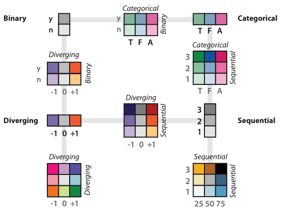
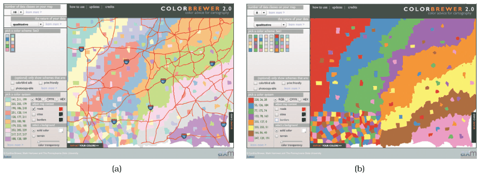
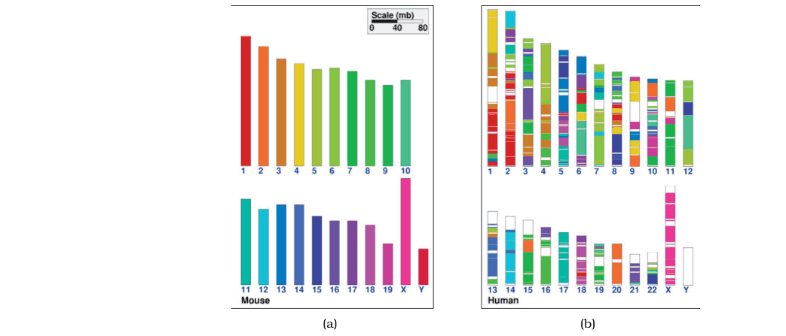
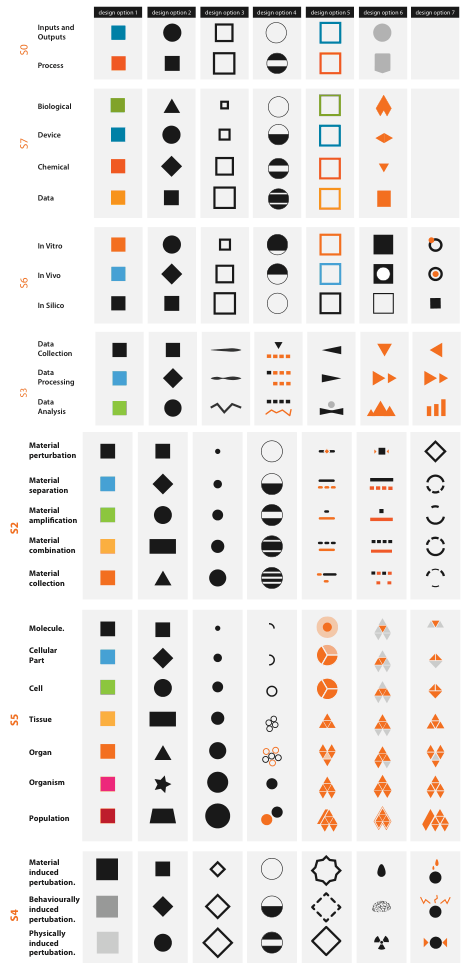
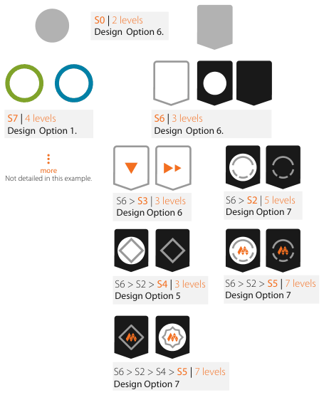

# Categorical Colormaps

## Idiom box

No idiom box in the book.

- **What: Data.** A categorical attribute, or categories and groupings [p.251].
- **Why: Tasks.** Distinguishing categories and showing groupings; colour is the next best channel for categorical data after spatial position [p.251].
- **How: Encode.** Colour as a single integral identity channel, normally segmented into discrete bins; hue is the identity channel most effective for categories [pp.249-251].
- **Scale.** Six to twelve distinguishable colours for small separated regions, counting background and default object colours [p.251].

## What it is

<!-- verbatim p.251 -->
> A categorical colormap uses color to encode categories and groupings. Categorical colormaps are normally segmented.
<!-- /verbatim -->

Also called a qualitative colormap [p.251]. It uses colour as one integral identity channel for one attribute, not hue, saturation and luminance for three attributes [p.251].

## Use when / avoid when

- **Use** for categorical data: used appropriately it is very effective, second only to spatial position [p.251].
- **Use** at most six to twelve colours when regions are small and separated; include background and default object colours (often black, white, gray) in the count [p.251].
- **Use** easily nameable colours, starting with red, blue, green and yellow, then orange, brown, pink, magenta, purple and cyan [pp.251-252].
- **Use** highly saturated colours for small marks (points, lines) and low-saturation pastels for large areas; the right colormap can depend on mark type [pp.249-252].
- **Use** colours close in luminance when all should be equally salient against one background (saturated yellow and green have much less contrast on white than red and blue); for other uses, colours should differ enough in luminance to be distinguished even in black and white [p.252].
- **Use** a segmented rainbow for a small number of categories [p.259].
- **Avoid** more categories than distinguishable colours: in noncontiguous small regions the eye merges them (21 genome colours fell to about 12 bins). Instead, derive fewer bins deliberately (hierarchical groups, or filter to the most important categories plus "other"), or move categories to other channels such as shape, size or glyphs [pp.253-256].
- **Avoid** hue-only differences for colour-deficient viewers; vary luminance or saturation too [p.260].

## Figures

-  **Figure 10.6** [p.251]. The colormap categorization partially mirrors the data types: categorical versus ordered, and sequential and diverging within ordered. Bivariate encodings of two separate attributes at once is safe if one has only two levels, but they can be difficult to interpret when both attributes have multiple levels. After [Brewer 99].
-  **Figure 10.7** [p.252]. Saturation and area. (a) The ten-element low-saturation map works well with large areas. (b) The eight-element high-saturation map would be better suited for small regions and works poorly for these large areas. Made with ColorBrewer, <http://www.colorbrewer2.org>.
-  **Figure 10.8** [p.253]. Ineffective categorical colormap use. (a) The 21 colors used as an index for each mouse chromosome can indeed be distinguished in large regions next to each other. (b) In noncontiguous small regions only about 12 bins of color can be distinguished from each other, so a lot of information about how regions in the mouse genome map to the human genome is lost. From [Sinha and Meller 07, Figure 2].
-  **Figure 10.9** [p.255]. Effective categorical colormap use: A large space of visual encoding possibilities for 27 categories was considered systematically in addition to the color channel, including size and shape channels and more complex glyphs. From [Maguire et al. 12, Figure 5].
-  **Figure 10.10** [p.256]. Effective categorical colormap use: The final design uses the color channel for only four of the categories. From [Maguire et al. 12, Figure 6].

## Alternatives and disambiguation

- **Ordered Colormaps** are for ordinal and quantitative attributes and use luminance or saturation, because hue has no implicit order; for ordinal data, a segmented map emphasises its discrete nature and a continuous one its ordered nature [p.250].
- **Bivariate Colormaps** add a second attribute; categorical–binary maps fix the hues and vary saturation, while categorical–categorical maps give poor results [pp.259-260].
- **Shape Channel** and **Texture and Stippling** carry categories when colour runs out of bins: shape gives dozens or even hundreds of bins on large enough points, and careful design might give roughly a dozen within 10×10 pixels; texture gives at least one or two dozen with sufficient care [pp.263-265].

## Related

- [10.3.1 Categorical Colormaps](../ch10-map-color-other-channels/s10-03-colormaps/s10-03-01-categorical-colormaps.md): the full section with the genome and workflow examples [p.251]
- [10.2.3 Luminance, Saturation, and Hue](../ch10-map-color-other-channels/s10-02-color-theory/s10-02-03-luminance-saturation-hue.md): hue bin limits and the saturation-by-region-size rule [p.249]
- [Colorblind-Safe Colormaps](colorblind-safe-colormaps.md): checking the palette for red–green deficiency [p.260]
- [15.8 Constellation](../ch15-analysis-case-studies/s15-08-constellation.md): a few dozen categories narrowed to eight colours [p.254]
- [Shape Channel](shape-channel.md): the main alternative channel for many categories [p.254]

## Implementation hints [NOT FROM BOOK]

### matplotlib

```python
import matplotlib.pyplot as plt
import numpy as np
rng = np.random.default_rng(0)
cats = ["A", "B", "C", "D", "E"]
pal = plt.get_cmap("Set1").colors[:len(cats)]  # saturated: small marks
fig, (ax1, ax2) = plt.subplots(1, 2, figsize=(8, 3))
for i, c in enumerate(cats):
    ax1.scatter(*rng.normal(i, 0.4, (2, 30)), s=12, color=pal[i], label=c)
ax1.legend(fontsize=7)
ax2.bar(cats, [3, 5, 2, 4, 1], color=plt.get_cmap("Pastel1").colors[:5])  # pastel: large areas
```

### D3

```js
import * as d3 from "d3";
const cats = ["a", "b", "c", "d", "e"];
const small = d3.scaleOrdinal(cats, d3.schemeSet1);    // points, lines
const large = d3.scaleOrdinal(cats, d3.schemePastel1); // areas, backgrounds
console.log(small("a"), large("a"));
```
