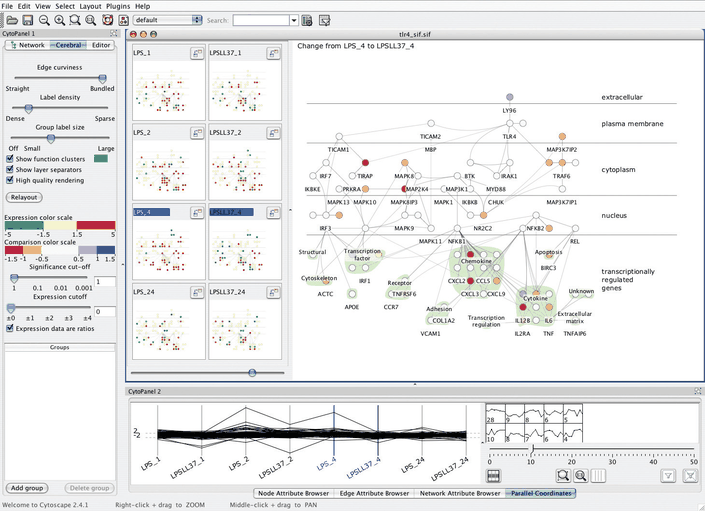
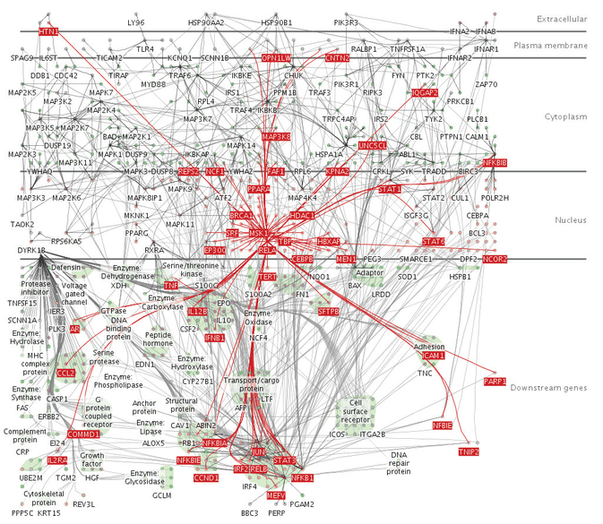

# Cerebral

## Idiom box

No idiom box in the book.

The book describes Cerebral in a System box rather than an Idiom box; its fields are quoted here [p.300].

<!-- verbatim p.300 -->
> What: Data Multidimensional table: one categorical key attribute (gene), one categorical key attribute (condition), one quantitative value attribute (gene activity at condition). Network: nodes (genes), links (known interaction between genes), one ordered attribute on nodes: location within cell of interaction.
<!-- /verbatim -->

<!-- verbatim p.300 -->
> What: Derived One quantitative value attribute (difference between measurements for two partitions).
<!-- /verbatim -->

<!-- verbatim p.300 -->
> How: Encode Node–link network using connection marks, vertical spatial position expressing interaction location, containment marks for coregulated gene groups, diverging colormap. Small-multiple network views aligned in matrix. Parallel coordinates.
<!-- /verbatim -->

<!-- verbatim p.300 -->
> How: Facet Partition: small multiple views partitioned on condition, and multiform views. Coordinate: linked highlighting and navigation.
<!-- /verbatim -->

The System box gives no Why: Tasks or Scale field [p.300].

## What it is

A bioinformatics system whose dataset is a multidimensional table keyed by gene and experimental condition, with microarray measurements of gene activity as the value (Figure 12.5) [p.299]. The large view is a node–link network of genes and their known interactions, drawn with connection marks; vertical position encodes where in the cell the interaction occurs, and containment marks show groups of coregulated genes [p.299].

**Small multiples.** Views to the left partition the dataset by condition and are aligned in a reorderable matrix. Each colours nodes with a diverging red–green colormap of gene activity for its condition, following bioinformatics domain conventions; other colormaps that better serve colourblind users are available. The large view instead colours nodes with a diverging orange–blue colormap of the derived difference between two selected small multiples, whose titlebars are highlighted in blue [p.299].

**Multiform and linked.** A parallel coordinates view and a clustering control panel sit below, and navigation between the views is linked [p.299].

**Dynamic layering.** Cerebral builds a foreground layer that updates constantly as the cursor moves: over a node, it shows that node's one-hop neighbourhood (every node a single topological hop away, plus the links to them) in a fully saturated red with larger linewidth, against a background of only low-saturation colours (Figure 12.17) [p.319].

## Use when / avoid when

- **Use** small multiples to make partitions, here conditions, visible side by side, so the user glances between them with minimal interaction cost and memory load, instead of animating through them [p.299].
- **Use** a dynamic foreground layer when the potential layers are too many to show at once, such as one per node's neighbourhood, since dynamic layers are constructed on the fly [p.319].
- **Avoid** pushing small multiples past the screen limit: around one million pixels supports a few dozen views with several hundred elements each [p.299].

## Figures

-  **Figure 12.5** [p.300]. Cerebral uses small-multiple views to show the same base graph of gene interactions colored according to microarray measurements made at different times. The coloring in the main view uses the derived attribute of the difference in values between the two chosen views. From [Barsky et al. 08, Figure 2].
-  **Figure 12.17** [p.320]. Cerebral dynamically creates a foreground visual layer of all nodes one topological hop away in the network from the node underneath the cursor. From [Barsky et al. 07, Figure 1].

## Alternatives and disambiguation

- **Animation** shows conditions one by one instead of side by side, but imposes a massive memory load when change is complex and spatially distributed [p.299].
- **Multiform Overview–Detail Microarrays** handles a similar microarray dataset with a time-series overview filtering a scatterplot detail view rather than small-multiple networks [pp.296-298].
- **Improvise** also mixes small multiples, multiform views and linked navigation, for census data with one shared colormap [pp.302-303].
- **Static layers** such as hierarchical edge bundles keep a small fixed set of layers on screen; Cerebral's foreground layer is constructed from the cursor position [p.317] [p.319].

## Related

- [12.3.2 Share Data: All, Subset, None](../ch12-facet-into-multiple-views/s12-03-juxtapose-coordinate-views/s12-03-02-share-data-all-subset.md): small multiples, where Cerebral is introduced [p.299]
- [12.3.4 Combinations](../ch12-facet-into-multiple-views/s12-03-juxtapose-coordinate-views/s12-03-04-combinations.md): the encoding-by-data table (Figure 12.6) that classifies its views [p.301]
- [12.5.3 Dynamic Layers](../ch12-facet-into-multiple-views/s12-05-superimpose-layers/s12-05-03-dynamic-layers.md): its one-hop foreground layer [p.319]
- [7.5.2 Matrix Alignment: Two Keys](../ch07-arrange-tables/s07-05-separate-order-align-categorical/s07-05-02-matrix-alignment-two-keys.md): the red–green colormap convention in bioinformatics [p.299]
- [6.5 Eyes Beat Memory](../ch06-rules-thumb/s06-05-eyes-beat-memory.md): animation and memory [p.299]
- [Parallel Coordinates](parallel-coordinates.md): its multiform view [p.299]
- [9.5 Containment: Hierarchy Marks](../ch09-arrange-networks-trees/s09-05-containment-hierarchy-marks.md): containment marks over a network, as for its coregulated groups [p.299]

## Implementation hints [NOT FROM BOOK]

### matplotlib

```python
import numpy as np, networkx as nx, matplotlib.pyplot as plt
G = nx.les_miserables_graph(); pos = nx.spring_layout(G, seed=2)
rng = np.random.default_rng(3); conditions = ["t0", "t1", "t2", "t3"]
act = {c: rng.normal(0, 1, G.number_of_nodes()) for c in conditions}
fig, axs = plt.subplots(2, 2, figsize=(8, 8))            # small multiples share layout
for ax, c in zip(axs.flat, conditions):
    nx.draw_networkx_edges(G, pos, ax=ax, alpha=0.2)
    nx.draw_networkx_nodes(G, pos, ax=ax, node_size=20, node_color=act[c],
                           cmap="RdBu_r", vmin=-3, vmax=3)
    ax.set_title(c); ax.set_axis_off()
```

### D3

```js
import * as d3 from "d3";
// One shared force layout; one <g> per condition; a hover layer for one-hop neighbours.
const color = d3.scaleDiverging(d3.interpolateRdBu).domain([3, 0, -3]);
function highlight(node, links) {
  const nbrs = new Set(links.filter(l => l.source === node || l.target === node)
    .flatMap(l => [l.source, l.target]));
  d3.selectAll("circle").classed("fg", d => nbrs.has(d));   // saturated red, thicker
}
```
