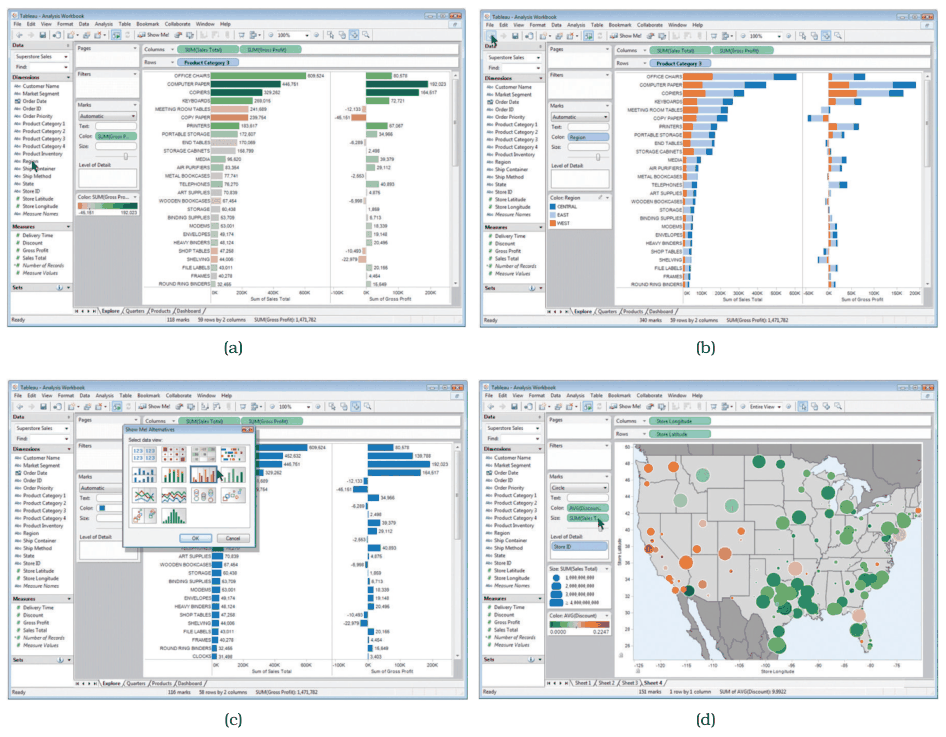
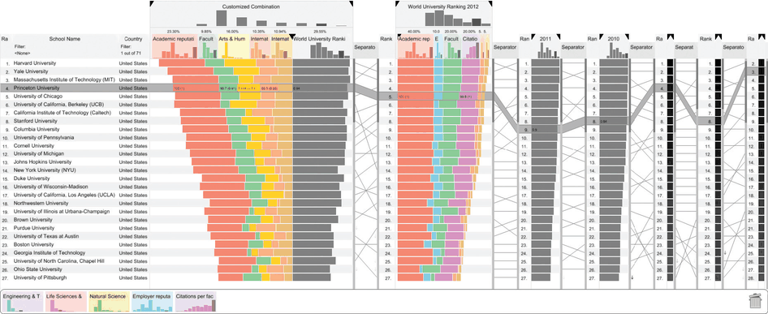
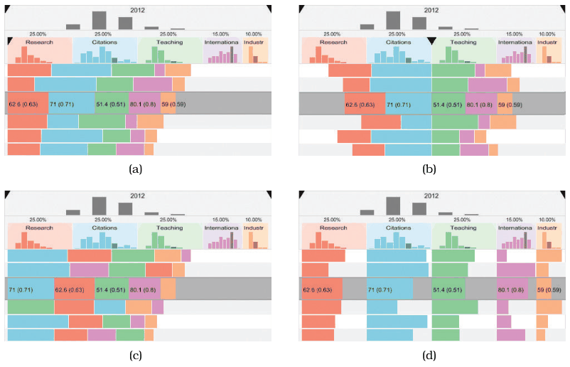
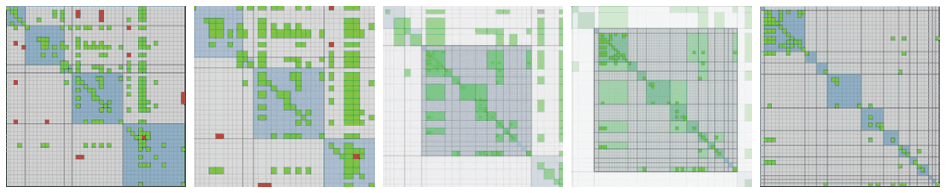

# Change over Time

## Idiom box

No idiom box in the book.

The card is named for the choice to change a view over time, the first of the manipulate choices in Figure 11.1 [p.268] [p.269]; its source is section 11.3, Change View over Time [p.269].

- **What: Data.** Any; the possible changes span every other design choice for constructing an idiom [p.269].
- **Why: Tasks.** Handle datasets too large and complex to show at once in a single static view without overwhelming clutter; reordering in particular serves finding patterns [p.269] [p.271].
- **How: Manipulate.** Change the idiom, an encoding parameter, the order, the alignment, the viewpoint, the filtering or the aggregation level, often animated [pp.269-273].

## What it is

<!-- verbatim p.269 -->
> The possibilities for how the view changes can be based on any of the other design choices of how to construct an idiom: change the encoding, change the arrangement, change the order, change the viewpoint, change which attributes are filtered, change the aggregation level, and so on.
<!-- /verbatim -->

- **Change the idiom.** Switch encodings, such as node–link to matrix for a network; Tableau moves between bars, stacked bars, recommended alternatives and geographic encodings by drag and drop (Figure 11.2) [pp.269-270].
- **Change a parameter** of the existing encoding, such as the range of possible mark sizes [p.270].
- **Reorder** (sort) by interactively changing the attribute used to order the data, such as sorting table rows by a chosen column [pp.270-271].
- **Realign**, as LineUp does between stacked, diverging, ordered and separately aligned bars (Figure 11.4) [p.272].
- **Reduce or increase the data shown** by changing aggregation and filtering, the heart of interactive data reduction [p.273].
- **Animate** the change, for example with animated transitions (Figure 11.5) [pp.273-274].

## Use when / avoid when

- **Use** when a dataset is too large and complex for one static view; change over time is the most obvious, most popular and most flexible of the five options for handling complexity, and combines with the others [p.269].
- **Where encoding control is common.** Giving the user control of the encoding is particularly common in general-purpose systems meant for a large range of datasets, rather than special-purpose systems fine-tuned for one task [p.269].
- **Use** reordering to find patterns: it exploits spatial position, the highest-ranked channel. It works with any categorical attribute [p.271].
- **Avoid** reordering ordered attributes, which already have a given order [p.271].
- **Weigh animation.** It has intuitive appeal to many beginning designers, but it is valuable to think carefully about cognitive load and other trade-offs [p.273].

## Figures

-  **Figure 11.2** [p.270]. Tableau supports fluid changes between visual encoding idioms with drag and drop interaction. (a) Data encoded with bars. (b) Data encoded with stacked bars. (c) The user selects a completely different visual encoding. (d) Data encoded using geographic positions.
-  **Figure 11.3** [p.271]. The LineUp system for comparing multiattribute rankings with reordering and realignment. From [Gratzl et al. 13, Figure 1].
-  **Figure 11.4** [p.272]. Changing the alignment in Lineup. (a) Classical stacked bars. (b) Diverging stacked bars. (c) Ordered stacked bars. (d) Separately aligned bars: small multiple bar charts. From [Gratzl et al. 13, Figure 4].
-  **Figure 11.5** [p.274]. Frames from an animated transition showing zoom between levels in a compound network arranged as an adjacency matrix. From [van Ham 03, Figure 4].

## Alternatives and disambiguation

- **Faceting, reducing, embedding and deriving** are the other four options for handling complexity, and are not mutually exclusive with change [p.269].
- **LineUp** is one system built around reordering and realignment of rankings [p.271].
- **Animated Transitions** is how to show a change, not what to change [p.273].
- **Navigation** (zoom, pan, slice, cut, project) is the special case of changing the viewpoint, treated separately [p.268].

## Related

- [11.3 Change View over Time](../ch11-manipulate-view/s11-03-change-view-over-time.md): the full narrative [p.269]
- [11.2 Why Change?](../ch11-manipulate-view/s11-02-why-change.md): why interactivity is the most flexible choice [p.269]
- [LineUp](lineup.md): reordering and realigning rankings [p.271]
- [Animated Transitions](animated-transitions.md): showing a change smoothly [p.273]
- [7.5 Separate, Order, and Align: Categorical Regions](../ch07-arrange-tables/s07-05-separate-order-align-categorical/node.md): ordering categorical regions [p.271]
- [13 Reduce Items and Attributes](../ch13-reduce-items-attributes/node.md): filtering and aggregation as changes [p.273]

## Implementation hints [NOT FROM BOOK]

### matplotlib

`matplotlib.widgets` gives in-figure controls; redraw on change. Here radio buttons reorder the bars.

```python
import matplotlib.pyplot as plt
from matplotlib.widgets import RadioButtons
data = {"Ant": 4, "Bee": 9, "Cat": 2, "Dog": 7}
fig, ax = plt.subplots()
fig.subplots_adjust(left=0.35)
radio = RadioButtons(fig.add_axes([0.02, 0.4, 0.2, 0.2]), ["name", "value"])

def draw(order):
    keys = sorted(data, key=(lambda k: -data[k]) if order == "value" else None)
    ax.clear(); ax.barh(keys, [data[k] for k in keys]); ax.invert_yaxis()
    fig.canvas.draw_idle()

radio.on_clicked(draw)
draw("name")
```

### D3

```js
// re-sort on a control, keyed join + transition keeps item identity
d3.select("#sort").on("change", function () {
  const by = this.value;  // "name" | "value"
  x.domain(data.toSorted((a, b) => by === "value" ? b.v - a.v : d3.ascending(a.name, b.name)).map(d => d.name));
  svg.selectAll(".bar").transition().duration(600).attr("x", d => x(d.name));
  svg.select(".x-axis").transition().duration(600).call(d3.axisBottom(x));
});
```
