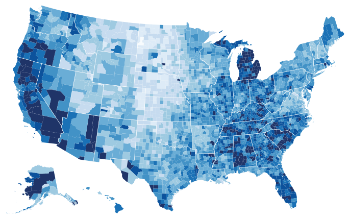

<a id="idiom:choropleth-maps"></a>

# Choropleth Map

## Idiom box

<!-- verbatim p.206 -->
> What: Data Geographic geometry data. Table with one quantitative attribute per region.
<!-- /verbatim -->

<!-- verbatim p.206 -->
> How: Encode Space: use given geometry for area mark boundaries. Color: sequential segmented colormap.
<!-- /verbatim -->

The box has no Why: Tasks or Scale field [p.206].

## What it is

<!-- verbatim p.206 -->
> A choropleth map shows a quantitative attribute encoded as color over regions delimited as area marks, where the shape of each region is determined by using given geometry.
<!-- /verbatim -->

- **Region shapes.** Either provided directly as the base dataset, or derived from base data through cartographic generalization choices [p.206].
- **Design choices.** The major ones are how to construct the colormap and which region boundaries to use [p.206].
- **Example.** Figure 8.2 maps 2008 US unemployment rates by county within states, with a segmented sequential white-to-blue colormap of nine levels of monotonically decreasing luminance [p.206].

## Use when / avoid when

- **Use** when a geographic dataset has one quantitative attribute per region and the central task is understanding spatial relationships, so given spatial position is the layout substrate [pp.204-206].
- **Avoid** when the task does not mainly involve spatial relationships; then which attributes to encode with spatial position is an open question again [p.205].
- **Take care** over region boundaries: the book points to Section 13.4.2 for the problem of spatial aggregation and its relationship to region boundaries [p.206].

## Figures

-  **Figure 8.2** [p.206]. Choropleth map showing regions as area marks using given geometry, where a quantitative attribute is encoded with color. From <http://bl.ocks.org/> mbostock/4060606.

## Alternatives and disambiguation

- **Size-coded point marks.** At the scale of a whole country a city can be a point mark, sized by a population table, rather than an area mark with its boundary shape [p.205].
- **Topographic Terrain Map.** Also layered on a geographic map, but shows a continuous 2D spatial field through derived isolines rather than one value per given region [pp.206-208].
- **Contour plot.** Colours the regions between isolines of a scalar field with a sequential colormap; its regions are derived from the field, not given geometry [p.208].

## Related

- [8.3 Geometry](../ch08-arrange-spatial-data/s08-03-geometry.md#s08.03.01): cartographic generalization and the geographic data behind region shapes [p.205]
- [8.2 Why Use Given?](../ch08-arrange-spatial-data/s08-02-why-use-given.md): why the given geometry, not another attribute, takes spatial position [p.204]
- [10.3.2 Ordered Colormaps](../ch10-map-color-other-channels/s10-03-colormaps/s10-03-02-ordered-colormaps.md): sequential colormaps, the colour choice in the box [p.206]
- [13.4.2 Spatial Aggregation](../ch13-reduce-items-attributes/s13-04-aggregate/s13-04-02-spatial-aggregation.md): how region boundaries affect aggregated values [p.206]
- [Topographic Terrain Map](topographic-terrain-map.md): the isoline idiom on geographic data [p.208]

## Implementation hints [NOT FROM BOOK]

### matplotlib

```python
import numpy as np, matplotlib.pyplot as plt
from matplotlib.collections import PolyCollection
from matplotlib.colors import BoundaryNorm
rng = np.random.default_rng(0)
polys = [[(i, j), (i + 1, j), (i + 1, j + 1), (i, j + 1)] for i in range(6) for j in range(4)]
rate = rng.uniform(2, 14, len(polys))  # one quantitative value per region
bins = np.linspace(2, 14, 10)          # nine segmented levels
norm = BoundaryNorm(bins, 256)
fig, ax = plt.subplots()
pc = PolyCollection(polys, array=rate, cmap="Blues", norm=norm, edgecolor="white")
ax.add_collection(pc); ax.autoscale(); ax.set_aspect("equal"); ax.axis("off")
fig.colorbar(pc, ax=ax, label="unemployment %")
```

With real boundaries, `geopandas.GeoDataFrame.plot(column=..., cmap="Blues", scheme="quantiles", k=9)` does the same.

### D3

```js
const color = d3.scaleQuantize().domain([0, 0.15]).range(d3.schemeBlues[9]);
const path = d3.geoPath(d3.geoAlbersUsa());
export function draw(svg, counties, rateById) {
  svg.selectAll("path").data(counties.features).join("path")
    .attr("d", path)
    .attr("fill", d => color(rateById.get(d.id)));
}
```
