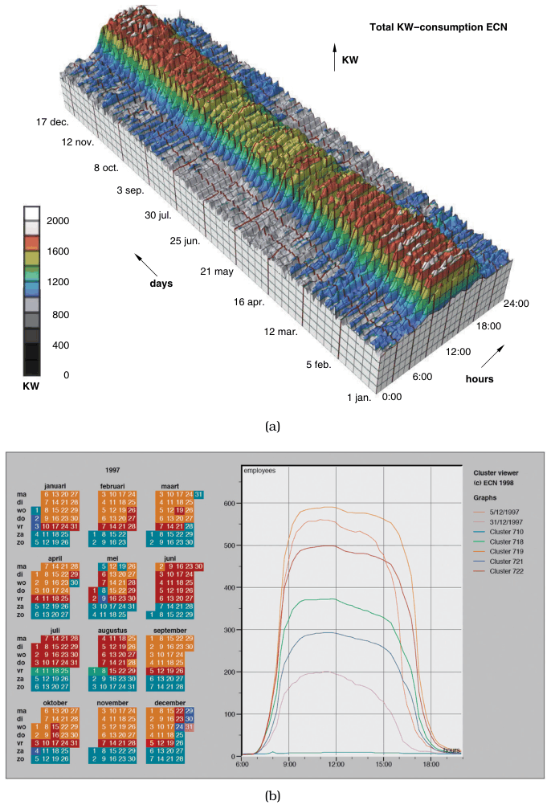

# Cluster–Calendar Time-Series Vis

## Idiom box

No idiom box in the book.

The book presents it as a worked example in Section 6.3.8, from a system by van Wijk and van Selow for browsing time-series data [p.150]. Summarised under the box facets:

- **What: Data.** Two related sets of measurements in an office building, the number of people inside and the amount of power used, each measured over the course of every day for one full year [pp.150-152].
- **What: Derived.** A hierarchical clustering of the daily time-series curves, built iteratively by merging the most similar curves into a cluster represented by the average of its curves [p.152].
- **Why: Tasks.** Browsing time-series data, comparing curve heights at all times of day, and finding temporal patterns at both large and small scales [pp.150-152].
- **How: Encode.** Multiple linked 2D views: one aggregate curve per highest-level cluster, all superimposed in one 2D view, beside a calendar view; the views are linked with shared colour coding [p.152].

## What it is

The design replaces a straightforward 3D representation, in which each day's power curve is a 2D cross-section extruded along a third axis (Figure 6.7(a)), with a different data abstraction and linked 2D views (Figure 6.7(b)) [p.152].

<!-- verbatim p.152 -->
> There are few enough of these aggregate curves that they can all be superimposed in the same 2D image without excessive visual clutter. Direct comparison between the curve heights at all times of the day is easy because there is no perspective distortion or occlusion.
<!-- /verbatim -->

The calendar is on the left; the book calls calendars a very traditional and successful way to show temporal patterns [p.152]. In this Dutch calendar weeks are vertical strips with the weekend at the bottom [p.152]. Reading the shared colours, weekends and holidays are the nearly flat teal curve with nobody in, normal weekdays the topmost tan curve, summer days and winter Fridays the brown curve with a hundred fewer people, summer Fridays the green curve with nearly half the staff gone, blue and magenta the days between holidays, and red the Dutch Santa Claus day, when everyone leaves an hour early [p.152].

The 2D version keeps the large-scale seasonal patterns visible in 3D and reveals smaller-scale patterns that are difficult or impossible to spot in the 3D view [p.152]. The two panels of Figure 6.7 do not show the same attribute: the cluster–calendar vis shows the number of people, the 3D extrusion shows power consumption [p.152].

## Use when / avoid when

- **Use** as the book's alternative to a 3D extruded surface of many daily curves, which shows only very large-scale patterns and suffers from occlusion and perspective distortion [pp.151-152].
- **Use** knowing that the superimposed view works in the example because there are few enough aggregate curves to superimpose without excessive visual clutter [p.152].
- **Use** to show temporal patterns by day of the calendar; the book calls calendars a very traditional and successful way to show temporal patterns [p.152].
- The book states no conditions for avoiding it [pp.150-152].

## Figures

-  **Figure 6.7** [p.151]. 3D versus 2D. (a) A 3D representation of this time-series dataset introduces the problems of occlusion and perspective distortion. (b) The linked 2D views of derived aggregate curves and the calendar allow direct comparison and show more fine-grained patterns. From [van Wijk and van Selow 99, Figures 1 and 4].

## Alternatives and disambiguation

- **3D extruded time-series surface.** The design this replaces: one curve per day along a third axis; shows only very large-scale patterns, with occlusion and perspective distortion [p.152].
- **Layer-Oriented Time-Series Vis.** Similar on the surface, but keeps 3D and justifies it through tight constraints, rather than replacing it with 2D views [p.153].
- **Superimposed Line Charts.** The aggregate-curve view is a set of superimposed curves; this idiom adds the derived clustering and the linked calendar [p.152].

## Related

- [6.3.8 Justification and Alternatives](../ch06-rules-thumb/s06-03-no-unjustified-3d/s06-03-08-justification-alternatives.md): the example in its context [p.150]
- [6.3.4 Perspective Distortion Dangers](../ch06-rules-thumb/s06-03-no-unjustified-3d/s06-03-04-perspective-distortion-dangers.md): why the 3D version's curve heights cannot be compared [p.152]
- [Layer-Oriented Time-Series Vis](layer-oriented-time-series-vis.md): the contrasting, justified use of 3D [p.153]
- [Superimposed Line Charts](superimposed-line-charts.md): the superimposition used for the aggregate curves [p.152]
- [12 Facet into Multiple Views](../ch12-facet-into-multiple-views/node.md): linked views, discussed there [p.152]
- [13.4.1 Item Aggregation](../ch13-reduce-items-attributes/s13-04-aggregate/s13-04-01-item-aggregation.md): aggregation, as in the averaged cluster curves [p.152]

## Implementation hints [NOT FROM BOOK]

### matplotlib

```python
import numpy as np, matplotlib.pyplot as plt, datetime as dt
rng = np.random.default_rng(0)
days = [dt.date(2024, 1, 1) + dt.timedelta(d) for d in range(366)]
hours = np.arange(24)
office = np.where((hours >= 8) & (hours < 18), 1.0, 0.0)
level = np.array([0.05 if d.weekday() >= 5 else 0.6 if d.weekday() == 4 else 1.0 for d in days])
curves = level[:, None] * office + rng.normal(0, 0.03, (len(days), 24))
clusters = [[i] for i in range(len(days))]          # agglomerative merge of most similar means
while len(clusters) > 3:
    means = np.array([curves[c].mean(0) for c in clusters])
    d = ((means[:, None] - means[None]) ** 2).sum(-1) + np.eye(len(means)) * 1e9
    i, j = np.unravel_index(d.argmin(), d.shape)
    clusters[i] += clusters.pop(j)
label = np.empty(len(days), int)
for k, c in enumerate(clusters):
    label[c] = k
colors = plt.cm.tab10(np.arange(len(clusters)))
fig, (cal, ax) = plt.subplots(1, 2, figsize=(11, 4), width_ratios=[2, 1])
for n, (d, k) in enumerate(zip(days, label)):       # weeks as vertical strips, weekend at bottom
    week = (n + days[0].weekday()) // 7
    cal.add_patch(plt.Rectangle((week, d.weekday()), 1, 1, color=colors[k]))
cal.set(xlim=(0, 53), ylim=(7, 0), xlabel="week", ylabel="weekday")
for k, c in enumerate(clusters):
    ax.plot(hours, curves[c].mean(0), color=colors[k], lw=2)
ax.set(xlabel="hour", ylabel="people (normalised)")
```

### D3

Calendar: `d3.timeDays(start, end)` with `d3.timeMonday.count(d3.timeYear(d), d)` for the column and `(d.getDay() + 6) % 7` for the row. Curves: one `d3.line()` path per cluster mean on shared `d3.scaleLinear` axes. Link both views through one `d3.scaleOrdinal(d3.schemeTableau10)` keyed by cluster id. Do the hierarchical clustering beforehand (for example in Python), since D3 has no clustering module.
