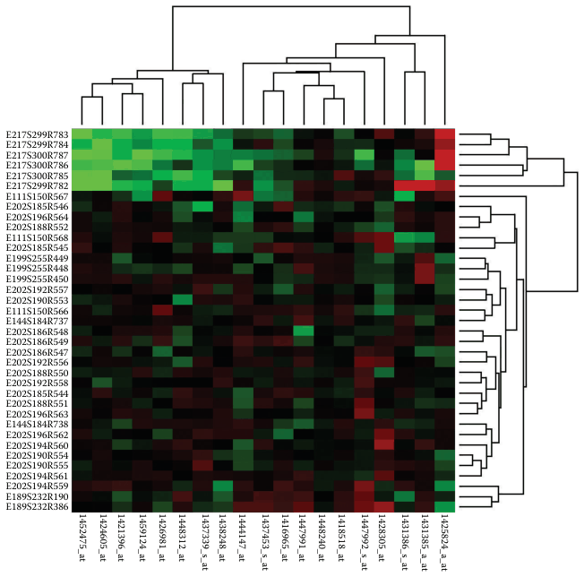

# Cluster Heatmaps

## Idiom box

<!-- verbatim p.185 -->
> What: Derived Two cluster hierarchies for table rows and columns.
<!-- /verbatim -->

<!-- verbatim p.185 -->
> How: Encode Heatmap: 2D matrix alignment, ordered by both cluster hierarchies. Dendrogram: connection line marks for parent–child relationships in tree.
<!-- /verbatim -->

The box gives only these two fields; it follows the Heatmaps box directly, and the book does not say whether the heatmap's Data, Task and Scale fields carry over [p.185].

## What it is

The cluster heatmap combines the basic heatmap with matrix reordering, where two attributes are reordered in combination [p.185]. The goal of matrix reordering is to group similar cells to check for large-scale patterns between both attributes, just as reordering a single attribute shows trends across it [p.185]. Synonyms include matrix permutation, seriation, ordination, biclustering, co-clustering and two-mode clustering [p.185].

It is the juxtaposed combination of a heatmap and two dendrograms showing the derived cluster hierarchies used for the reordering [p.185]. A cluster hierarchy records how a clustering algorithm operates iteratively: each leaf is a single-item cluster, interior nodes record the order in which clusters merge by similarity, and the root is the cluster of all items [p.185].

<!-- verbatim p.185 -->
> A dendrogram is a visual encoding of tree data with the leaves aligned so that the interior branch heights are easy to compare.
<!-- /verbatim -->

The final order of the matrix rows and columns comes from traversing the leaves of the trees [p.185].

## Use when / avoid when

- **Use** to find clusters and large-scale patterns between the two key attributes of a heatmap [p.185].
- The Cluster Heatmaps box has no Scale field; the Heatmaps box directly before it gives hundreds of levels per key and 3 to 11 value levels, and the book does not say whether these carry over [pp.184-185].

## Figures

-  **Figure 7.11** [p.184]. Cluster heatmap. A heatmap provides a compact summary of a quantitative value attribute with 2D matrix alignment by two key attributes and small area marks colored with a diverging colormap. The cluster heatmap includes trees drawn on the periphery showing how the matrix is ordered according to the derived data of hierarchical clusterings on its rows and columns.

## Alternatives and disambiguation

- **Heatmaps** are the basic idiom; a cluster heatmap adds matrix reordering by two cluster hierarchies and the juxtaposed dendrograms [p.185].
- **Reordering a single attribute** aims to show trends across it; a cluster heatmap reorders two attributes in combination to group similar cells [p.185].

## Related

- [7.5.2 Matrix Alignment: Two Keys](../ch07-arrange-tables/s07-05-separate-order-align-categorical/s07-05-02-matrix-alignment-two-keys.md): the section that presents this idiom [p.183]
- [13.4.1 Item Aggregation](../ch13-reduce-items-attributes/s13-04-aggregate/s13-04-01-item-aggregation.md): how the hierarchical clusterings behind the dendrograms are built [p.185]
- [7.8 Further Reading](../ch07-arrange-tables/s07-08-further-reading.md): histories of heatmaps, cluster heatmaps and matrix reordering [p.201]
- [Heatmaps](heatmaps.md): the unordered matrix it builds on [p.185]

## Implementation hints [NOT FROM BOOK]

### matplotlib

With SciPy, `scipy.cluster.hierarchy.linkage`, `dendrogram(Z, ax=..., orientation="left")` and `leaves_list(Z)` replace the `cluster` and `dendrogram` helpers below. This version needs only NumPy.

```python
import numpy as np
import matplotlib.pyplot as plt

def cluster(X):
    """Average-linkage agglomeration: leaf order and merges (a, b, height)."""
    D = np.linalg.norm(X[:, None] - X[None], axis=-1)
    groups, merges = {i: [i] for i in range(len(X))}, []
    while len(groups) > 1:
        keys = list(groups)
        h, a, b = min((D[np.ix_(groups[a], groups[b])].mean(), a, b) for i, a in enumerate(keys) for b in keys[i + 1:])
        groups[len(X) + len(merges)] = groups.pop(a) + groups.pop(b)
        merges.append((a, b, h))
    return next(iter(groups.values())), merges

def dendrogram(ax, order, merges, vertical):
    pos = {leaf: (i, 0.0) for i, leaf in enumerate(order)}
    for k, (a, b, h) in enumerate(merges, start=len(order)):
        (xa, ha), (xb, hb) = pos[a], pos[b]
        xs, hs = [xa, xa, xb, xb], [ha, h, h, hb]
        ax.plot(*((xs, hs) if vertical else (hs, xs)), color="0.3", lw=0.8)
        pos[k] = ((xa + xb) / 2, h)
    ax.set_axis_off()

rng = np.random.default_rng(4)
data = rng.normal(0, 1, (24, 10)) + np.repeat(rng.normal(0, 2, (3, 10)), 8, axis=0)
rows, row_merges = cluster(data)
cols, col_merges = cluster(data.T)

fig, axes = plt.subplots(2, 2, figsize=(6, 7), width_ratios=[1, 4], height_ratios=[1, 4], sharex="col", sharey="row")
axes[0, 0].set_axis_off()
limit = np.abs(data).max()
axes[1, 1].imshow(data[np.ix_(rows, cols)], cmap="RdBu_r", vmin=-limit, vmax=limit, aspect="auto")
dendrogram(axes[0, 1], cols, col_merges, vertical=True)
dendrogram(axes[1, 0], rows, row_merges, vertical=False)
axes[1, 0].invert_xaxis()
```

### D3

D3 has no clustering. Compute the hierarchy elsewhere, load it with `d3.hierarchy`, lay it out with `d3.cluster()` so the leaves align, draw the links with `d3.linkHorizontal`, and set each heatmap axis to `d3.scaleBand().domain(root.leaves().map(d => d.data.id))`.
