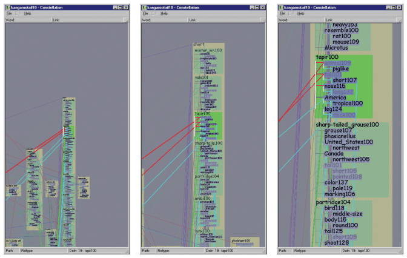

# Constrained Navigation

## Idiom box

No idiom box in the book.

- **What: Data.** Any view navigated with a camera, 2D or 3D [pp.281-282].
- **Why: Tasks.** Reach a useful viewpoint easily, keep context, and avoid empty or lost views [pp.281-282].
- **How: Manipulate.** Navigate with limits on the camera's possible motion, often by animated transition to a selected item [p.282].

## What it is

<!-- verbatim p.282 -->
> In contrast, constrained navigation idioms have some kind of limit on the possible motion of the camera.
<!-- /verbatim -->

- **Limit the zoom range** (one of the simplest 2D approaches): no farther out than where the whole scene is visible, no farther in than the size of the smallest object [p.282].
- **Frame a selected item.** The user selects an item; the system computes a smooth camera trajectory for an animated transition to a better viewpoint for it, maintaining context [p.282].
- **Framing rules (Figure 15.20).** Zoomed in enough that labels are clearly visible, out enough that the whole object fits, and panned so it is in frame; a click anywhere in the box around a set of words frames the whole object rather than zooming to that point [p.282].
- **3D orientation.** End looking straight down at the object along a perpendicular vector, with the camera's up vector matching the object's vertical axis [p.282].
- **Linked navigation.** Clicking an item in a sortable list or table view, good for searching known names, can frame it in another, more elaborate view built for browsing local neighbourhoods with a very different spatial encoding [p.282].

## Use when / avoid when

- **Use** when users would struggle with free navigation: reaching a desired viewpoint is hard, especially with six degrees of freedom in 3D, a skill few people have [p.281].
- **Use** when free navigation's problems matter: the viewpoint easily ends up inside objects meant to be solid (collision detection is costly and separate from drawing), or pointed at nothing, in 3D and also with unconstrained 2D pan and zoom; a reset-view button is a good idea but far from a complete solution [pp.281-282].
- **Use** combined with linked navigation between multiple views, where it is particularly powerful [p.282].
- **Keep unconstrained navigation as a backup** for uncommon cases needing fully general controls; many tools offer constrained shortcuts for common use plus free navigation [p.283].

## Figures

-  **Figure 15.20** [p.391]. Constellation uses a subtle version of the semantic zooming design choice, where the space allocated for the first word versus the rest of the definition changes according to the zoom level. From [Munzner 00, Figure 5.19].

## Alternatives and disambiguation

- **Unconstrained navigation** lets the camera move anywhere; it is easy for graphics programmers to implement but hard for users [p.281].
- **Geometric and semantic zooming** say how items are drawn as the camera moves; constrained navigation says where the camera may go [pp.280-282].
- **Animated Transitions** are the means by which a constrained trajectory keeps context [p.282].

## Related

- [11.5 Navigate: Changing Viewpoint](../ch11-manipulate-view/s11-05-navigate-changing-viewpoint.md#s11.05.03): the idiom in context [p.281]
- [Animated Transitions](animated-transitions.md): the transitions along the computed trajectory [p.282]
- [11.4.3 Selection Outcomes](../ch11-manipulate-view/s11-04-select-elements/s11-04-03-selection-outcomes.md): centring a selected item as a selection outcome [p.279]
- [15.8 Constellation](../ch15-analysis-case-studies/s15-08-constellation.md): the Figure 15.20 framing example [p.282]
- [12.3 Juxtapose and Coordinate Views](../ch12-facet-into-multiple-views/s12-03-juxtapose-coordinate-views/node.md): linked navigation between views [p.282]
- [11.7 Further Reading](../ch11-manipulate-view/s11-07-further-reading.md): constrained 3D navigation and smooth 2D trajectories [p.287]

## Implementation hints [NOT FROM BOOK]

### matplotlib

Clamp limits in a callback to bound the zoom range, and frame a chosen item with a margin.

```python
import numpy as np, matplotlib.pyplot as plt
rng = np.random.default_rng(3)
xy = rng.random((200, 2)) * 100
fig, ax = plt.subplots()
ax.scatter(*xy.T, s=8)
FULL, MIN_SPAN = (0, 100), 2.0  # whole scene, smallest object size

def clamp(ax):
    lo, hi = ax.get_xlim()
    span = min(max(hi - lo, MIN_SPAN), FULL[1] - FULL[0])
    lo = min(max(lo, FULL[0]), FULL[1] - span)
    if (lo, lo + span) != (ax.get_xlim()):
        ax.set_xlim(lo, lo + span)

def frame(i, pad=5):
    x, y = xy[i]
    ax.set_xlim(x - pad, x + pad); ax.set_ylim(y - pad, y + pad)

ax.callbacks.connect("xlim_changed", clamp)
frame(0)
```

### D3

```js
const zoom = d3.zoom()
  .scaleExtent([1, 40])                       // limit zoom range
  .translateExtent([[0, 0], [width, height]]) // never pan to empty space
  .on("zoom", ({ transform }) => g.attr("transform", transform));
svg.call(zoom);
function frameItem([[x0, y0], [x1, y1]]) {  // bounding box of the selected item
  const k = Math.min(40, 0.9 / Math.max((x1 - x0) / width, (y1 - y0) / height));
  const t = d3.zoomIdentity.translate(width / 2, height / 2).scale(k).translate(-(x0 + x1) / 2, -(y0 + y1) / 2);
  svg.transition().duration(750).call(zoom.transform, t);  // smooth trajectory: d3.interpolateZoom
}
```
