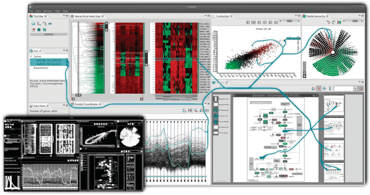

# Context-Preserving Visual Links

## Idiom box

<!-- verbatim p.278 -->
> What: Data Any data.
<!-- /verbatim -->

<!-- verbatim p.278 -->
> How: Encode Any encoding. Highlight with link marks connecting items across views.
<!-- /verbatim -->

<!-- verbatim p.278 -->
> How: Manipulate Select any element.
<!-- /verbatim -->

<!-- verbatim p.278 -->
> (How: Coordinate) Juxtaposed multiple views.
<!-- /verbatim -->

The box gives no Why: Tasks or Scale field [p.278].

## What it is

<!-- verbatim p.278 -->
> Figure 11.6 shows the idiom of context-preserving visual links, where links are drawn as curves that are carefully routed between existing elements in a vis [Steinberger et al. 11].
<!-- /verbatim -->

The route trades off four criteria [p.278]:

- minimise link lengths [p.278];
- minimise occlusion of salient regions [p.278];
- maximise the difference between the link's colour and the colours of existing elements it crosses [p.278];
- maximise bundling of links together [p.278].

It applies the highlighting choice of adding connection marks between objects in the selection set, which explicitly draws links, in contrast to the implicit choices that change existing marks [pp.277-278].

## Use when / avoid when

- **Use** to highlight a selection across juxtaposed multiple views, with any data and any encoding [p.278].
- **Explicit, not implicit.** The links are added connection marks, in contrast to the other highlight choices, which change existing marks [pp.277-278].
- The book gives no failure cases or scale limits for the idiom [p.278].

## Figures

-  **Figure 11.6** [p.278]. The context-preserving visual links idiom is an example of the design choice to coordinate betweeen views by explicitly drawing links as connection marks between items and regions of interest. From [Steinberger et al. 11, Figure 1].

## Alternatives and disambiguation

- **Highlighting by colour, outline, size, shape or motion** changes existing marks implicitly; visual links add explicit connection marks [pp.277-278].
- **Edge bundling**, one of the routing criteria, is discussed in Section 12.5.2 [p.278].

## Related

- [11.4.2 Highlighting](../ch11-manipulate-view/s11-04-select-elements/s11-04-02-highlighting.md): the idiom in context [p.278]
- [Highlighting](highlighting.md): the other highlight choices [p.277]
- [12.5.2 Static Layers](../ch12-facet-into-multiple-views/s12-05-superimpose-layers/s12-05-02-static-layers.md): edge bundling, one of the link-routing criteria [p.278]
- [12.3 Juxtapose and Coordinate Views](../ch12-facet-into-multiple-views/s12-03-juxtapose-coordinate-views/node.md): juxtaposed multiple views the links coordinate [p.278]

## Implementation hints [NOT FROM BOOK]

### matplotlib

`ConnectionPatch` draws a curve between points in different axes. It does no occlusion-aware routing.

```python
import matplotlib.pyplot as plt
from matplotlib.patches import ConnectionPatch
fig, (a1, a2) = plt.subplots(1, 2, figsize=(8, 3))
a1.bar(["A", "B", "C"], [3, 5, 2]); a2.scatter([1, 2, 3], [2, 6, 4])
sel = (1, 5, (2, 6))  # bar B top in a1, its point in a2
con = ConnectionPatch(xyA=(sel[0], sel[1]), coordsA=a1.transData, xyB=sel[2], coordsB=a2.transData,
                      connectionstyle="arc3,rad=-0.3", color="magenta", lw=2, alpha=0.8)
fig.add_artist(con)
```

### D3

```js
// overlay SVG spanning all views; link the centres of selected elements
const centre = el => { const r = el.getBoundingClientRect(), o = overlay.node().getBoundingClientRect();
  return [r.x + r.width / 2 - o.x, r.y + r.height / 2 - o.y]; };
const link = d3.link(d3.curveBumpX).source(d => centre(d[0])).target(d => centre(d[1]));
overlay.selectAll("path").data(pairs).join("path")
  .attr("d", link).attr("fill", "none").attr("stroke", "magenta").attr("stroke-width", 2);
```
