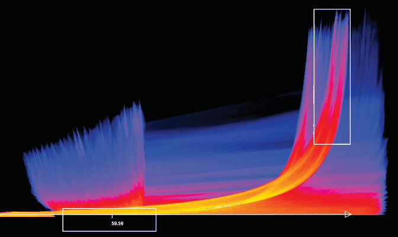

# Continuous Scatterplots

## Idiom box

<!-- verbatim p.333 -->
> What: Data Table: two quantitative value attributes.
<!-- /verbatim -->

<!-- verbatim p.333 -->
> What: Derived Derived table: two ordered key attributes (x, y pixel locations), one quantitative attribute (overplot density).
<!-- /verbatim -->

<!-- verbatim p.333 -->
> How: Encode Dense space-filling 2D matrix alignment, sequential categorical hue + ordered luminance colormap.
<!-- /verbatim -->

<!-- verbatim p.333 -->
> How: Reduce Item aggregation.
<!-- /verbatim -->

The box has no Why: Tasks or Scale field [p.333].

## What it is

Continuous scatterplots solve the occlusion problem of scatterplots by plotting an aggregate value at each pixel rather than drawing every item as a point [p.332]. Colour at each pixel shows the density of overplotting, often with transparency [p.332]. Conceptually this uses a derived attribute, overplot density, calculated after the layout is computed; in practice many hardware acceleration techniques avoid calculating it explicitly [p.332]. The layout is a dense, space-filling 2D matrix alignment in which each pixel gets a different colour [p.333].

Figure 13.6 shows a tornado air-flow dataset, velocity magnitude horizontally and z-direction velocity vertically, with density on a log-scale sequential colormap of monotonically increasing luminance: dark blues at the low end, reds in the middle, yellows and whites at the high end [p.332].

## Use when / avoid when

- **Use** when many dots would be overplotted on the same location, a major readability problem for scatterplots that size coding and text labels make worse [p.332].
- **Use** for scalability to large datasets [p.332].
- **Continuous data.** Scatterplots began as an idiom for discrete, categorical data and were generalised to density functions for continuous data, giving continuous scatterplots in 2D [pp.332-333].

## Figures

-  **Figure 13.6** [p.332]. The continuous scatterplot idiom uses color to show the density at each location, solving the problem of occlusion from overplotting and allowing scalability to large datasets. From [Bachthaler and Weiskopf 08, Figure 9].

## Alternatives and disambiguation

- **Scatterplots** have a similar name, but analysis via the framework of design choices shows the approach is very different: discrete point marks against a dense, per-pixel aggregate in matrix alignment [p.333].
- **Continuous histograms** are the 1D case of the same density-function framework [p.333].

## Related

- [13.4.1 Item Aggregation](../ch13-reduce-items-attributes/s13-04-aggregate/s13-04-01-item-aggregation.md): the section that presents the idiom [p.332]
- [Scatterplots](scatterplots.md): the discrete idiom this one aggregates [p.333]
- [Histograms](histograms.md): the 1D aggregation of one quantitative attribute [p.333]
- [7.5.2 Matrix Alignment: Two Keys](../ch07-arrange-tables/s07-05-separate-order-align-categorical/s07-05-02-matrix-alignment-two-keys.md): the 2D matrix alignment the derived x, y pixel keys use [p.333]
- [Ordered Colormaps](ordered-colormaps.md): the sequential luminance colormap used for density [p.332]

## Implementation hints [NOT FROM BOOK]

### matplotlib

```python
import numpy as np, matplotlib.pyplot as plt
from matplotlib.colors import LogNorm
rng = np.random.default_rng(0)
x = rng.normal(size=200_000)
y = x * 0.6 + rng.normal(scale=0.8, size=x.size)
fig, ax = plt.subplots()
h = ax.hist2d(x, y, bins=300, norm=LogNorm(), cmap="inferno")
fig.colorbar(h[3], ax=ax, label="items per bin (log)")
```

`ax.hexbin(x, y, gridsize=150, bins="log")` is a hexagonal alternative; datashader rasterises truly per pixel for millions of points.

### D3

Bin to pixels on a `canvas`: accumulate counts in a `Float32Array(width * height)` at `(Math.floor(x(d.x)), Math.floor(y(d.y)))`, then colour each non-zero pixel with `d3.scaleSequentialLog(d3.interpolateInferno).domain([1, maxCount])` via `ImageData`, leaving empty pixels as background because a log scale is undefined at zero. For smoothed density use `d3.contourDensity().x(d => x(d.x)).y(d => y(d.y)).bandwidth(2)(data)` and fill the contours.
