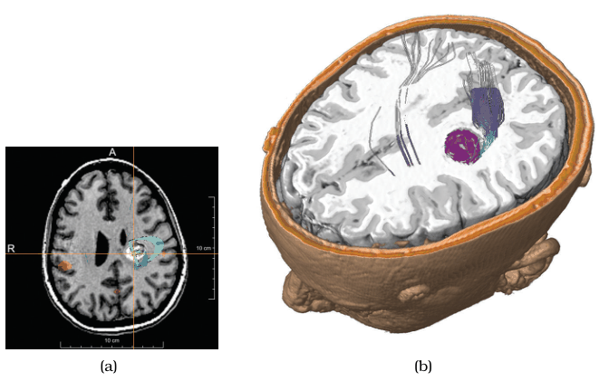

# Cut

## Idiom box

No idiom box in the book.

- **What: Data.** Typically a 3D spatial volume, such as medical image data [p.285].
- **Why: Tasks.** See features in the interior of a 3D volume while keeping 3D context [p.285].
- **How: Manipulate.** Navigate to reduce attributes by positioning a cutting plane and hiding everything on the camera's side of it [p.285].

## What it is

<!-- verbatim p.285 -->
> The interaction idiom of cut allows the user to position a plane that divides the viewing volume in two, and everything on the side of the plane nearest to the camera viewpoint is not shown.
<!-- /verbatim -->

- It separates the volume into two parts with a plane and eliminates everything on one side, an idea motivated by the camera metaphor [pp.268-269].
- The plane can be axis aligned or arbitrarily oriented, as with slices; in computer graphics it is often called a clipping plane [p.285].
- **Figure 11.8(b)** cuts medical brain data at the same level as the slice in Figure 11.8(a) [p.285].
- Figure 8.6(c) also shows a cutting plane on a human head dataset, with direct volume rendering [p.285].

## Use when / avoid when

- **Use** to see features in the interior of a 3D volume [p.285].
- **Use** instead of a slice when the 3D context behind the plane matters: the cut shows more than the 2D slice alone [p.285].
- The book gives no failure cases for cutting [p.285].

## Figures

-  **Figure 11.8** [p.284]. The slice choice eliminates a dimension/attribute by extracting only the items with a chosen value in that dimension. The cut choice eliminates all data on one side of a spatial cutting plane. (a) Axis-aligned slice. (b) Axis-aligned cut. From [Rieder et al. 08, Figures 7c and 0].

## Alternatives and disambiguation

- **Slice** keeps only the items on the plane; cut keeps everything behind the plane as well [p.285].
- **Project** keeps every item and drops dimensions rather than removing half the volume [p.286].

## Related

- [11.6 Navigate: Reducing Attributes](../ch11-manipulate-view/s11-06-navigate-reducing-attributes.md#s11.06.02): the idiom in context [p.285]
- [Slice](slice.md): the context-free alternative at the same plane [p.285]
- [8.4.2 Direct Volume Rendering](../ch08-arrange-spatial-data/s08-04-scalar-fields-one-value/s08-04-02-direct-volume-rendering.md): the encoding the Figure 8.6(c) cut uses [p.285]
- [Multidimensional Transfer Functions](multidimensional-transfer-functions.md): the second figure printed as 8.6, with the cut head dataset [p.285]

## Implementation hints [NOT FROM BOOK]

### matplotlib

Matplotlib's 3D is limited; `ax.voxels` with a mask shows the idea for small volumes. Use VTK or PyVista (`clip`) for real volumes.

```python
import numpy as np, matplotlib.pyplot as plt
n = 16
x, y, z = np.indices((n, n, n))
solid = (x - n / 2) ** 2 + (y - n / 2) ** 2 + (z - n / 2) ** 2 < (n / 2.2) ** 2
inner = (x - n / 2) ** 2 + (y - n / 2) ** 2 + (z - n / 2) ** 2 < (n / 4) ** 2
cut_at = n // 2
keep = solid & (y >= cut_at)  # drop the half nearest the camera
colors = np.where(inner, "crimson", "lightgray")
ax = plt.figure().add_subplot(projection="3d")
ax.voxels(keep, facecolors=colors, edgecolor="none")
ax.view_init(elev=20, azim=-90)
```

### D3

D3 has no 3D volume rendering; a snippet would mislead. Use a WebGL library: three.js `renderer.localClippingEnabled = true` with `material.clippingPlanes = [new THREE.Plane(normal, constant)]`, and drive `constant` from a `d3.select("input").on("input", …)` control.
