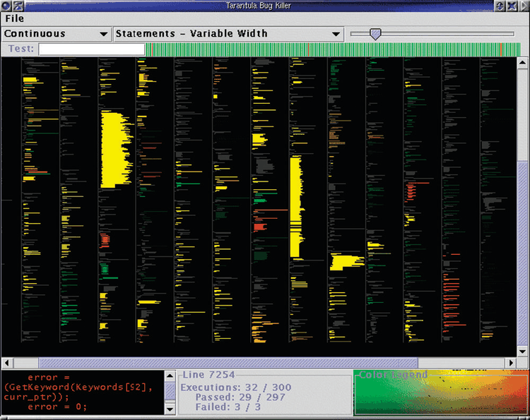

# Dense Software Overviews

## Idiom box

<!-- verbatim p.199 -->
> What: Data Text with numbered lines (source code, test results log).
<!-- /verbatim -->

<!-- verbatim p.199 -->
> What: Derived Two quantitative attributes (test execution results).
<!-- /verbatim -->

<!-- verbatim p.199 -->
> How: Encode Dense layout. Spatial position and line length from text ordering. Color channels of hue and brightness.
<!-- /verbatim -->

<!-- verbatim p.199 -->
> Why: Task Locate faults, summarize results and coverage.
<!-- /verbatim -->

<!-- verbatim p.199 -->
> Scale Lines of text: ten thousand.
<!-- /verbatim -->

<!-- verbatim p.199 -->
> (How: Facet) Same encoding, same dataset, global overview with detail showing subset of data, different resolutions, linking with color.
<!-- /verbatim -->

<!-- verbatim p.199 -->
> (How: Reduce) Detail: filter to local neighborhood of selection
<!-- /verbatim -->

The bracketed fields cover material from later chapters on faceting and reducing, included because the example is a full system using several idioms [p.198].

## What it is

A dense layout uses small, densely packed marks to give an overview of as many items as possible with very high information density; a synonym is pixel-oriented [p.197]. Maximally dense marks are a single pixel, so only planar position and colour can encode data [p.197].

Dense displays using line marks have become popular for overviews of source code: the order and length of the lines of code dictate the arrangement, and colour encodes an attribute of interest [p.197]. The book's example is Tarantula, a tool for visualising test coverage (Figure 7.20) [p.197]. Most of its screen is a dense overview of one-pixel-tall lines coloured by whether they passed, failed or had mixed results in a test suite [p.197]. The code is illegible at that resolution, but indentation and line length are preserved as landmarks that convey code structure, and the layout wraps one long list into several columns [p.197]. A small detail view shows a few lines at legible size with the same colour coding [p.197].

Tarantula derives two quantitative attributes from the tests: brightness encodes coverage percentage (dark is low, bright is high), and hue encodes the relative percentage of passed versus failed tests [p.198]. The book describes each test's categorical attribute as "test or fail"; the wording is ambiguous, since the surrounding text speaks of passed and failed tests [p.198].

## Use when / avoid when

- **Use** for an overview of highly structured, line-ordered text when tasks need reading short snippets in their original order, but only a few units at a time; a dense overview for orientation plus a legible detail view is reasonable for that [pp.197-198].
- **Keep the order of lines**: reordering or ignoring line order within a method would not be an appropriate transformation for software tasks [p.197].
- **Scale**: around ten thousand lines of code, using about one thousand vertical pixels and ten columns [p.197].
- **Avoid** channels that need room: size, shape, tilt and curvature are unavailable at single-pixel mark size [p.197].

## Figures

-  **Figure 7.20** [p.198]. Tarantula shows a dense overview of source code with lines color coded by execution status of a software test suite. From [Jones et al. 02, Figure 4].

## Alternatives and disambiguation

- **VisDB** is a dense display for multidimensional tables using point marks rather than line marks [p.197].
- **SeeSoft** was an early dense layout for text and source code; Tarantula is a later system using the same design choice [p.201].
- **Space-filling layouts** such as treemaps fill all available space; dense and space-filling are related but not identical choices [p.196]. Treemaps are one such layout [p.199].

## Related

- [7.7 Spatial Layout Density](../ch07-arrange-tables/s07-07-spatial-layout-density.md): the section that presents this idiom [p.197]
- [15.4 VisDB](../ch15-analysis-case-studies/s15-04-visdb.md): a dense display with point marks [p.197]
- [12.3 Juxtapose and Coordinate Views](../ch12-facet-into-multiple-views/s12-03-juxtapose-coordinate-views/node.md): the overview and detail choice [p.198]
- [Treemaps](treemaps.md): a space-filling layout using containment [p.199]

## Implementation hints [NOT FROM BOOK]

### matplotlib

Paint one pixel row per line of code into an RGB image, wrapping into columns. Hue runs from red (failing) to green (passing), and brightness is coverage.

```python
import numpy as np
import matplotlib.pyplot as plt
from matplotlib.colors import hsv_to_rgb

rng = np.random.default_rng(7)
n_lines, rows, width, gap = 4000, 500, 60, 8
indent = np.clip(np.cumsum(rng.choice([-4, 0, 0, 0, 4], n_lines)), 0, 24)
length = rng.integers(5, width - 25, n_lines)
pass_ratio = np.clip(np.convolve(rng.uniform(0, 1, n_lines), np.ones(40) / 40, "same") * 1.6 - 0.3, 0, 1)
coverage = rng.uniform(0.3, 1, n_lines)

cols = -(-n_lines // rows)
image = np.ones((rows, cols * (width + gap), 3))
for i in range(n_lines):
    r, c = i % rows, i // rows
    x0 = c * (width + gap) + indent[i]
    image[r, x0:x0 + length[i]] = hsv_to_rgb([pass_ratio[i] / 3, 1, coverage[i]])

fig, ax = plt.subplots(figsize=(8, 6))
ax.imshow(image, interpolation="nearest", aspect="auto")
ax.set_axis_off()
```

### D3

Draw on a `<canvas>` rather than SVG at this density.

```js
const ctx = canvas.getContext("2d");
const color = d => d3.hsl(120 * d.passRatio, 1, 0.15 + 0.4 * d.coverage);
lines.forEach((d, i) => {
  const col = Math.floor(i / rows);
  ctx.fillStyle = color(d);
  ctx.fillRect(col * (colWidth + gap) + d.indent, i % rows, d.length, 1);
});
```
