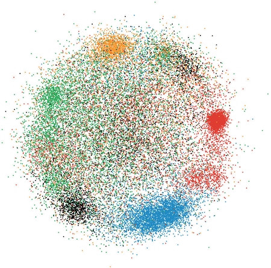
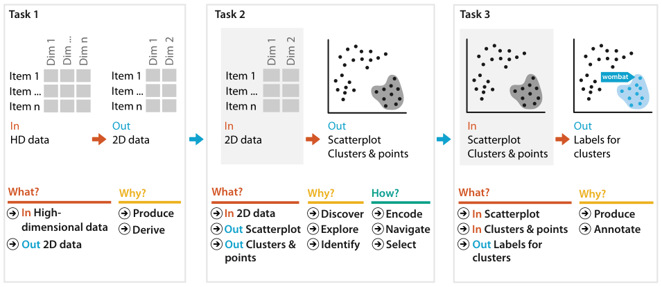

# Dimensionality Reduction for Document Collections

## Idiom box

<!-- verbatim p.344 -->
> What: Data Text document collection.
<!-- /verbatim -->

<!-- verbatim p.344 -->
> What: Derived Table with 10,000 attributes.
<!-- /verbatim -->

<!-- verbatim p.344 -->
> What: Derived Table with two attributes.
<!-- /verbatim -->

<!-- verbatim p.344 -->
> How: Encode Scatterplot, colored by conjectured clustering.
<!-- /verbatim -->

<!-- verbatim p.344 -->
> How: Reduce Attribute aggregation (dimensionality reduction) with MDS.
<!-- /verbatim -->

<!-- verbatim p.344 -->
> Scale Original attributes: 10,000. Derived attributes: two. Items: 100,000.
<!-- /verbatim -->

The box has no Why: Tasks field; the text gives the tasks [pp.342-344].

## What it is

Document collections of thousands to millions of texts, too many to read, are not directly visualisable but can be transformed into a derived high-dimensional table [p.341]. Each document becomes a bag of words: word order is ignored and each word's uses are counted, giving a feature vector over every word in the collection [p.341]. Very common words are typically removed, yet vectors can still hold tens of thousands of words, and they are very sparse [p.341]. Dimensionality reduction then derives a much smaller set of new attributes that still represents much of the structure: same items, just a few attributes [p.342].

The book analyses the scenario as a chained sequence (Figure 13.13) [p.342]:

1. **Derive.** Produce a low-dimensional table from the high-dimensional one using multidimensional scaling [p.342].
2. **Encode and discover.** Show the low-dimensional data as a scatterplot colour coded by a conjectured clustering; the user verifies whether there are visible clusters and identifies those with semantic meaning [p.342]. In Figure 13.12, reduced with the Glimmer MDS algorithm, the user navigates the scatterplot, and selecting a point shows document keywords in a popup and the full text in another view [p.342].
3. **Annotate.** Produce text labels for the verified clusters [p.342].

## Use when / avoid when

- **Use** to analyse the differential distribution of words between documents, or to find clusters of related documents by common word use [p.342].
- **Use** for cluster discovery: verifying a conjectured cluster structure or finding unknown structure [p.342].
- **Do not read correlation** into the scatterplot: DR collapses correlated dimensions into synthetic dimensions designed not to be correlated [p.344].
- **Read only relative distances and large-scale structure.** Absolute positions are not meaningful, and fine-grained structure is not strongly reliable because some information is lost in the reduction [p.345].
- **Avoid 3D.** 2D scatterplots or SPLOMs are the safest choices for DR data; 3D scatterplots and 3D landscapes are problematic [p.345].

## Figures

-  **Figure 13.12** [p.343]. Dimensionality reduction of a large document collection using Glimmer for multidimensional scaling. The results are laid out in a single 2D scatterplot, allowing the user to verify that the conjectured clustering shown with color coding is partially supported by the spatial layout. From [Ingram et al. 09, Figure 8].
-  **Figure 13.13** [p.343]. A chained sequence of what–why–how analysis instances for the scenario of dimensionality reduction of document collection data.

## Alternatives and disambiguation

- **Scatterplot matrix (SPLOM)** is the choice when more than two synthetic attributes are created [p.344].
- **Attribute filtering** eliminates attributes rather than synthesising new ones; DR usually means attribute synthesis through aggregation, not filtering [p.341].
- **3D scatterplots and 3D landscapes** have been proposed for DR data but suffer the problems of 3D representations [p.345].

## Related

- [13.4.3 Attribute Aggregation: Dimensionality Reduction](../ch13-reduce-items-attributes/s13-04-aggregate/s13-04-03-attribute-aggregation-dimensionality-reduction.md): DR in general and how to show and read its output [p.341]
- [3.4.2 Produce](../ch03-why-task-abstraction/s03-04-actions/s03-04-02-produce.md#s03.04.02.03): deriving new data, which both stages do [p.341]
- [Scatterplots](scatterplots.md): the encoding for two synthetic attributes [p.344]
- [Scatterplot Matrix (SPLOM)](scatterplot-matrix-splom.md): the encoding for more than two [p.344]
- [6.3 No Unjustified 3D](../ch06-rules-thumb/s06-03-no-unjustified-3d/node.md): why 3D views of DR data are a poor choice [p.345]

## Implementation hints [NOT FROM BOOK]

### matplotlib

```python
import numpy as np, matplotlib.pyplot as plt
rng = np.random.default_rng(0)
centres = rng.normal(0, 4, (4, 50))
conjectured = rng.integers(0, 4, 300)
X = centres[conjectured] + rng.normal(size=(300, 50))
D2 = ((X[:, None] - X[None]) ** 2).sum(-1)
J = np.eye(300) - 1 / 300
B = -0.5 * J @ D2 @ J
vals, vecs = np.linalg.eigh(B)
xy = vecs[:, -2:] * np.sqrt(vals[-2:])
fig, ax = plt.subplots()
ax.scatter(xy[:, 0], xy[:, 1], c=conjectured, cmap="tab10", s=10)
ax.set_aspect("equal")
ax.set_xticks([]); ax.set_yticks([])
```

This is classical (linear) MDS in NumPy; for real text use scikit-learn's `TfidfVectorizer` with `TruncatedSVD` or `sklearn.manifold.MDS`, or UMAP; hide axis ticks because absolute positions carry no meaning.

### D3

D3 has no MDS; compute coordinates offline (scikit-learn, `druid.js`) and plot with `d3.scaleLinear` on both axes using one shared extent, colour with `d3.scaleOrdinal(d3.schemeTableau10)`, and wire `d3.zoom()` for navigation and a click handler that shows the document's keywords.
