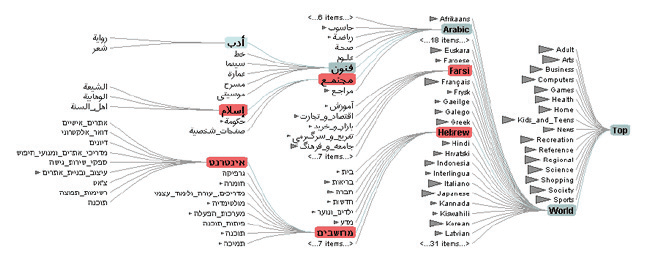

# DOITrees Revisited

## Idiom box

No idiom box in the book.

The book describes DOITrees Revisited in a System box rather than an Idiom box; its fields are quoted here [p.350].

<!-- verbatim p.350 -->
> What: Data Tree.
<!-- /verbatim -->

<!-- verbatim p.350 -->
> How: Encode Node–link layout.
<!-- /verbatim -->

<!-- verbatim p.350 -->
> How: Reduce Embed: elide, multiple foci.
<!-- /verbatim -->

<!-- verbatim p.350 -->
> Scale Nodes: hundreds of thousands.
<!-- /verbatim -->

## What it is

The system uses multiple foci to show an elided version of a 600,000-node tree [p.350]. Shaded triangles give an aggregate representation of the size of each elided subtree [p.350]. The context is computed by tree traversal from the focus nodes up towards their common ancestors and the root, so distance is topological, counted in hops through the tree, rather than geometric [p.350]. Focus nodes are chosen explicitly by clicking or indirectly through search [p.350].

It is the book's worked example for the degree of interest function DOI = I(x) − D(x, y), where I is an interest function, D a semantic or spatial distance, x an item's location and y the current focus point; algorithms threshold the continuous function into focus items to show, context items to aggregate and items to elide [pp.349-350]. Such functions typically exploit hierarchical structure [p.350].

## Use when / avoid when

- **Use** for a very large tree, up to hundreds of thousands of nodes, where several focus nodes must be seen in detail with their ancestors as context [p.350].
- **Focus selection.** Focus nodes can be chosen explicitly by clicking, or indirectly through searching [p.350].
- The book states no avoid condition for this system [pp.349-350].

## Figures

-  **Figure 14.2** [p.350]. DOITrees Revisited uses elision to show multiple focus nodes within context in a 600,000 node tree. From [Heer and Card 04, Figure 1].

## Alternatives and disambiguation

- **Toolglass and Magic Lenses.** Shows focus in a local superimposed layer rather than omitting items [p.351].
- **Hyperbolic Geometry and Stretch and Squish Navigation.** Fit large trees by geometric distortion rather than elision [pp.354-358].

## Related

- [14.3 Elide](../ch14-embed-focus-context/s14-03-elide.md): the elision choice and the DOI framework [p.349]
- [13.3.1 Item Filtering](../ch13-reduce-items-attributes/s13-03-filter/s13-03-01-item-filtering.md): the filtering that elision applies dynamically [p.349]
- [13.4.1 Item Aggregation](../ch13-reduce-items-attributes/s13-04-aggregate/s13-04-01-item-aggregation.md): the aggregation behind the subtree triangles [p.350]
- [9.2 Connection: Link Marks](../ch09-arrange-networks-trees/s09-02-connection-link-marks.md): node–link tree layouts [p.350]

## Implementation hints [NOT FROM BOOK]

### matplotlib

```python
import networkx as nx, matplotlib.pyplot as plt
T = nx.balanced_tree(3, 6)
foci = [700, 1000]
D = nx.single_source_shortest_path_length
keep = set()
for f in foci:
    keep |= set(nx.shortest_path(T, 0, f))          # path to root is context
    keep |= {n for n, d in D(T, f, cutoff=1).items()}
depth = D(T, 0)
parent = {c: p for p, c in nx.bfs_edges(T, 0)}
S = T.subgraph(keep)
pos = nx.bfs_layout(S, 0)
pos = {n: (y, -x) for n, (x, y) in pos.items()}     # root on top
fig, ax = plt.subplots()
nx.draw(S, pos, ax=ax, node_size=10)
for n in keep:                                     # elided subtrees as triangles
    hidden = [c for c in T[n] if c not in keep and depth[c] > depth[n]]
    if hidden:
        size = sum(len(nx.descendants(nx.bfs_tree(T, 0), c)) + 1 for c in hidden)
        ax.scatter(*pos[n], marker="v", s=size ** 0.5 * 10, alpha=0.3, c="grey")
```

### D3

Build a `d3.hierarchy`, compute a DOI per node (for example `-depth - hops to nearest focus`), keep nodes above a threshold, and lay the kept subtree out with `d3.tree()`; replace each pruned child list with a `path` triangle whose width scales with the pruned `node.count()`.
