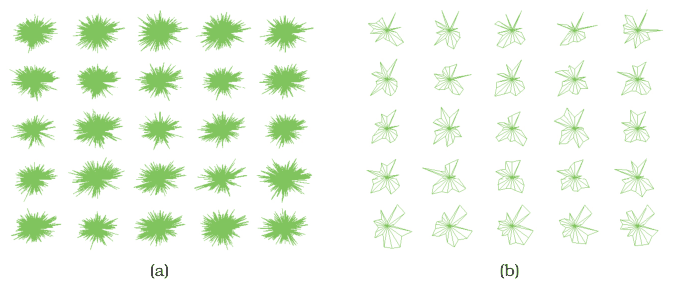

# DOSFA

## Idiom box

No idiom box in the book.

The book describes DOSFA in a System box rather than an Idiom box; its fields are quoted here [p.329].

<!-- verbatim p.329 -->
> What: Data Table: many value attributes.
<!-- /verbatim -->

<!-- verbatim p.329 -->
> How: Encode Star plots.
<!-- /verbatim -->

<!-- verbatim p.329 -->
> How: Facet Small multiples with matrix alignment.
<!-- /verbatim -->

<!-- verbatim p.329 -->
> How: Reduce Attribute filtering.
<!-- /verbatim -->

The System box gives no Why: Tasks or Scale field [p.329].

## What it is

The Dimensional Ordering, Spacing, and Filtering Approach (DOSFA) is an idiom that features attribute filtering, as its name suggests: it shows the same number of items but fewer attributes for each [pp.328-329]. Figure 13.4 applies it to 215 attributes representing word counts and 298 points representing documents in a collection of medical abstracts, drawn as star plots [p.329]. In (a) the plot axes are so densely packed that little structure can be seen; in (b), after the dimensions are ordered by similarity and filtered by both similarity and importance thresholds, the display shows clear visual patterns [p.329].

Attribute filtering is often paired with attribute (dimensional) ordering: if attributes are ordered by a derived similarity measure, such as variance, the high-scoring or low-scoring ones can easily be filtered out interactively [p.330].

## Use when / avoid when

- **Use** when a table has so many attributes that a multi-attribute encoding is too dense to show patterns, as with the 215-attribute dataset of Figure 13.4 [p.329].
- **Encodings.** DOSFA can be used with many visual encoding approaches; Figure 13.4 shows star plots [p.329].

## Figures

-  **Figure 13.4** [p.329]. The DOSFA idiom shown on star glyphs with a medical records dataset of 215 dimensions and 298 points. (a) The full dataset is so dense that patterns cannot be seen. (b) After ordering on similarity and filtering on both similarity and importance, the star glyphs show structure. From [Yang et al. 03a, Figures 3a and 3d].

## Alternatives and disambiguation

- **Item filtering**, such as FilmFinder's, removes items and keeps every attribute; DOSFA removes attributes and keeps every item; the two can be combined [pp.328-329].
- **Attribute aggregation (dimensionality reduction)** merges attributes into new synthetic ones instead of eliminating them [p.330].

## Related

- [13.3.2 Attribute Filtering](../ch13-reduce-items-attributes/s13-03-filter/s13-03-02-attribute-filtering.md): the section that presents DOSFA and similarity-based ordering [p.329]
- [7.6.3 Radial Layouts](../ch07-arrange-tables/s07-06-spatial-axis-orientation/s07-06-03-radial-layouts.md): star plots, the encoding shown [p.329]
- [FilmFinder](filmfinder.md): the item-filtering counterpart [p.329]
- [Dimensionality Reduction for Document Collections](dimensionality-reduction-for-document-collections.md): reducing attributes by synthesis rather than filtering [p.330]

## Implementation hints [NOT FROM BOOK]

### matplotlib

```python
import numpy as np, matplotlib.pyplot as plt
rng = np.random.default_rng(0)
X = rng.gamma(1.0, 1.0, (12, 40)) * rng.uniform(0.1, 1, 40)
keep = np.argsort(X.var(axis=0))[::-1][:8]
order = keep[np.argsort(np.corrcoef(X[:, keep].T)[0])[::-1]]
Xr = (X[:, order] - X[:, order].min(0)) / np.ptp(X[:, order], axis=0)
angles = np.linspace(0, 2 * np.pi, len(order), endpoint=False)
fig, axes = plt.subplots(3, 4, subplot_kw=dict(projection="polar"))
for row, ax in zip(Xr, axes.flat):
    ax.fill(np.r_[angles, angles[0]], np.r_[row, row[0]], alpha=0.5)
    ax.set_xticks([]); ax.set_yticks([])
```

Variance is the importance filter and correlation with the first kept attribute stands in for the similarity ordering.

### D3

Compute per-attribute variance with `d3.variance`, filter with a threshold bound to a range input, order the survivors, then draw each item's star with `d3.lineRadial().angle((d, i) => i * 2 * Math.PI / n).radius(d => r(d)).curve(d3.curveLinearClosed)` in a grid of small multiples.
