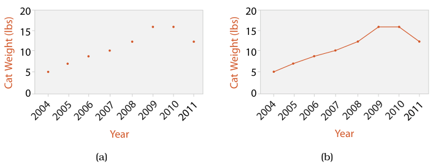

<a id="idiom:dot-and-line-charts"></a>

# Dot Charts

## Idiom box

<!-- verbatim p.180 -->
> What: Data Table: one quantitative value attribute, one ordered key attribute.
<!-- /verbatim -->

<!-- verbatim p.180 -->
> How: Encode Express value attribute with aligned vertical position and point marks. Separate/order into horizontal regions by key attribute.
<!-- /verbatim -->

The box has no Why: Task or Scale field [p.180].

## What it is

The book presents dot charts and line charts as one example, "Dot and Line Charts"; this card covers the dot chart and the [Line Charts](line-charts.md) card covers the connected version [pp.180-181].

A dot chart encodes one quantitative attribute with spatial position against one categorical attribute, using point marks rather than the line marks of a bar chart [p.180]. Figure 7.8(a) plots a cat's weight on the vertical axis against the ordered attribute of year on the horizontal axis [p.180]. The book is ambiguous about the key: the prose says categorical, while the box says ordered and the example uses years [p.180].

It can be thought of as a scatterplot where one axis shows a categorical attribute, or as a bar chart that uses point marks instead of line marks; the second view matches its standard use more closely [p.180]. Like bar and line charts, dot charts are often augmented with a second categorical attribute shown with colour or shape [p.181].

The terms dot chart and dot plot are sometimes synonyms and are overloaded: the book's dot chart is the idiom popularised by Cleveland, whereas Wilkinson uses dot plot for an idiom that shows distributions, similar to histograms [p.180].

## Use when / avoid when

- **Use** for one value attribute against one key attribute in a rectilinear layout, the data that line charts and bar charts also show [p.181].
- The book gives no task for dot charts. What separates them from line charts is the missing connection marks, which in a line chart imply a trend between one item and the next [p.181].

## Figures

-  **Figure 7.8** [p.180]. Line charts versus dot charts. (a) Dot charts use a point mark to show the value for each item. (b) Line charts use point marks connected by lines between them.

## Alternatives and disambiguation

- **Line charts** add connection marks between the dots, which emphasise ordering and imply a trend; they suit ordered keys only [pp.180-181].
- **Bar charts** encode the same value with line marks [p.180].
- **Scatterplots** put quantitative attributes on both axes [p.180].
- **Wilkinson's dot plot** is a different idiom for showing distributions, similar to histograms [p.180].

## Related

- [7.5.1 List Alignment: One Key](../ch07-arrange-tables/s07-05-separate-order-align-categorical/s07-05-01-list-alignment-one-key.md): the section that presents dot and line charts together [p.180]
- [13.4.1 Item Aggregation](../ch13-reduce-items-attributes/s13-04-aggregate/s13-04-01-item-aggregation.md): histograms, which Wilkinson's dot plot resembles [p.180]
- [Line Charts](line-charts.md): the connected version of this idiom [p.180]
- [Bar Charts](bar-charts.md): the line-mark version of this idiom [p.180]

## Implementation hints [NOT FROM BOOK]

### matplotlib

For a categorical key, Cleveland's layout puts categories on the vertical axis, sorted by value, with faint guide lines.

```python
import matplotlib.pyplot as plt

rates = {"Austria": 4.1, "Belgium": 5.6, "Denmark": 3.2, "Finland": 6.8, "Greece": 9.4, "Spain": 11.2}
names, values = zip(*sorted(rates.items(), key=lambda kv: kv[1]))

fig, ax = plt.subplots()
ax.plot(values, names, "o", color="C0")
ax.grid(axis="y", color="0.9")
ax.set_axisbelow(True)
ax.set_xlabel("unemployment (%)")
```

### D3

```js
const y = d3.scalePoint().domain(d3.sort(data, d => d.value).map(d => d.key)).range([height, 0]).padding(0.5);
const x = d3.scaleLinear().domain([0, d3.max(data, d => d.value)]).nice().range([0, width]);
svg.selectAll("circle").data(data).join("circle")
  .attr("cx", d => x(d.value)).attr("cy", d => y(d.key)).attr("r", 4);
svg.append("g").call(d3.axisLeft(y).tickSize(-width)).call(g => g.selectAll(".tick line").attr("stroke-opacity", 0.1));
```
