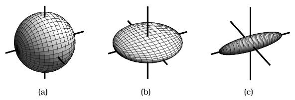
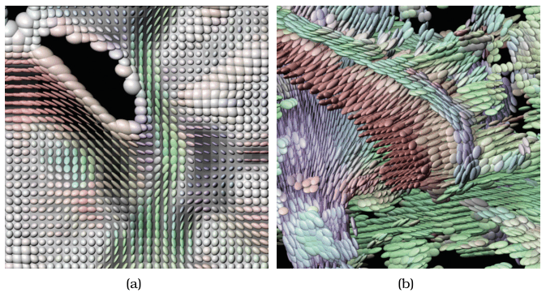

# Ellipsoid Tensor Glyphs

## Idiom box

<!-- verbatim p.221 -->
> What: Data Spatial field: 3D tensor field.
<!-- /verbatim -->

<!-- verbatim p.221 -->
> What: Derived Three quantitative attributes: tensor shape. Three vectors: tensor orientation.
<!-- /verbatim -->

<!-- verbatim p.221 -->
> How: Encode Glyph showing six derived attributes, color and opacity according to cluster.
<!-- /verbatim -->

The box has no Why: Tasks or Scale field. Its "according to cluster" wording matches the Similarity-Clustered Streamlines box, and the ellipsoid text itself describes no clustering; the book does not explain it [pp.218-221].

## What it is

<!-- verbatim p.219 -->
> Tensor quantities can be naturally decomposed into orientation and shape information; these quantities can be visually encoded with a 3D glyph.
<!-- /verbatim -->

- **Mathematics.** Shape comes from the eigenvalues and orientation from the eigenvectors [p.219].
- **Isotropy.** A shape is isotropic when every direction is the same and anisotropic when there is a directional asymmetry; in biological tissue, water moves faster in some directions than others. Figure 8.10 shows the 2D case: ink spreads evenly through Kleenex and faster in one direction through newspaper [p.220].
- **Three basic shapes.** Isotropic: a sphere. Partially anisotropic, planar: a sphere flattened in one direction. Completely anisotropic, linear: flattened differently in two directions into a cigar-shaped ellipsoid (Figure 8.11) [pp.220-221].
- **Encoding.** The ellipsoid encodes shape, and the direction it points is an intuitive encoding of orientation [p.221].
- **Examples.** Figure 8.12(a) inspects a 2D slice with orientation also used for colour; Figure 8.12(b) shows a 3D field with isotropic glyphs filtered out so anisotropic regions are visible [p.221].

## Use when / avoid when

- **Use** for tensor fields, for example diffusion tensor MRI used to study brain architecture and find abnormalities, where shape and orientation at each cell matter [p.219].
- **Use** a glyph in all cells or only in a carefully chosen subset; in 3D, filtering out isotropic glyphs lets anisotropic regions show [pp.219-221].
- **Avoid** where glyphs must be told apart from one viewpoint: different ellipsoid glyphs cannot be disambiguated from a single viewpoint [p.221].

## Figures

-  **Figure 8.11** [p.220]. Ellipsoid glyphs can show three basic shapes. (a) Isotropic: sphere. (b) Partially anisotropic: planar. (c) Fully anisotropic: linear. From [Kindlmann 04, Figure 1].
-  **Figure 8.12** [p.221]. Ellipsoid glyphs show shape and orientation of tensors at each cell in a field. (a) 2D slice. (b) 3D field, with isotropic glyphs filtered out. From [Kindlmann 04, Figures 10a and 11a].

## Alternatives and disambiguation

- **Superquadric tensor glyphs** are a more sophisticated approach that resolves the single-viewpoint ambiguity [Kindlmann 04]; a comparison of the two is in [Vilanova et al. 06] [pp.221-223].
- **Vector flow glyphs** such as arrows make the same all-cells-or-subset choice, but tensor glyphs need more complex geometry because they encode more information [p.219].
- **Geometric, texture and feature tensor flow** use hyperstreamlines or tensorlines, dense textures, or explicitly detected features instead of local glyphs [pp.221-222].

## Related

- [8.6 Tensor Fields: Many Values](../ch08-arrange-spatial-data/s08-06-tensor-fields-many-values.md): tensor fields and their idiom families [p.219]
- [8.5.1 Flow Glyphs](../ch08-arrange-spatial-data/s08-05-vector-fields-multiple-values/s08-05-01-flow-glyphs.md): the vector glyph counterpart [p.219]
- [Similarity-Clustered Streamlines](similarity-clustered-streamlines.md): the sparse-geometry vector idiom whose intuitions tensorlines share [p.221]
- [8.7 Further Reading](../ch08-arrange-spatial-data/s08-07-further-reading.md): tensor field and diffusion tensor imaging sources [p.223]

## Implementation hints [NOT FROM BOOK]

### matplotlib

```python
import numpy as np, matplotlib.pyplot as plt
from matplotlib.collections import EllipseCollection
rng = np.random.default_rng(1)
xs, ys = np.meshgrid(np.arange(10), np.arange(8))
offsets = np.column_stack([xs.ravel(), ys.ravel()])
A = rng.normal(size=(len(offsets), 2, 2))
T = A @ A.transpose(0, 2, 1) + 0.2 * np.eye(2)       # symmetric tensors
w, V = np.linalg.eigh(T)                              # shape and orientation
scale = 0.9 / w.max()
angle = np.degrees(np.arctan2(V[:, 1, 1], V[:, 0, 1])) # major-axis direction
fig, ax = plt.subplots()
ec = EllipseCollection(scale * w[:, 1], scale * w[:, 0], angle, units="xy",
                       offsets=offsets, offset_transform=ax.transData,
                       array=np.mod(angle, 180), cmap="twilight", clim=(0, 180))  # cyclic map for axis orientation
ax.add_collection(ec); ax.autoscale(); ax.set_aspect("equal")
```

### D3

```js
export function draw(svg, cells, x, y, k) {
  // each cell: {x, y, l1, l2, theta} from an eigen-decomposition done upstream
  const hue = d3.scaleSequential(d3.interpolateRainbow).domain([0, Math.PI]);
  svg.selectAll("ellipse").data(cells).join("ellipse")
    .attr("transform", d => `translate(${x(d.x)},${y(d.y)}) rotate(${(d.theta * 180) / Math.PI})`)
    .attr("rx", d => k * d.l1).attr("ry", d => k * d.l2)
    .attr("fill", d => hue(((d.theta % Math.PI) + Math.PI) % Math.PI));
}
```
