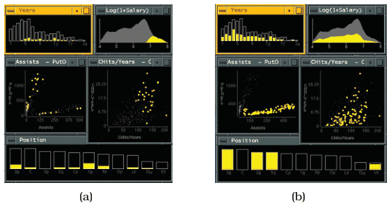

# Exploratory Data Visualizer (EDV)

## Idiom box

No idiom box in the book.

The book describes EDV in a System box rather than an Idiom box; its fields are quoted here [p.294].

<!-- verbatim p.294 -->
> What: Data Tables.
<!-- /verbatim -->

<!-- verbatim p.294 -->
> How: Encode Bar charts, scatterplots, and histograms.
<!-- /verbatim -->

<!-- verbatim p.294 -->
> How: Facet Partition: multiform views. Coordinate: linked highlighting.
<!-- /verbatim -->

The System box gives no Why: Tasks or Scale field [p.294].

## What it is

EDV features linked highlighting between views: items selected interactively in one view are immediately highlighted in all the others in the same colour [pp.292-293]. Figure 12.2 shows a baseball statistics dataset in linked bar charts, scatterplots and a histogram [p.293]. Selecting high salaries in the smoothed histogram shows no rookies in the Years played bar chart, little correlation of salary with Assists-PutOuts, hits per year more correlated with salary than home runs, and a loose relationship with position [pp.293-294]. Selecting the lower of two clumps in the Assists-PutOuts scatterplot shows that it corresponds to specific positions played, while those players are fairly evenly spread in the other windows [p.294].

## Use when / avoid when

- **Use** to see how a region that is contiguous in one view is distributed within another, the central benefit of linked highlighting [p.292].
- **Use** when tasks are too complex for one view: each multiform view can show a subset of attributes, avoiding the clutter of superimposing too many attributes in one view [pp.292-293].
- **Weigh** the cost in display area, the obvious and significant cost of juxtaposed views: two views side by side each get only half the area a single view could provide [p.291].

## Figures

-  **Figure 12.2** [p.293]. Linked highlighting between views shows how regions that are contiguous in one view are distributed within another. (a) Selecting the high salaries in the upper right window shows different distributions in the other views. (b) Selecting the bottom group in the Assists-PutOuts window shows that the clump corresponds to specific positions played. From [Wills 95, Figures 4 and 5].

## Alternatives and disambiguation

- **Improvise** also links multiform views by highlighting, but adds small multiples, overview–detail maps with linked navigation and one shared bivariate colormap [pp.302-303].
- **Multiform Overview–Detail Microarrays** links multiform views too, but adds overview–detail: the overview selects the subset (a time window) that the detail view shows [pp.297-298].
- **Superimposing layers** keeps everything in one view without extra screen space, but strongly limits how many layers can be superimposed before clutter becomes overwhelming [p.291].

## Related

- [12.3.1 Share Encoding: Same/Different](../ch12-facet-into-multiple-views/s12-03-juxtapose-coordinate-views/s12-03-01-share-encoding-same-different.md): linked highlighting and multiform views in full [p.292]
- [12.2 Why Facet?](../ch12-facet-into-multiple-views/s12-02-why-facet.md): the rationale for multiform views [p.291]
- [Improvise](improvise.md): a larger coordinated system with the same linking [p.302]
- [Histograms](histograms.md): one of EDV's view types [p.294]
- [Scatterplots](scatterplots.md): one of EDV's view types [p.294]
- [Bar Charts](bar-charts.md): one of EDV's view types [p.294]

## Implementation hints [NOT FROM BOOK]

### matplotlib

```python
import numpy as np, matplotlib.pyplot as plt
rng = np.random.default_rng(0)
salary = rng.lognormal(0, 0.6, 200); years = rng.integers(1, 20, 200)
assists, putouts = rng.gamma(2, 50, 200), rng.gamma(2, 80, 200)
sel = salary > np.quantile(salary, 0.8)          # the "brush"
c = np.where(sel, "tab:red", "lightgray")         # one highlight colour everywhere
fig, ax = plt.subplots(1, 3, figsize=(10, 3))
ax[0].hist([salary[~sel], salary[sel]], bins=20, stacked=True, color=["lightgray", "tab:red"])
ax[1].scatter(assists, putouts, c=c, s=10)
counts = [np.bincount(years[m], minlength=20) for m in (~sel, sel)]
ax[2].bar(range(20), counts[0], color="lightgray"); ax[2].bar(range(20), counts[1], bottom=counts[0], color="tab:red")
```

### D3

```js
import * as d3 from "d3";
const xSalary = d3.scaleLinear().domain([0, 5]).range([0, 300]);
// Every view draws its marks with .datum(row); a brush in one view sets the shared selection.
const brush = d3.brushX().on("brush end", ({ selection }) => {
  const [x0, x1] = selection ? selection.map(xSalary.invert) : [Infinity, -Infinity];
  d3.selectAll(".mark").classed("selected", d => d.salary >= x0 && d.salary <= x1);
});
d3.select("#salary-histogram").append("g").call(brush);
```
