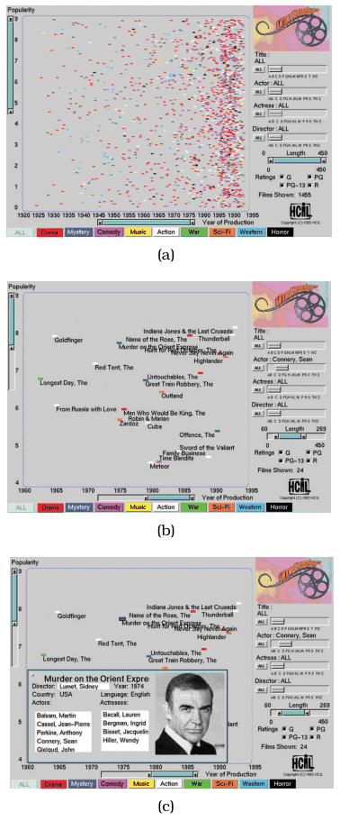

# FilmFinder

## Idiom box

No idiom box in the book.

The book describes FilmFinder in a System box rather than an Idiom box; its fields are quoted here [p.326].

<!-- verbatim p.326 -->
> What: Data Table: nine value attributes.
<!-- /verbatim -->

<!-- verbatim p.326 -->
> How: Encode Scatterplot; detail view with text/images.
<!-- /verbatim -->

<!-- verbatim p.326 -->
> How: Facet Multiform, overview–detail.
<!-- /verbatim -->

<!-- verbatim p.326 -->
> How: Reduce Item filtering.
<!-- /verbatim -->

The System box gives no Why: Tasks or Scale field [p.326].

## What it is

A system for exploring a movie database: a table with nine value attributes (genre, year made, title, actors, actresses, directors, rating, popularity and length) [p.326]. Movies are drawn in an interactive scatterplot of year made versus popularity, colour coded by genre [p.326]. Moving sliders and pressing buttons immediately filters items out or adds them back [p.326]. The encoding adapts to the number of items: once enough have been filtered away, marks are automatically enlarged and labelled [p.326]. Clicking a mark brings up a popup detail view about that movie, in multiform overview–detail views [p.326]. Its widgets include a dual slider selecting a minimum and maximum movie length, and alpha sliders tuned for selecting text strings rather than numbers [p.326].

FilmFinder is a specific example of dynamic queries: all items are shown at the start as an overview, and direct manipulation of widgets replaces reformulating queries [p.326].

## Use when / avoid when

- **Use** for browsing, as opposed to search, where the user must formulate an explicit query that might return far too many items, or none [p.326].
- **Use** when users explore potentially unknown datasets and cannot know in advance what filter values to type [p.325].
- **Beware** that people tend to forget elements that have been filtered out, even after quite recent actions [pp.324-325].

## Figures

-  **Figure 13.2** [p.327]. FilmFinder features tightly coupled interactive filtering, where the result of moving sliders and pressing buttons is immediately reflected in the visual encoding. (a) Exploration begins with an overview of all movies in the dataset. (b) Moving the actor slider to select Sean Connery filters out most of the other movies, leaving enough room to draw labels. (c) Clicking on the mark representing a movie brings up a detail view. From [Ahlberg and Shneiderman 94, Color Plates 1, 2, and 3].

## Alternatives and disambiguation

- **Scented widgets** extend filtering controls themselves with a small chart, icons or labels, or channels such as hue, saturation and opacity, at little or no extra screen cost [p.328].
- **Query-based search**, as with a database, is the alternative that dynamic queries replace [p.326].
- **Attribute filtering (DOSFA)** keeps every item and removes attributes; FilmFinder keeps attributes and removes items [pp.326-328].

## Related

- [13.3.1 Item Filtering](../ch13-reduce-items-attributes/s13-03-filter/s13-03-01-item-filtering.md): dynamic queries, scented widgets and the FilmFinder example [p.326]
- [Scatterplots](scatterplots.md): the overview encoding [p.326]
- [DOSFA](dosfa.md): the attribute-filtering counterpart [p.328]
- [13.2 Why Reduce?](../ch13-reduce-items-attributes/s13-02-why-reduce.md): the cognitive cost of filtering [p.325]

## Implementation hints [NOT FROM BOOK]

### matplotlib

```python
import numpy as np, matplotlib.pyplot as plt
from matplotlib.widgets import RangeSlider
rng = np.random.default_rng(0)
year, pop, length = rng.integers(1930, 1995, 800), rng.uniform(0, 10, 800), rng.integers(70, 200, 800)
genre = rng.integers(0, 6, 800)
fig, ax = plt.subplots()
fig.subplots_adjust(bottom=0.2)
sc = ax.scatter(year, pop, c=genre, cmap="tab10", s=12)
slider = RangeSlider(fig.add_axes([0.2, 0.05, 0.6, 0.04]), "length", 70, 200, valinit=(70, 200))
def update(lohi):
    keep = (length >= lohi[0]) & (length <= lohi[1])
    sc.set_offsets(np.c_[year[keep], pop[keep]])
    sc.set_array(genre[keep])
    fig.canvas.draw_idle()
slider.on_changed(update)
```

### D3

Bind `input[type=range]` or `d3.brushX()` controls to filter predicates, and on every `input` event rejoin the filtered data with `selection.data(filtered, d => d.id).join("circle")`, so marks leave and return immediately. Add labels with `.join("text")` only when `filtered.length` falls below a threshold. For a scented widget, draw a small `d3.bin` histogram behind the slider track.
