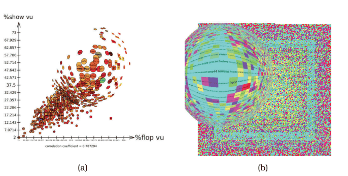
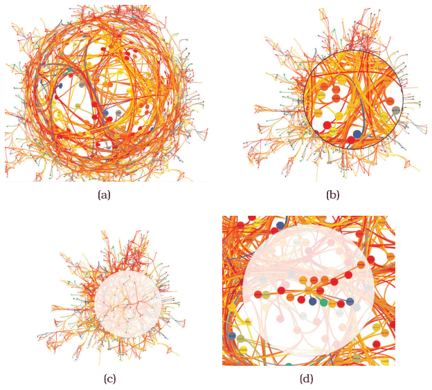

# Fisheye Lens

## Idiom box

<!-- verbatim p.354 -->
> What: Data Any data.
<!-- /verbatim -->

<!-- verbatim p.354 -->
> How: Encode Any layout.
<!-- /verbatim -->

<!-- verbatim p.354 -->
> How: Reduce Embed: distort with fisheye; single focus, local radial region, moveable lens interaction metaphor.
<!-- /verbatim -->

## What it is

A distortion idiom with a single focus of local extent and radial shape, using a draggable lens on top of the main view; it gives the same radial distortion as physical camera lenses and door peepholes [p.353]. The lens layer completely replaces what is beneath it, like the magic lens, rather than superimposing extra information on top [p.353]. The lens moves by standard 2D translation; the mathematics is straightforward, and graphics hardware supports high-performance fisheye lenses with vertex shaders [p.353].

The distortion has a small circle of very high magnification at the centre, surrounded by a larger region varying continuously from medium magnification to very high compression, returning to low compression at the periphery [p.360]. In Figure 14.5 it is applied to a poker-player scatterplot and a dense matrix view laid out by a space-filling curve: labels under the lens become readable while the focus stays embedded in the global pattern [pp.353-354].

## Use when / avoid when

- **Use** over any data and any layout to read local detail, such as labels in a dense view, while keeping the surrounding context visible [pp.353-354].
- **Less problematic** with familiar shapes, such as geographic maps of known places, because people can read the distortion as a change to a known baseline [pp.360-361].
- **Topology tasks.** One of the most successful uses of geometric distortion is exploring node–link layouts of networks and trees, where understanding topology is likely robust to distortion [p.359].
- **Avoid** for tasks that need distance or length comparisons, which distortion severely impairs [p.359].
- **Caution** with unfamiliar structures, where the basic shape can be hard to reconstruct: although designed to reduce disorientation, fisheye lenses can be quite disorienting, and the continuous magnification change adds some cognitive load even when used interactively [pp.360-361].
- **Consider a magnifying lens instead.** In the book's graph example the fisheye may be harder to use than a plain magnifying lens; it is not clear that avoiding occlusion is worth the cost [p.361].

## Figures

-  **Figure 14.5** [p.354]. Focus+context with interactive fisheye lens, with poker player dataset. (a) Scatterplot showing correlation between two strategies. (b) Dense matrix view showing correlation between a specific complex strategy and the player’s winning rate, encoded by color.
-  **Figure 14.10** [p.361]. Four approaches to graph exploration. (a) Fisheye lens. (b) Magnifying lens. (c) Neighborhood highlighting with layering. (d) Neighborhood highlighting with both layering and Bring and Go interaction. From [Lambert et al. 10, Figures 2a, 2b, 3b, and 4b].

## Alternatives and disambiguation

- **Magnifying lens.** Two discrete levels with a discontinuous jump; it occludes the immediately surrounding region but avoids continuous distortion [p.361].
- **Neighbourhood highlighting and Bring and Go.** These avoid distorting all positions: layering dims non-neighbours, and Bring and Go moves only one-hop neighbours, cutting the cost of tracking moving items; neither helps where magnification is critical, such as reading labels [p.362].
- **Hyperbolic Geometry.** Also a single radial focus, but global, and suited to trees or networks; its effect resembles a fisheye lens across the whole scene [pp.354-356].
- **Toolglass and Magic Lenses.** Also a moveable lens whose layer replaces what is beneath, but shows different information rather than distorting [pp.351-353].
- **Stretch and Squish Navigation.** Multiple rectangular global foci instead of one local radial focus [p.356].

## Related

- [14.5 Distort](../ch14-embed-focus-context/s14-05-distort.md): the distortion design choices and the full example [p.353]
- [14.6 Costs and Benefits: Distortion](../ch14-embed-focus-context/s14-06-costs-benefits-distortion.md): fisheye versus magnifying lens versus neighbourhood highlighting [p.360]
- [Toolglass and Magic Lenses](toolglass-and-magic-lenses.md): the lens whose replacing layer the fisheye shares [p.353]
- [12.5 Superimpose Layers](../ch12-facet-into-multiple-views/s12-05-superimpose-layers/node.md): the superimposing-layer choice the fisheye does not follow [p.353]

## Implementation hints [NOT FROM BOOK]

### matplotlib

```python
import numpy as np, matplotlib.pyplot as plt
rng = np.random.default_rng(0)
xy = rng.normal(size=(400, 2))
focus, radius, d = np.array([0.3, 0.2]), 1.2, 4.0
v = xy - focus
r = np.hypot(*v.T)
inside = r < radius
g = r[inside] / radius
scale = np.ones_like(r)
scale[inside] = ((d + 1) * g / (d * g + 1)) / np.where(g == 0, 1, g)  # Sarkar-Brown
fxy = focus + v * scale[:, None]
fig, ax = plt.subplots()
ax.scatter(*fxy.T, s=8)
ax.add_patch(plt.Circle(focus, radius, fill=False, ls="--"))
ax.set_aspect("equal")
```

### D3

```js
import * as d3 from "d3";
export function fisheye(focus, radius = 120, distortion = 3) {
  return ([x, y]) => {
    const dx = x - focus[0], dy = y - focus[1], r = Math.hypot(dx, dy);
    if (r === 0 || r >= radius) return [x, y];
    const g = r / radius, k = ((distortion + 1) * g) / (distortion * g + 1) / g;
    return [focus[0] + dx * k, focus[1] + dy * k];
  };
}
// on pointermove: const f = fisheye(d3.pointer(event)); circles.attr("cx", d => f([d.x, d.y])[0]).attr("cy", d => f([d.x, d.y])[1]);
```
