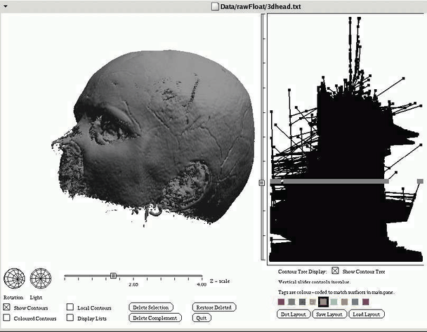
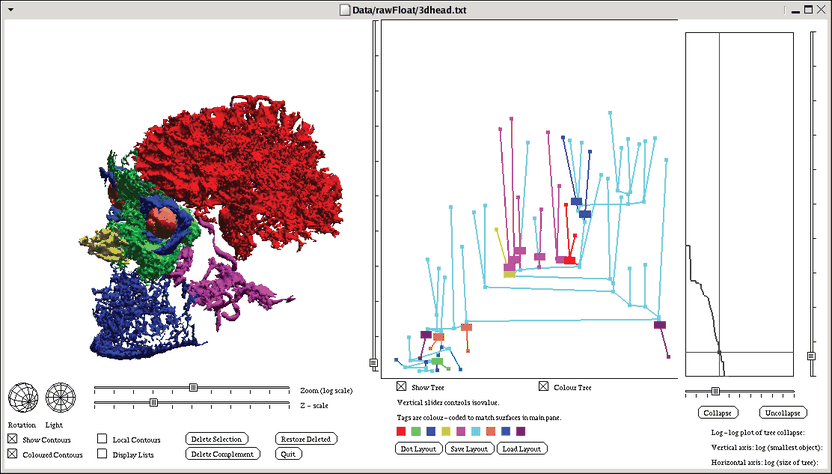

# Flexible Isosurfaces

## Idiom box

<!-- verbatim p.211 -->
> What: Data Spatial field.
<!-- /verbatim -->

<!-- verbatim p.211 -->
> What: Derived Geometry: surfaces. Tree: simplified contour tree.
<!-- /verbatim -->

<!-- verbatim p.211 -->
> How: Encode Surfaces: use given. Tree: line marks, vertical spatial position encodes isovalue.
<!-- /verbatim -->

<!-- verbatim p.211 -->
> Why: Tasks Query shape.
<!-- /verbatim -->

<!-- verbatim p.211 -->
> Scale One dozen contour levels.
<!-- /verbatim -->

## What it is

<!-- verbatim p.210 -->
> The flexible isosurfaces idiom uses one more level of derived data, the simplified contour tree, to help users find structure that would be hidden with the standard single-level approach.
<!-- /verbatim -->

- **Why a tree.** One value may give several disconnected isosurfaces, and as the value changes, components can appear, join, split or disappear. The contour tree tracks this evolution explicitly, showing how connected components change their nesting structure [p.210].
- **Simplification.** The full tree for the head dataset has over 1.5 million edges (Figure 8.5); careful simplification gives under 100 (Figure 8.6) [p.210].
- **Interaction.** The simplified tree drives filtering and colouring through multiple coordinated views, supporting interactive exploration [p.210].
- **Result.** Several meaningful structures in the head, found this way, are shown in one 3D view, so users see both their shape and their positions relative to each other [p.210].

## Use when / avoid when

- **Use** to query the shape of a 3D scalar field when a single isovalue would hide structure, such as disconnected components that appear, merge or split as the value changes [p.210].
- **Avoid** the full, unsimplified contour tree: with over 1.5 million edges it does not help users explore isosurfaces [p.210].
- **Note** that the standard alternative, showing every contour surface for dozens of values at once, fails in 3D because outer surfaces occlude inner ones [p.209].

## Figures

-  **Figure 8.5** [p.210]. A full contour tree with over 1.5 million edges does not help the user explore isosurfaces. From [Carr et al. 04, Figure 1].
-  **Figure 8.6** [p.211]. The flexible isosurfaces idiom uses the simplified contour tree of under 100 edges to help users identify meaningful structure. From [Carr et al. 04, Figure 1].

## Alternatives and disambiguation

- **Standard isosurfaces.** One level at a time, chosen with a dynamic control such as a slider from minimum to maximum value, or several levels with careful colour and transparency [p.209].
- **Multidimensional Transfer Functions.** Direct volume rendering builds the image from the whole field without deriving surfaces; the user's work goes into choosing a transfer function, not an isovalue [pp.211-212].
- **Topographic Terrain Map.** The 2D case, where isolines for dozens of levels can coexist without clutter [p.208].

## Related

- [8.4.1 Isocontours](../ch08-arrange-spatial-data/s08-04-scalar-fields-one-value/s08-04-01-isocontours.md): isosurfaces and the level-choice problem [p.209]
- [13.3.2 Attribute Filtering](../ch13-reduce-items-attributes/s13-03-filter/s13-03-02-attribute-filtering.md): the filtering the contour tree drives [p.210]
- [12.3 Juxtapose and Coordinate Views](../ch12-facet-into-multiple-views/s12-03-juxtapose-coordinate-views/node.md): the coordinated tree and 3D views [p.210]
- [11.5 Navigate: Changing Viewpoint](../ch11-manipulate-view/s11-05-navigate-changing-viewpoint.md): the 3D navigation used to inspect isosurfaces [p.209]
- [Multidimensional Transfer Functions](multidimensional-transfer-functions.md): the volume-rendering route to the same field [p.212]

## Implementation hints [NOT FROM BOOK]

### matplotlib

matplotlib has no contour tree. A 2D stand-in shows how components split and merge as the level changes; for 3D surfaces use `skimage.measure.marching_cubes` with `mpl_toolkits.mplot3d`'s `plot_trisurf`, and for real contour trees the Topology ToolKit (TTK).

```python
import numpy as np, matplotlib.pyplot as plt
x, y = np.meshgrid(np.linspace(-3, 3, 200), np.linspace(-3, 3, 200))
f = np.exp(-((x - 1) ** 2 + y ** 2)) + 0.8 * np.exp(-((x + 1) ** 2 + y ** 2))
fig, axes = plt.subplots(1, 3, figsize=(9, 3))
for ax, level in zip(axes, [0.3, 0.7, 0.9]):  # one blob, two blobs, one blob
    ax.contourf(x, y, f, levels=[level, f.max()], colors=["tab:orange"])
    ax.set_title(f"isovalue {level}"); ax.set_aspect("equal"); ax.axis("off")
```

### D3

`d3.contours().thresholds([v])` on a 2D grid gives one MultiPolygon per isovalue; its `coordinates.length` counts the connected components, which is the quantity a contour tree tracks. Pair it with a `d3.scaleLinear` slider for the isovalue. For true 3D isosurfaces use a WebGL library instead.
