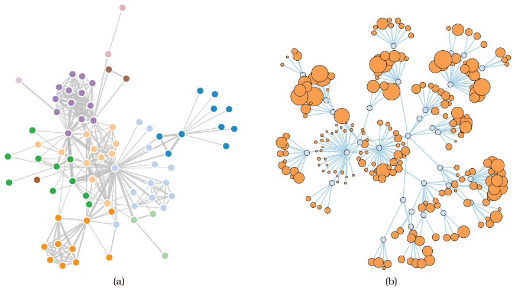

# Force-Directed Placement

## Idiom box

<!-- verbatim p.231 -->
> What: Data Network.
<!-- /verbatim -->

<!-- verbatim p.231 -->
> How: Encode Point marks for nodes, connection marks for links.
<!-- /verbatim -->

<!-- verbatim p.231 -->
> Why: Tasks Explore topology, locate paths.
<!-- /verbatim -->

<!-- verbatim p.231 -->
> Scale Nodes: dozens/hundreds. Links: hundreds.
> Node/link density: L < 4N
<!-- /verbatim -->

## What it is

A node–link network layout, one of the most widely used, in a family with many variants. In one variant, nodes push away from each other while links act like springs drawing their endpoints together; many algorithms start from random positions and iteratively refine them under these simulated forces [p.229]. It is also known as spring embedding, energy minimisation, or nonlinear optimisation [p.229].

Spatial position does not directly encode attributes: the algorithm places nodes to minimise distracting artifacts such as edge crossings and node overlaps, so location is a side effect of the computation. Size and colour coding of nodes and edges is common [p.229].

## Use when / avoid when

- **Use** for exploring topology and locating paths in a network of dozens to hundreds of nodes [p.231].
- **Strengths:** a simple version is very easy to implement, and the spring analogy makes it easy to understand and explain [p.229].
- **Avoid** reading proximity as meaning: tightly linked groups tend to clump, but some clumps may simply be artifacts of repulsion from elsewhere, so proximity is sometimes meaningful and sometimes arbitrary, which can mislead [p.229].
- **Weakness: nondeterminism.** Layouts are often nondeterministic, so spatial memory cannot be exploited across runs and region-based identifications such as "the stuff in the upper left corner" are not useful; reusing the random seed restores repeatability for most random layouts [p.230].
- **Weakness: scalability**, the major one: readable for tiny graphs of dozens of nodes, a hairball with even a few hundred, and path following becomes essentially impossible with thousands or more [p.231].
- **Avoid** continual bouncing in a multiple-view context, where the user may want to attend to other views without motion-sensitive peripheral vision being invoked; more sophisticated algorithms stop automatically once the forces balance [p.231].
- Many algorithms are brittle, needing parameters tuned per dataset, and can get stuck in a local minimum energy configuration [p.231].
- The density limit is ambiguous in the book: the box says L < 4N, while the text says results are poor "when the number of nodes is more than roughly four times the number of links" [p.231].

## Figures

-  **Figure 9.4** [p.230]. Node–link layouts of small networks. (a) Force-directed placement of small network of 75 nodes, with size coding for link attributes. (b) Larger network, with size coding for node attributes. From <http://bl.ocks.org/> mbostock/4062045 and <http://bl.ocks.org/1062288>.

## Alternatives and disambiguation

- **Multilevel force-directed placement (sfdp)** adds a derived cluster hierarchy, laying out coarse versions first; it improves speed and quality, avoids local minima better, and scales to 1000 to 10,000 nodes [pp.231-232].
- **Adjacency matrix view** handles large and dense networks without occlusion and is stable when items are added, where a force-directed view might change a lot; it is weaker for topology tasks such as path tracing [p.236].
- **Node–link tree layouts** (triangular, radial, BubbleTree) use spatial position to show tree depth, unlike force-directed layouts, which use position only indirectly [pp.226-229].

## Related

- [9.2 Connection: Link Marks](../ch09-arrange-networks-trees/s09-02-connection-link-marks.md): the full discussion of this idiom and node–link diagrams [p.229]
- [Multilevel Force-Directed Placement (sfdp)](multilevel-force-directed-placement-sfdp.md): the scalable multilevel variant [p.231]
- [Adjacency Matrix View](adjacency-matrix-view.md): the alternative for large or dense networks [p.236]
- [9.4 Costs and Benefits: Connection versus Matrix](../ch09-arrange-networks-trees/s09-04-costs-benefits-connection-matrix.md): when node–link layouts beat matrices [p.231]

## Implementation hints [NOT FROM BOOK]

### matplotlib

Matplotlib has no graph layout; compute positions with NetworkX and draw with matplotlib. Fix the seed for a repeatable layout.

```python
import networkx as nx, matplotlib.pyplot as plt
G = nx.karate_club_graph()
pos = nx.spring_layout(G, seed=42, iterations=200)
nx.draw_networkx_edges(G, pos, width=[G[u][v].get("weight", 1) / 2 for u, v in G.edges], alpha=0.4)
nx.draw_networkx_nodes(G, pos, node_size=[20 * G.degree(n) for n in G])
plt.axis("off")
```

### D3

`d3-force`: `d3.forceSimulation(nodes).force("link", d3.forceLink(links).id(d => d.id)).force("charge", d3.forceManyBody()).force("center", d3.forceCenter(w / 2, h / 2))`, then update `line` and `circle` positions on `"tick"`. The simulation cools via `alphaDecay` and stops on its own; call `simulation.stop()` and run `simulation.tick(n)` for a static, non-bouncing layout.
