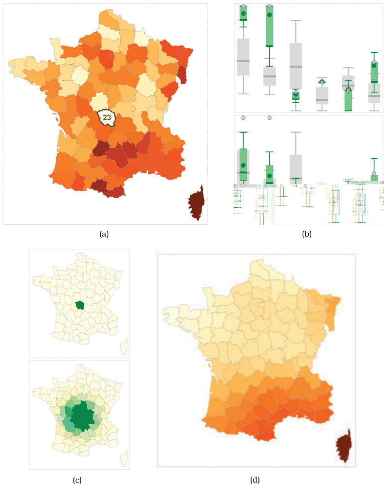

# Geographically Weighted Boxplots

## Idiom box

<!-- verbatim p.340 -->
> What: Data Geographic geometry with area boundaries. Table: Key attribute (area), several quantitative value attributes. Table: Five-number statistical summary distributions for each original attribute.
<!-- /verbatim -->

<!-- verbatim p.340 -->
> What: Derived Multidimensional table: key attribute (area), key attribute (scale), quantitative value attributes (geographically weighted statistical summaries for each area at multiple scales).
<!-- /verbatim -->

<!-- verbatim p.340 -->
> How: Encode Boxplot.
<!-- /verbatim -->

<!-- verbatim p.340 -->
> How: Facet Superimposed layers: global boxplot as gray background, current-scale boxplot as green foreground.
<!-- /verbatim -->

<!-- verbatim p.340 -->
> How: Reduce Spatial aggregation.
<!-- /verbatim -->

The box has no Why: Tasks or Scale field [p.340].

## What it is

The gw-boxplot belongs to the geowigs family (geographically weighted interactive graphics), which supports spatial aggregation with geographically weighted regression and geographically weighted summary statistics [p.338]. It compares the global distribution with the currently chosen spatial scale through superimposed layers: the global distribution is a grey background boxplot, and the local statistics for the interactively chosen scale are a green foreground boxplot [p.340].

Figure 13.11 explores social issues in 19th-century France through six quantitative attributes, x1 to x6 (crimes against persons and property, literacy, donations to the poor, illegitimate births, suicides) [pp.338-340]. It shows (a) a choropleth map coloured by x1 with the region Creuse (23) selected; (b) gw-boxplots for all six attributes at two scales; (c) weighting maps for each scale, very local on top and larger below; and (d) a gw-mean map weighted by the larger scale [p.340]. At the local level x1 is clearly an outlier, matching the region's pale map colour; at the larger scale its distribution is close to the global one, matching the mid-range colour of the gw-mean map [p.340].

## Use when / avoid when

- **Use** when aggregating spatial data must take its spatial nature into account, because of the modifiable areal unit problem: changing region boundaries, or the scale of the units, can dramatically change the analysis results [p.338].
- **Use** to compare a selected region's local statistics with the global distribution, at more than one spatial scale [p.340].

## Figures

-  **Figure 13.11** [p.339]. Geowigs are geographically weighted interactive graphics. (a) A choropleth map showing attribute x1. (b) The set of gw-boxplots for all six attributes at two scales. (c) Weighting maps showing the scales: local and larger. (d) A gw-mean map at the larger scale. From [Dykes and Brunsdon 07, Figures 7a and 2].

## Alternatives and disambiguation

- **Boxplot charts** summarise each whole attribute; gw-boxplots add a geographically weighted local boxplot over the global one [p.340].
- **Choropleth maps** colour each region by one attribute and are subject to the MAUP; gw-boxplots and gw-mean maps are used alongside them in Figure 13.11 [pp.338-340].
- **gw-mean maps** are a sibling geowig: a map of geographically weighted means at a chosen scale [p.340].

## Related

- [13.4.2 Spatial Aggregation](../ch13-reduce-items-attributes/s13-04-aggregate/s13-04-02-spatial-aggregation.md): the MAUP and this example [p.338]
- [Boxplot Charts](boxplot-charts.md): the boxplot encoding, covered in Section 13.4.1 [p.340]
- [Choropleth Map](choropleth-map.md): the map type linked to the gw-boxplots, covered in Section 8.3.1 [p.340]
- [12.5 Superimpose Layers](../ch12-facet-into-multiple-views/s12-05-superimpose-layers/node.md): the facet choice used for global versus local boxplots [p.340]

## Implementation hints [NOT FROM BOOK]

### matplotlib

```python
import numpy as np, matplotlib.pyplot as plt
rng = np.random.default_rng(0)
xy = rng.uniform(0, 100, (90, 2))
vals = rng.normal(50, 10, (90, 6)) + xy[:, :1] * 0.2
focus, bandwidth = 0, 15.0
d = np.hypot(*(xy - xy[focus]).T)
w = np.exp(-0.5 * (d / bandwidth) ** 2)
local = [rng.choice(vals[:, j], 500, p=w / w.sum()) for j in range(6)]
fig, ax = plt.subplots()
ax.boxplot(vals, positions=range(6), widths=0.6, patch_artist=True,
           boxprops=dict(facecolor="lightgrey"), showfliers=False)
ax.boxplot(local, positions=range(6), widths=0.3, patch_artist=True,
           boxprops=dict(facecolor="tab:green"), showfliers=False)
ax.set_xticks(range(6), [f"x{j + 1}" for j in range(6)])
```

Weighted resampling approximates weighted quantiles; `mgwr` or `pysal` compute geographically weighted statistics properly.

### D3

Compute Gaussian distance weights per region, then weighted quartiles (sort values, accumulate weights, read off 0.25/0.5/0.75); draw the global boxplot in grey and the local one narrower in green on the same `d3.scaleBand()` slot. Link to a choropleth built with `d3.geoPath()` so selecting a region recomputes the local boxes.
