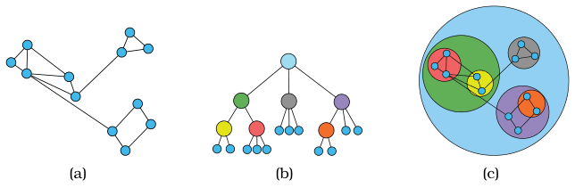

# GrouseFlocks

## Idiom box

No idiom box in the book.

The book describes GrouseFlocks in a System box rather than an Idiom box; its fields are quoted here [p.241].

<!-- verbatim p.241 -->
> What: Data Network.
<!-- /verbatim -->

<!-- verbatim p.241 -->
> What: Derived Cluster hierarchy atop original network.
<!-- /verbatim -->

<!-- verbatim p.241 -->
> What: Encode Connection marks for original network, containment marks for cluster hierarchy.
<!-- /verbatim -->

The System box gives no Why: Tasks or Scale field [p.241].

## What it is

A system for exploring compound networks: a base network of pairwise links plus a cluster hierarchy that groups its nodes, so the network nodes are the leaves of a tree on top of it [p.240]. Users can investigate multiple possible hierarchies, and they are shown explicitly. Figure 9.10 moves from the original graph (a), to a cluster hierarchy drawn as a node–link layout (b), to a combined view with containment marks for the hierarchy and connection marks for the network links (c) [pp.240-241].

## Use when / avoid when

- **Use** when a network has a hierarchical grouping of its nodes to show: containment is usually only used when there is a hierarchical structure, and it is often used for exploring compound networks [p.240].
- **Use** when users should investigate multiple possible hierarchies, shown explicitly, rather than one derived hierarchy used only internally, as in sfdp [p.240].
- The book gives no limits or failure cases for GrouseFlocks [pp.240-241].

## Figures

-  **Figure 9.10** [p.240]. GrouseFlocks uses containment to show graph hierarchy structure. (a) Original graph. (b) Cluster hierarchy built atop the graph, shown with a node– link layout. (c) Network encoded using connection, with hierarchy encoded using containment. From [Archambault et al. 08, Figure 3].

## Alternatives and disambiguation

- **Multilevel force-directed placement (sfdp)** also derives a cluster hierarchy atop the network, but uses one hierarchy only to accelerate layout and never shows it [p.240].
- **Treemaps** use containment for a plain tree with sized leaves, not for a hierarchy laid over a network [pp.238-240].

## Related

- [9.5 Containment: Hierarchy Marks](../ch09-arrange-networks-trees/s09-05-containment-hierarchy-marks.md): compound networks and GrouseFlocks in context [p.240]
- [Multilevel Force-Directed Placement (sfdp)](multilevel-force-directed-placement-sfdp.md): the hidden-hierarchy contrast [p.240]
- [Treemaps](treemaps.md): containment for plain trees [p.240]
- [7.5.2 Matrix Alignment: Two Keys](../ch07-arrange-tables/s07-05-separate-order-align-categorical/s07-05-02-matrix-alignment-two-keys.md): where the book discusses cluster hierarchies further [p.240]

## Implementation hints [NOT FROM BOOK]

### matplotlib

Draw the network with NetworkX, then one translucent enclosing circle per cluster, coarsest level first. Swap in `scipy.spatial.ConvexHull` for tighter hulls.

```python
import numpy as np, networkx as nx, matplotlib.pyplot as plt
from matplotlib.patches import Circle
G = nx.random_partition_graph([8, 8, 8, 8], 0.5, 0.02, seed=3)
leaves = [sorted(block) for block in G.graph["partition"]]
pos = nx.spring_layout(G, seed=3)

def enclose(circles, pad=0.06):  # radius covers every child circle, so nesting holds
    centre = np.mean([c for c, _ in circles], axis=0)
    return centre, max(np.linalg.norm(c - centre) + r for c, r in circles) + pad

fine = [enclose([(np.asarray(pos[n]), 0.0) for n in block]) for block in leaves]
coarse = [enclose(fine[:2]), enclose(fine[2:])]
ax = plt.gca()
for depth, level in enumerate([coarse, fine]):  # coarsest first
    for centre, radius in level:
        ax.add_patch(Circle(centre, radius, alpha=0.12, color=f"C{depth}"))
nx.draw_networkx(G, pos, node_size=15, with_labels=False, ax=ax)
ax.set_aspect("equal")
ax.set_axis_off()
```

### D3

Lay out the hierarchy with `d3.pack()` over `d3.hierarchy(clusters)` so network nodes sit inside their cluster circles, draw `root.descendants()` as circles, then draw network links as `line`s between leaf centres. Alternatively, run `d3.forceSimulation` and draw `d3.polygonHull` per cluster on each tick.
