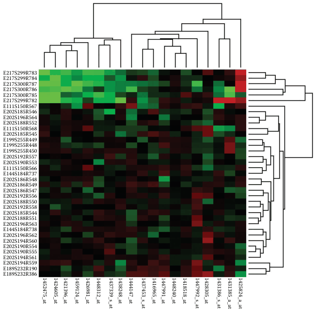

# Heatmaps

## Idiom box

<!-- verbatim p.185 -->
> What: Data Table: two categorical key attributes (genes, conditions), one quantitative value attribute (activity level for gene in condition).
<!-- /verbatim -->

<!-- verbatim p.185 -->
> How: Encode 2D matrix alignment of area marks, diverging colormap.
<!-- /verbatim -->

<!-- verbatim p.185 -->
> Why: Task Find clusters, outliers; summarize.
<!-- /verbatim -->

<!-- verbatim p.185 -->
> Scale Items: one million. Categorical attribute levels: hundreds. Quantitative attribute levels: 3–11.
<!-- /verbatim -->

## What it is

Heatmaps are one of the simplest uses of matrix alignment: each cell is fully occupied by an area mark that encodes a single quantitative value attribute with colour [p.183]. They are the book's example of an idiom showing two keys and one value [p.171]. One key is distributed along the rows and the other along the columns, so a rectangular cell is the region for each item's value [pp.182-183].

Heatmaps are often used with bioinformatics data: in Figure 7.11 the keys are genes and experimental conditions, and the value is a gene's activity level in a condition, measured by microarray [p.183]. Genes are categorical; conditions may be categorical or ordered, for example successive times [p.183]. The figure uses a diverging red–green colormap, a strong genomics convention that causes problems for colourblind users [p.183].

## Use when / avoid when

- **Use** for overviews with high information density: encoding quantitative data with colour on small area marks is very compact [pp.183-184].
- **Scale**: marks several pixels on a side easily handle a 200 × 200 matrix of 40,000 items; single-pixel marks reach one million items, so each key can have hundreds of levels [p.184].
- **Value levels**: only 3 to 11 bins of the quantitative attribute are distinguishable, because of the limits on colour perception in small noncontiguous regions [p.184].
- These limits assume a standard 1000 × 1000 display [p.184].

## Figures

-  **Figure 7.11** [p.184]. Cluster heatmap. A heatmap provides a compact summary of a quantitative value attribute with 2D matrix alignment by two key attributes and small area marks colored with a diverging colormap. The cluster heatmap includes trees drawn on the periphery showing how the matrix is ordered according to the derived data of hierarchical clusterings on its rows and columns.

## Alternatives and disambiguation

- **Cluster heatmaps** add matrix reordering of rows and columns by cluster hierarchies, with dendrograms on the periphery [p.185].
- **Scatterplot matrices** are a more complex matrix in which each cell shows a complete chart rather than one value [p.185].
- **Bar charts** suit one key and one value; heatmaps suit two keys and one value [p.171].

## Related

- [7.5.2 Matrix Alignment: Two Keys](../ch07-arrange-tables/s07-05-separate-order-align-categorical/s07-05-02-matrix-alignment-two-keys.md): the section that presents this idiom [p.183]
- [10.3 Colormaps](../ch10-map-color-other-channels/s10-03-colormaps/node.md): designing the diverging colormap [p.183]
- [10.3.4 Colorblind-Safe Colormap Design](../ch10-map-color-other-channels/s10-03-colormaps/s10-03-04-colorblind-safe-colormap-design.md): the problem with red–green [p.183]
- [Cluster Heatmaps](cluster-heatmaps.md): the reordered version with dendrograms [p.185]

## Implementation hints [NOT FROM BOOK]

### matplotlib

Centre a diverging map on zero and resample it to a few bins.

```python
import numpy as np
import matplotlib as mpl
import matplotlib.pyplot as plt

rng = np.random.default_rng(3)
genes = [f"g{i:02d}" for i in range(30)]
conditions = [f"t{j}" for j in range(12)]
activity = rng.normal(0, 1, (30, 12)) + np.outer(rng.normal(0, 1, 30), np.linspace(-1, 1, 12))

limit = np.abs(activity).max()
fig, ax = plt.subplots(figsize=(5, 8))
mesh = ax.pcolormesh(conditions, genes, activity, cmap=mpl.colormaps["RdBu_r"].resampled(9), vmin=-limit, vmax=limit)
ax.invert_yaxis()
ax.tick_params(labelsize=7)
fig.colorbar(mesh, ax=ax, label="activity")
```

`ax.imshow(activity, aspect="auto")` is faster for very large matrices.

### D3

```js
const x = d3.scaleBand().domain(conditions).range([0, width]);
const y = d3.scaleBand().domain(genes).range([0, height]);
const limit = d3.max(cells, d => Math.abs(d.value));
const color = d3.scaleDiverging([-limit, 0, limit], t => d3.interpolateRdBu(1 - t));
svg.selectAll("rect").data(cells).join("rect")
  .attr("x", d => x(d.condition)).attr("y", d => y(d.gene))
  .attr("width", x.bandwidth()).attr("height", y.bandwidth()).attr("fill", d => color(d.value));
```

For discrete bins, use `d3.scaleQuantize([-limit, limit], [...d3.schemeRdBu[9]].reverse())`, reversed so high values stay red as above.
