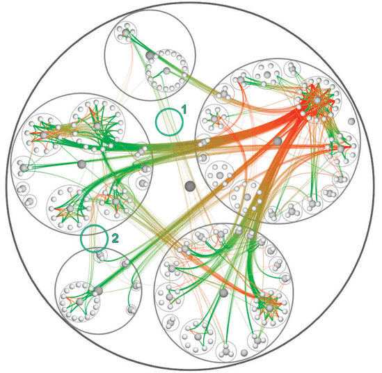

# Hierarchical Edge Bundles

## Idiom box

<!-- verbatim p.319 -->
> What: Data Compound graph: network, hierarchy whose leaves are nodes in network.
<!-- /verbatim -->

<!-- verbatim p.319 -->
> How: Encode Back layer shows hierarchy with containment marks colored gray, middle layer shows network links colored red–green, front layer shows nodes colored gray.
<!-- /verbatim -->

<!-- verbatim p.319 -->
> How: Facet Superimpose static layers, distinguished with color.
<!-- /verbatim -->

The box gives no Why: Tasks or Scale field [p.319].

## What it is

A more complex example of static superimposition, operating on a compound network: a base network plus a cluster hierarchy that groups its nodes [p.317]. Figure 12.16 shows a software call graph, which functions call which, together with the hierarchical structure of the source code where those calls are defined [p.318].

Colour makes two easily distinguished layers: the gray source-code hierarchy, drawn with circular containment marks, and the semitransparent red–green call-graph edges, drawn as connection link marks [p.318]. The name comes from bundling the network edges together, like physical cables tied with cable ties, to reduce occlusion of the underlying tree [p.318]. The idiom does not rely on a specific tree layout and can be applied to many [p.319].

## Use when / avoid when

- **Use** for a compound graph where both the hierarchy and the network links must be seen together [pp.317-318].
- **Use** bundling to reduce occlusion of the hierarchy by the links: in the book's example, without it most of the background layer structure would be very difficult to see [p.318].
- **Avoid** drawing the edges gray and opaque like the hierarchy: without distinct layering, the image would be much harder to interpret [pp.318-319].

## Figures

-  **Figure 12.16** [p.318]. The hierarchical edge bundles idiom shows a compound network in three layers: the tree structure in back with containment circle marks, the red– green graph edges with connection marks in a middle layer, and the graph nodes in a front layer. From [Holten 06, Figure 13].

## Alternatives and disambiguation

- **GrouseFlocks** works on the same compound-network data type, which Section 9.5 defines and discusses; see its card for how Chapter 9 arranges it [p.317].
- **Cartographic Layering** and **Superimposed Line Charts** are the book's simpler static layering examples, for geographic and time-series data [pp.314-315].
- **Cerebral** also combines a network with containment marks, but adds a dynamic foreground layer for the hovered node's neighbourhood [p.299] [p.319].

## Related

- [12.5.2 Static Layers](../ch12-facet-into-multiple-views/s12-05-superimpose-layers/s12-05-02-static-layers.md): where this idiom is presented [p.317]
- [9.5 Containment: Hierarchy Marks](../ch09-arrange-networks-trees/s09-05-containment-hierarchy-marks.md): compound networks defined and discussed [p.317]
- [GrouseFlocks](grouseflocks.md): a compound-network idiom from Chapter 9 [p.317]
- [12.5.1 Visually Distinguishable Layers](../ch12-facet-into-multiple-views/s12-05-superimpose-layers/s12-05-01-visually-distinguishable-layers.md): the layer limits this three-layer design works within [p.319]

## Implementation hints [NOT FROM BOOK]

### matplotlib

```python
import numpy as np, matplotlib.pyplot as plt
from matplotlib.path import Path
from matplotlib.patches import PathPatch
groups, per = 6, 8; n = groups * per
ang = np.linspace(0, 2 * np.pi, n, endpoint=False)
leaf = np.c_[np.cos(ang), np.sin(ang)]
centre = np.array([leaf[g * per:(g + 1) * per].mean(0) * 0.5 for g in range(groups)])
rng = np.random.default_rng(7)
fig, ax = plt.subplots(figsize=(6, 6))
for c in centre:                                          # back layer: hierarchy, gray
    ax.add_patch(plt.Circle(c, 0.32, color="0.85", zorder=0))
for _ in range(80):                                       # middle layer: bundled links
    a, b = rng.integers(0, n, 2); ga, gb = a // per, b // per
    pts = [leaf[a], centre[ga], (0, 0), centre[gb], leaf[b]]
    path = Path(pts, [Path.MOVETO] + [Path.CURVE4] * 3 + [Path.LINETO])
    ax.add_patch(PathPatch(path, fc="none", ec=plt.cm.RdYlGn(a / n), alpha=0.4, lw=0.8))
ax.scatter(*leaf.T, s=12, color="0.4", zorder=3)          # front layer: nodes
ax.set_aspect("equal"); ax.set_axis_off()
```

### D3

```js
import * as d3 from "d3";
// Radial cluster layout of the hierarchy; links routed along the tree path, bundled by beta.
const root = d3.cluster().size([2 * Math.PI, 300])(d3.hierarchy({ children: [] }));
const line = d3.lineRadial().curve(d3.curveBundle.beta(0.85))
  .radius(d => d.y).angle(d => d.x);
const linkPath = (a, b) => line(a.path(b));               // a.path(b) climbs to the common ancestor
```
