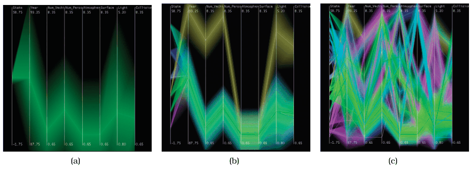

# Hierarchical Parallel Coordinates

## Idiom box

<!-- verbatim p.337 -->
> What: Data Table.
<!-- /verbatim -->

<!-- verbatim p.337 -->
> What: Derived Cluster hierarchy atop original table of items. Five per-cluster attributes: count, mean, min, max, depth.
<!-- /verbatim -->

<!-- verbatim p.337 -->
> How: Encode Parallel coordinates. Color clusters by proximity in hierarchy.
<!-- /verbatim -->

<!-- verbatim p.337 -->
> How: Reduce Interactive item aggregation to change level of detail.
<!-- /verbatim -->

<!-- verbatim p.337 -->
> Scale Items: 10,000–100,000. Clusters: one dozen.
<!-- /verbatim -->

The box has no Why: Tasks field [p.337].

## What it is

An idiom of hierarchical aggregation: the derived data is a hierarchical clustering of the original items, and the user interactively controls the level of detail shown based on that hierarchy [p.336]. Several statistics are computed per cluster: the number of points, the mean, minimum and maximum values, and the depth in the hierarchy [p.336].

Each cluster is drawn as a band of varying width and opacity, with the mean in the middle and the width at each axis set by the cluster's minimum and maximum for that attribute; in the limit, a single-item cluster is a single line, as in plain parallel coordinates [pp.336-337]. Bands are coloured by proximity in the cluster hierarchy, so clusters far apart get very different colours [p.337]. A single slider controls the global level of detail; its parameter is a derived variable that varies the aggregate level of detail smoothly and continuously [p.337].

Figure 13.9 shows eight attributes and 230,000 items: (a) the single top-level cluster as very broad green bands; (b) a mid-level view with several clusters, the tan cluster's extents clearly distinguishable from the now-smaller green one; (c) dozens of clusters with tighter bands [p.337].

## Use when / avoid when

- **Use** to scale parallel coordinates beyond what drawing every item allows: the text says to hundreds of thousands of items [p.336].
- **Use** when the user needs to move between overview and detail levels of a large multi-attribute table [p.337].
- **Many clusters.** With many clusters shown, the proximity-based colouring mitigates occlusion and helps clusters remain distinguishable [p.337].

The box gives the scale as 10,000 to 100,000 items and one dozen clusters, while the text says hundreds of thousands of items and Figure 13.9(c) shows dozens of clusters for 230,000 items; the book does not reconcile these [pp.336-337].

## Figures

-  **Figure 13.9** [p.337]. Hierarchical parallel coordinates provide multiple levels of detail. (a) The single top cluster has large extent. (b) When several clusters are shown, each has a smaller extent. (c) When many clusters are shown, the proximity-based coloring helps them remain distinguishable from each other. From [Fua et al. 99, Figure 4].

## Alternatives and disambiguation

- **Parallel coordinates** draw every item as a line; the hierarchical idiom draws cluster bands, reducing to single lines only for one-item clusters [pp.336-337].
- **Cluster–calendar time-series vis** (Figure 6.7) is another example of hierarchical aggregation [p.336].
- **SolarPlot** also gives interactive control of aggregation level, but through a circle's radius over histogram bins rather than a slider over a cluster hierarchy [p.336].

## Related

- [13.4.1 Item Aggregation](../ch13-reduce-items-attributes/s13-04-aggregate/s13-04-01-item-aggregation.md): the section that presents hierarchical aggregation and this idiom [p.336]
- [Parallel Coordinates](parallel-coordinates.md): the base encoding this idiom scales up [p.336]
- [7.6.2 Parallel Layouts](../ch07-arrange-tables/s07-06-spatial-axis-orientation/s07-06-02-parallel-layouts.md): the parallel axis layout it builds on [p.336]
- [Cluster–Calendar Time-Series Vis](cluster-calendar-time-series-vis.md): another hierarchical aggregation idiom [p.336]
- [SolarPlot](solarplot.md): a simpler idiom with an interactive aggregation level [p.336]

## Implementation hints [NOT FROM BOOK]

### matplotlib

```python
import numpy as np, matplotlib.pyplot as plt
rng = np.random.default_rng(0)
fine = rng.integers(0, 8, 20_000)
centres = rng.uniform(0, 1, (8, 6))
X = (centres[fine] + rng.normal(0, 0.08, (20_000, 6))).clip(0, 1)
step = 2
coarse = fine // step
axes = np.arange(X.shape[1])
fig, ax = plt.subplots()
for k in np.unique(coarse):
    pts = X[coarse == k]
    colour = plt.cm.viridis(k / max(coarse.max(), 1))
    ax.fill_between(axes, pts.min(0), pts.max(0), color=colour, alpha=0.3)
    ax.plot(axes, pts.mean(0), color=colour)
ax.set_xticks(axes)
```

The `fine // step` mapping stands in for cutting a real cluster tree (`scipy.cluster.hierarchy.linkage` then `fcluster`); bind `step` to a `matplotlib.widgets.Slider` to change the level of detail.

### D3

Precompute a cluster tree (for example with `d3.hierarchy` over server-side clusters), choose the frontier at the slider's depth, and per cluster draw a band with `d3.area().x(d => x(d.dim)).y0(d => yScales.get(d.dim)(d.min)).y1(d => yScales.get(d.dim)(d.max))` plus a `d3.line()` through the means; colour by position in the tree with `d3.scaleSequential(d3.interpolateRainbow)`.
