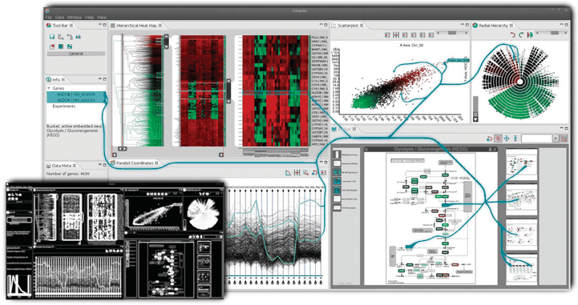

# Highlighting

## Idiom box

No idiom box in the book.

- **What: Data.** Any selected element: data items, links, attributes, or views [pp.276-277].
- **Why: Tasks.** Give immediate visual feedback on a selection, confirming the operation's result matches the user's intention [p.276].
- **How: Encode.** Change the selected elements' visual appearance: colour, outline, size, shape, motion, or added connection marks [pp.276-278].

## What it is

<!-- verbatim p.276 -->
> The action of selection is very closely tied to highlighting, where the elements that were chosen are indicated by changing their visual appearance in some way.
<!-- /verbatim -->

How the user selects (an interaction idiom) and how selected elements are highlighted (a visual encoding idiom) are two design choices that can vary independently [p.276]. The book's choices for data items [pp.276-277]:

- **Colour change**, very common; needs enough hue, luminance or saturation contrast to pop out [pp.276-277].
- **Outline**: add an outline mark, or recolour an existing one, which preserves colour coding [p.277].
- **Size**: enlarge an item or widen a link [p.277].
- **Shape**, for links: solid to dashed [p.277].
- **Combinations**, such as wider plus recoloured lines, for more salience [p.277].
- **Motion**: small circular orbits, slight back-and-forth movement, or a dash pattern crawling along links [p.277].
- **Connection marks** drawn between the selected objects, explicit rather than changing existing marks [pp.277-278].

Attributes encoded as marks take the same choices (a selected parallel coordinates axis recoloured or outlined); attributes chosen in a control panel use standard widgets such as radio buttons and lists; selected views typically use the operating system's window widgets [p.277].

## Use when / avoid when

- **Use** whenever users select: selection should trigger highlighting, to give immediate visual feedback that the result matches their intention [p.276].
- **Avoid colour change** when the task needs the existing colour coding, which a colour highlight temporarily hides [p.277].
- **Use an outline** to keep colour coding; it can be very effective for large marks but may lack salience for small ones [p.277].
- **Outline items individually** unless the tool constrains selections to be spatially contiguous [p.277].
- **Consider motion**: still unusual, but experiments found it often outperformed colouring, outlining and size changes [Ware and Bobrow 04] [p.277].

## Figures

-  **Figure 11.6** [p.278]. The context-preserving visual links idiom is an example of the design choice to coordinate betweeen views by explicitly drawing links as connection marks between items and regions of interest. From [Steinberger et al. 11, Figure 1].

## Alternatives and disambiguation

- **Context-Preserving Visual Links** is the link-mark choice made into an idiom, routing curves between items across views [p.278].
- **Colour versus outline versus size**: colour hides existing colour coding; outline keeps it but suits large marks; size enlarges items or widens links, and can be combined with a colour change for more salience [p.277].

## Related

- [11.4.2 Highlighting](../ch11-manipulate-view/s11-04-select-elements/s11-04-02-highlighting.md): the full narrative [p.276]
- [11.4.1 Selection Design Choices](../ch11-manipulate-view/s11-04-select-elements/s11-04-01-selection-design-choices.md): the independent choice of how users select [p.276]
- [Context-Preserving Visual Links](context-preserving-visual-links.md): highlighting with routed link marks [p.278]
- [5.5.4 Popout](../ch05-marks-channels/s05-05-channel-effectiveness/s05-05-04-popout.md): the popout a highlight colour needs [p.277]
- [6.8 Responsiveness Is Required](../ch06-rules-thumb/s06-08-responsiveness-required.md): timing of feedback [p.276]
- [Parallel Coordinates](parallel-coordinates.md): axes that can be highlighted as selected attributes [p.277]

## Implementation hints [NOT FROM BOOK]

### matplotlib

Click to toggle selection; outline the selected points so their fill colour survives.

```python
import numpy as np, matplotlib.pyplot as plt
rng = np.random.default_rng(0)
x, y, c = rng.random(40), rng.random(40), rng.integers(0, 3, 40)
fig, ax = plt.subplots()
pts = ax.scatter(x, y, c=c, cmap="tab10", s=80, picker=5, edgecolors="none")
selected = set()

def on_pick(event):
    selected.symmetric_difference_update(event.ind)  # toggle
    pts.set_edgecolors(["black" if i in selected else "none" for i in range(len(x))])
    pts.set_linewidths([2.5 if i in selected else 0 for i in range(len(x))])
    fig.canvas.draw_idle()

fig.canvas.mpl_connect("pick_event", on_pick)
```

### D3

```js
const selected = new Set();
const brush = d3.brush().on("brush end", ({ selection }) => {
  selected.clear();
  if (selection) {
    const [[x0, y0], [x1, y1]] = selection;
    data.forEach(d => { if (x0 <= x(d.a) && x(d.a) <= x1 && y0 <= y(d.b) && y(d.b) <= y1) selected.add(d.id); });
  }
  dots.attr("stroke", d => selected.has(d.id) ? "black" : null)   // outline keeps fill colour
      .attr("stroke-width", d => selected.has(d.id) ? 2 : 0);
});
svg.append("g").call(brush);
```
