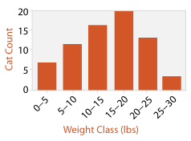
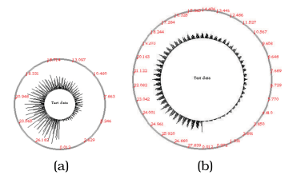

# Histograms

## Idiom box

<!-- verbatim p.331 -->
> What: Data Table: one quantitative value attribute.
<!-- /verbatim -->

<!-- verbatim p.331 -->
> What: Derived Derived table: one derived ordered key attribute (bin), one derived quantitative value attribute (item count per bin).
<!-- /verbatim -->

<!-- verbatim p.331 -->
> How: Encode Rectilinear layout. Line mark with aligned position to express derived value attribute. Position: key attribute.
<!-- /verbatim -->

The box has no Why: Tasks, How: Reduce or Scale field, although the text calls the histogram an aggregation idiom [p.331].

## What it is

A histogram shows the distribution of items within an original attribute: the attribute's range is partitioned into bins, and the number of items in each bin is computed and saved as a derived ordered attribute [p.331]. Figure 13.5 bins the weights of all the cats in a neighbourhood into 5-pound blocks [p.331]. The encoding is very similar to a bar chart, a line mark using spatial position in one direction with the bins along an axis in the other [p.331]. Its aggregation operator is count: bar height is the number of items in the set [p.335].

## Use when / avoid when

- **Use** to aggregate an arbitrary number of items into a concise representation of their distribution [p.331]. The number of bins can be chosen independently of the number of items [p.331].
- **Take care with bin size.** The choice is crucial and tricky, because a histogram can look quite different depending on the discretisation. The book offers two possible solutions: compute the number of bins from dataset characteristics, or give the user controls to change it interactively and see how the histogram changes [p.331].
- **Remember the limits of summaries.** Simple aggregation operators alone are rarely adequate, and the challenge is not to eliminate the interesting signals in the dataset while summarising it [p.330].

## Figures

-  **Figure 13.5** [p.331]. The histogram idiom aggregates an arbitrary number of items into a concise representation of their distribution.
-  **Figure 13.8** [p.336]. The SolarPlot circular histogram idiom provides indirect control of aggregation level by changing the circle size. (a) The small circle shows the increase in ticket sales over time. (b) Enlarging the circle shows seasonal patterns in addition to the gradual increase. From [Chuah 98, Figures 1 and 2].

## Alternatives and disambiguation

- **Bar charts** look similar but show the original table directly, with spaces between bars to imply discretisation; histograms show a derived, more concise table and are sometimes drawn without spaces to imply continuity [p.331].
- **Boxplot charts** summarise a distribution with five derived numbers rather than per-bin counts, and fit many attributes side by side [pp.333-334].
- **SolarPlot** is a radial histogram whose aggregation level the user changes by resizing its circle [p.335].
- **Continuous histograms** are the 1D counterpart of continuous scatterplots in the density-function framework [pp.332-333].

## Related

- [13.4.1 Item Aggregation](../ch13-reduce-items-attributes/s13-04-aggregate/s13-04-01-item-aggregation.md): the section that presents the idiom [p.331]
- [Bar Charts](bar-charts.md): the visually similar idiom that shows the original table [p.331]
- [Boxplot Charts](boxplot-charts.md): a five-number summary of the same kind of distribution [p.333]
- [SolarPlot](solarplot.md): a radial histogram with interactive aggregation level [p.335]
- [Continuous Scatterplots](continuous-scatterplots.md): the 2D density counterpart of continuous histograms [p.333]

## Implementation hints [NOT FROM BOOK]

### matplotlib

```python
import numpy as np, matplotlib.pyplot as plt
rng = np.random.default_rng(0)
weights = rng.normal(11, 3, 300).clip(2, 25)
fig, ax = plt.subplots()
ax.hist(weights, bins=np.arange(0, 30, 5), edgecolor="white")
ax.set_xlabel("Weight class (lbs)")
ax.set_ylabel("Count")
```

`bins="auto"` (or `"fd"`, `"sturges"`) derives the bin count from the data; wire a slider to `bins` to let users vary it.

### D3

`d3.bin().domain(x.domain()).thresholds(x.ticks(20))(values)` returns bins with `x0`, `x1` and `length`; draw one `rect` per bin with `x(d.x0)`, width `x(d.x1) - x(d.x0) - 1` and height from `d3.scaleLinear().domain([0, d3.max(bins, d => d.length)])`.
