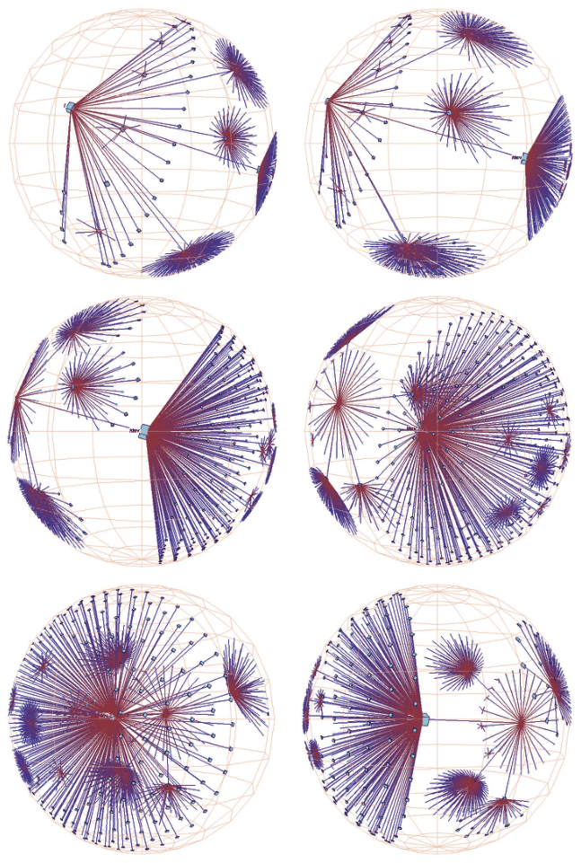

# Hyperbolic Geometry

## Idiom box

<!-- verbatim p.356 -->
> What: Data Tree or network.
<!-- /verbatim -->

<!-- verbatim p.356 -->
> How: Encode Hyperbolic layout.
<!-- /verbatim -->

<!-- verbatim p.356 -->
> How: Reduce Embed: distort by projecting from hyperbolic to Euclidean space; single global radial focus; hyperbolic translation interaction metaphor.
<!-- /verbatim -->

## What it is

A distortion idiom with a single radial global focus and the interaction metaphor of hyperbolic translation [p.354]. It uses non-Euclidean geometry to accommodate structures such as trees that grow by an exponential factor, whereas Euclidean geometry offers only a polynomial amount of space [p.354]. An infinite non-Euclidean plane maps to a finite Euclidean circle, and an infinite non-Euclidean volume to a finite sphere [p.354].

Hyperbolic translation changes the focus point of the projection, and so which items are magnified at the centre and minimised at the periphery; the global effect resembles a fisheye lens extending across the entire scene [pp.354-356]. Figure 14.6 shows a 3D hyperbolic node–link file-system tree laid out with H3: three frames of hyperbolic translation bring a subtree towards the centre, then three frames of standard rotation clarify the 3D structure [pp.355-356].

## Use when / avoid when

- **Use** for trees or networks that grow by an exponential factor, for which standard Euclidean geometry offers only a polynomial amount of space [p.354].
- **Use** for exploring the topology of node–link layouts, a task likely robust to distortion because precise angle and length judgements are not needed [p.359].
- **Show the boundary.** Hyperbolic views typically draw the enclosing circle or sphere so users notice the distortion, a risk that is highest with unfamiliar or sparse structures [p.359].
- **Avoid** for tasks needing distance or length comparisons, which distortion severely impairs [p.359].
- **Weigh 3D carefully.** H3 used 3D for greater information density, at the cost that any single frame is partially occluded [p.356].

## Figures

-  **Figure 14.6** [p.355]. Animated transition showing navigation through 3D hyperbolic geometry for a file system tree laid out with the H3 idiom, where the first three frames show hyperbolic translation changing the focus point and the last three show standard 3D rotation spinning the structure around. From [Munzner 98, Figure 3].

## Alternatives and disambiguation

- **Fisheye Lens.** Also a single radial focus, but local, over any data, moved by 2D translation [pp.353-354].
- **3D Perspective.** Also a global single-focus distortion of trees, from standard 3D graphics transformations with geometric navigation [pp.352-353].
- **Stretch and Squish Navigation.** Multiple rectangular foci and a rubber-sheet metaphor instead of one radial focus [p.356].

## Related

- [14.5 Distort](../ch14-embed-focus-context/s14-05-distort.md): the distortion design choices and the H3 example [p.354]
- [14.6 Costs and Benefits: Distortion](../ch14-embed-focus-context/s14-06-costs-benefits-distortion.md): unnoticed distortion and object constancy costs [p.359]
- [6.3 No Unjustified 3D](../ch06-rules-thumb/s06-03-no-unjustified-3d/node.md): the costs and benefits of 3D for abstract data, relevant to H3 [p.356]
- [9.2 Connection: Link Marks](../ch09-arrange-networks-trees/s09-02-connection-link-marks.md): Euclidean node–link tree layouts this idiom distorts [p.354]
- [14.7 Further Reading](../ch14-embed-focus-context/s14-07-further-reading.md): 2D hyperbolic trees and 3D hyperbolic networks [p.363]

## Implementation hints [NOT FROM BOOK]

### matplotlib

```python
import numpy as np, networkx as nx, matplotlib.pyplot as plt
T = nx.balanced_tree(3, 5)
depth = nx.single_source_shortest_path_length(T, 0)
leaves = [n for n in nx.dfs_preorder_nodes(T, 0) if T.degree(n) == 1]
ang = {n: 2 * np.pi * i / len(leaves) for i, n in enumerate(leaves)}
for n in reversed(list(nx.dfs_preorder_nodes(T, 0))):
    kids = [c for c in T[n] if depth[c] > depth[n]]
    if kids:
        ang[n] = np.mean([ang[c] for c in kids])
z = {n: np.tanh(0.6 * depth[n] / 2) * np.exp(1j * ang[n]) for n in T}  # Poincare disk
a = 0.5 * np.exp(1j * ang[leaves[5]])  # hyperbolic translation towards a focus
w = {n: (z[n] - a) / (1 - np.conj(a) * z[n]) for n in T}
fig, ax = plt.subplots()
for u, v in T.edges:
    ax.plot([w[u].real, w[v].real], [w[u].imag, w[v].imag], lw=0.5, c="k")
ax.add_patch(plt.Circle((0, 0), 1, fill=False))
ax.set_aspect("equal")
```

### D3

D3 has no hyperbolic layout. Compute a radial layout with `d3.tree().size([2 * Math.PI, depth])`, map each radius to the Poincaré disk with `Math.tanh(r / 2)`, and on drag apply the Möbius transform `(z - a) / (1 - conj(a) z)` to every node before redrawing; the `d3-hypertree` package packages this pattern.
