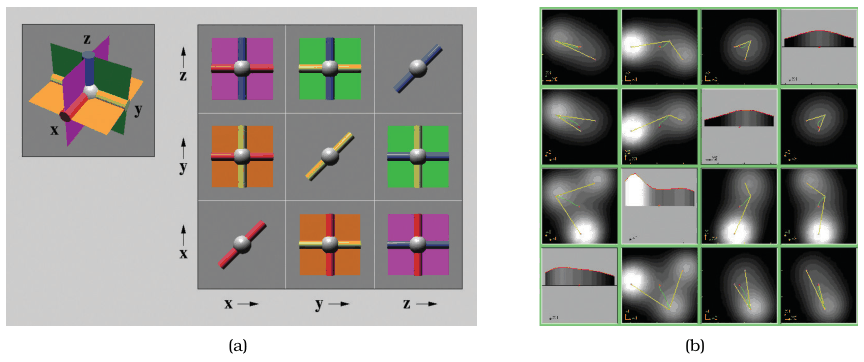

# HyperSlice

## Idiom box

No idiom box in the book.

The book presents HyperSlice as a worked example with no Idiom or System box [pp.284-285]. Its facets, from the text:

- **What: Data.** Abstract data with many attributes: scalar functions of many variables [p.284].
- **Why: Tasks.** Explore the high-dimensional space of the function [p.284].
- **How: Encode.** A matrix of views showing all possible orthogonal 2D slices; function value can be coded with luminance [pp.284-285].
- **How: Manipulate.** Slice for attribute reduction, with linked navigation: each view is both a display and a control [pp.284-285].

## What it is

The HyperSlice system uses the slicing design choice for attribute reduction to display scalar functions of many variables [van Wijk and van Liere 93] [p.284]. Figure 11.9(a) shows the intuition with three planes intersecting at right angles in 3D [p.284]. The views are coordinated by linked navigation of the high-dimensional space: dragging within a view changes the slice value based on that view's pair of dimensions [pp.284-285]. Figure 11.9(b) shows a four-dimensional dataset with function value coded by luminance [p.285].

## Use when / avoid when

- **Use** to explore abstract data with many attributes, specifically scalar functions of many variables [p.284].
- **Use** when every pair of dimensions should get its own orthogonal 2D slice view, linked so that dragging in one view changes the slice value for its pair [pp.284-285].
- The book gives no failure cases or scale limits for HyperSlice [pp.284-285].

## Figures

-  **Figure 11.9** [p.285]. The HyperSlice system uses extracting only the items with a chosen value in that dimension. (a) Three 3D planes that intersect at right angles. (b) Four-dimensional dataset where function value is encoded with luminance. From [van Wijk and van Liere 93, Figures 1 and 4].

## Alternatives and disambiguation

- **Slice** is the underlying single-slice design choice; HyperSlice arranges every orthogonal 2D slice in a linked matrix [p.284].
- **Project** in multiple views also gives one view per combination of dimensions, but shows all items with the other dimensions dropped rather than one slice [p.286].

## Related

- [11.6 Navigate: Reducing Attributes](../ch11-manipulate-view/s11-06-navigate-reducing-attributes.md#s11.06.01): HyperSlice in context [p.284]
- [Slice](slice.md): the design choice HyperSlice applies [p.284]
- [Project](project.md): one view per dimension pair, without slicing [p.286]
- [12.3 Juxtapose and Coordinate Views](../ch12-facet-into-multiple-views/s12-03-juxtapose-coordinate-views/node.md): linked navigation across views [p.284]

## Implementation hints [NOT FROM BOOK]

### matplotlib

Fix a focal point, then draw the 2D slice through it for every pair of dimensions in the lower triangle.

```python
import numpy as np, matplotlib.pyplot as plt
f = lambda p: np.sin(p[0] * 3) + np.cos(p[1] * 2) * p[2] + p[3] ** 2  # 4 variables
focus, n = np.zeros(4), 4
g = np.linspace(-1, 1, 50)
fig, axes = plt.subplots(n - 1, n - 1, figsize=(7, 7))
for i in range(1, n):
    for j in range(n - 1):
        ax = axes[i - 1, j]; ax.set_xticks([]); ax.set_yticks([])
        if j >= i:
            ax.set_axis_off(); continue
        A, B = np.meshgrid(g, g)
        p = [np.full_like(A, v) for v in focus]; p[j], p[i] = A, B
        ax.imshow(f(p), cmap="gray", origin="lower", extent=(-1, 1, -1, 1))
        ax.set_xlabel(f"x{j}", fontsize=7); ax.set_ylabel(f"x{i}", fontsize=7)
```

Make each view a control with a `button_press_event` handler that sets `focus[j], focus[i]` and redraws all panels.

### D3

One `canvas` per dimension pair in a CSS grid; `d3.drag()` on each canvas maps the pointer through that pair's `d3.scaleLinear` to update the shared focal point, then redraw every canvas.
